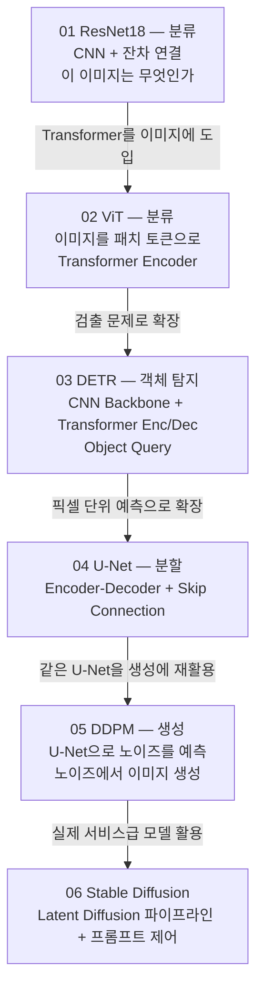

# 02.Vision — 실습 코드 완전 해설

> 이 문서는 Vision 실습 노트북 6종(ResNet18 / ViT / DETR / U-Net / DDPM / Stable Diffusion)의 핵심 코드를 단계별로 설명합니다.
> 각 모델이 **무엇을 푸는지**, **코드가 어떻게 동작하는지**, **시험에 나올 포인트**가 무엇인지를 중심으로 서술합니다.

---

## 전체 학습 흐름 한눈에 보기



**한 줄 요약**

| 노트북 | 과제(Task) | 핵심 구조 | 출력 |
|---|---|---|---|
| 01 ResNet18 | Image Classification | Residual CNN | `[B, 10]` 로짓 |
| 02 ViT | Image Classification | Patch + Transformer Encoder | `[B, 10]` 로짓 |
| 03 DETR | Object Detection | CNN + Transformer Enc/Dec + Query | `pred_logits [B,100,92]`, `pred_boxes [B,100,4]` |
| 04 U-Net | Semantic Segmentation | Encoder-Decoder + Skip | `[B, C, H, W]` 로짓 |
| 05 DDPM | Image Generation | U-Net (노이즈 예측) | 입력과 같은 shape의 노이즈 |
| 06 SD v1.4 | Text-to-Image | Latent Diffusion (VAE+UNet+CLIP) | PIL 이미지 |

**공통으로 반복되는 패턴 — 이 4개는 모든 노트북에 나옵니다**

1. **정규화(Normalize) + 역정규화(denormalize)** — 학습은 정규화된 텐서로, 시각화는 원래 범위로 되돌려서
2. **`model.train()` / `model.eval()` 전환** — Dropout·BatchNorm의 동작이 달라짐
3. **`forward hook`** — 모델을 수정하지 않고 중간 텐서를 꺼내는 표준 기법 (Activation Map, Grad-CAM, DETR attention 전부 이 방식)
4. **`(B, C, H, W)` ↔ `(B, N, D)` 변환** — CNN의 공간 표현과 Transformer의 토큰 시퀀스를 오가는 지점

---

# Chapter 1 — ResNet18 with CIFAR-10

## 1-1. 데이터 전처리 (Normalize의 의미)

```python
CIFAR10_MEAN = (0.4914, 0.4822, 0.4465)  # 채널별 평균(R,G,B)
CIFAR10_STD  = (0.2023, 0.1994, 0.2010)  # 채널별 표준편차(R,G,B)

train_tfms = T.Compose([
    T.RandomCrop(32, padding=4),   # 32x32를 padding 후 random crop
    T.RandomHorizontalFlip(),      # 좌우 반전
    T.ToTensor(),                  # PIL -> tensor (C,H,W), 0~1
    T.Normalize(CIFAR10_MEAN, CIFAR10_STD),
])

test_tfms = T.Compose([
    T.ToTensor(),
    T.Normalize(CIFAR10_MEAN, CIFAR10_STD),
])
```

**`T.Compose`의 순서가 중요합니다.** `RandomCrop`/`Flip`은 PIL 이미지에 작용하고, `Normalize`는 텐서에 작용합니다. 그래서 `ToTensor()`가 반드시 그 사이에 와야 합니다. 순서를 바꾸면 타입 에러가 납니다.

**train과 test의 transform이 다른 이유**

augmentation(RandomCrop, Flip)은 **학습에만** 적용합니다. 평가 시에 무작위성이 들어가면 같은 이미지를 두 번 넣었을 때 결과가 달라져 성능 측정이 불가능해집니다.

**`Normalize`가 하는 일**

$$
x' = \frac{x - \mu}{\sigma}
$$

0~1이던 값이 약 −2.5~2.5 범위로 바뀝니다. 입력 분포를 평균 0 근처로 맞춰야 초기 학습이 안정적입니다. mean/std가 CIFAR-10 전용 값인 이유는, ImageNet 값(`0.485, 0.456, 0.406`)을 쓰면 분포가 미묘하게 어긋나기 때문입니다. (DETR 노트북은 ImageNet 사전학습 backbone을 쓰므로 ImageNet 값을 씁니다.)

**`padding=4`가 붙은 RandomCrop**

32×32를 그냥 crop하면 잘라낼 여유가 없습니다. 상하좌우 4픽셀씩 패딩해 40×40으로 만든 뒤 32×32를 잘라내면, 객체가 최대 ±4픽셀 이동한 효과가 납니다. 위치 변화에 강해집니다.

## 1-2. 역정규화 (denorm) — 시각화의 필수 단계

```python
def denorm(x):  # -2.5~2.5 -> 0~1
    mean = torch.tensor(CIFAR10_MEAN).view(1,3,1,1)  # broadcast용
    std  = torch.tensor(CIFAR10_STD).view(1,3,1,1)
    return x * std + mean

images_dn = denorm(images[:16]).clamp(0,1)
grid = torchvision.utils.make_grid(images_dn, nrow=8)
plt.imshow(grid.permute(1,2,0))   # CHW -> HWC
```

세 가지가 한 번에 나옵니다.

- **`.view(1,3,1,1)`**: `(3,)` 텐서를 `(B,3,H,W)`에 브로드캐스팅하려면 채널 축을 1번 자리에 맞춰야 합니다
- **`.clamp(0,1)`**: 역변환 후 부동소수 오차로 0보다 작거나 1보다 큰 값이 생기는데, `imshow`는 이 범위를 벗어나면 이상하게 렌더링합니다
- **`.permute(1,2,0)`**: PyTorch는 `(C,H,W)`, matplotlib은 `(H,W,C)`를 씁니다. **이 변환을 빼먹는 것이 가장 흔한 실수**입니다

## 1-3. CIFAR용 ResNet18 개조 (이 노트북의 핵심)

```python
def build_resnet18_for_cifar10(num_classes: int = 10):
    model = models.resnet18(weights=None)   # pretrained 없이 from scratch

    model.conv1 = nn.Conv2d(3, 64, kernel_size=3, stride=1, padding=1, bias=False)
    model.maxpool = nn.Identity()           # maxpool 제거
    model.fc = nn.Linear(model.fc.in_features, num_classes)  # 출력 10개
    return model
```

**왜 stem을 바꿔야 하는가 — 시험 단골**

torchvision의 `resnet18`은 **ImageNet(224×224)** 기준으로 설계되어 있습니다.

| | 원본 (ImageNet용) | 개조 후 (CIFAR용) |
|---|---|---|
| `conv1` | 7×7, **stride 2** | 3×3, **stride 1** |
| `maxpool` | 3×3, stride 2 | `nn.Identity()` (제거) |
| stem 통과 후 해상도 | 224 → 56 (1/4) | 32 → **32** (그대로) |

원본을 32×32에 그대로 쓰면 stem에서 이미 8×8로 줄어듭니다. 이후 layer2/3/4에서 stride 2가 세 번 더 걸리므로 최종 feature map이 **1×1**이 되어버려 공간 정보가 완전히 사라집니다. stride를 1로 낮추고 maxpool을 제거하면 최종 4×4가 남습니다.

**`nn.Identity()`**는 "아무것도 하지 않고 입력을 그대로 반환"하는 모듈입니다. `del model.maxpool`로 지우면 `forward()` 안에서 `self.maxpool(x)` 호출이 에러를 내므로, 삭제 대신 항등 모듈로 **치환**합니다. 층을 무력화할 때 쓰는 표준 관용구입니다.

**`bias=False`인 이유**: 바로 뒤에 BatchNorm이 오기 때문입니다. BN이 평균을 빼는 순간 conv의 bias는 상쇄되어 무의미해집니다. 파라미터만 낭비하므로 끕니다.

**파라미터 수**: 약 **11,173,962개**. 원본 ResNet18(11,689,512)에서 conv1이 줄고(7×7×3×64 → 3×3×3×64) fc가 1000→10 클래스로 줄어든 결과입니다.

## 1-4. 학습 유틸 — AMP와 GradScaler

```python
scaler = torch.amp.GradScaler(enabled=torch.cuda.is_available())

def train_one_epoch(model, loader, optimizer, criterion):
    model.train()
    for images, labels in loader:
        images = images.to(device, non_blocking=True)
        labels = labels.to(device, non_blocking=True)

        optimizer.zero_grad(set_to_none=True)
        with torch.amp.autocast(device_type=device.type, enabled=torch.cuda.is_available()):
            logits = model(images)
            loss = criterion(logits, labels)
        scaler.scale(loss).backward()   # scaled backward
        scaler.step(optimizer)
        scaler.update()
```

**AMP(Automatic Mixed Precision)란**

FP32(32비트)와 FP16(16비트)을 섞어 씁니다. 행렬 곱처럼 오차에 둔감한 연산은 FP16으로 빠르게, 손실 합산처럼 민감한 연산은 FP32로 정확하게 수행합니다. 속도가 최대 2~3배 빨라지고 메모리 사용량이 절반 가까이 줄어듭니다.

**GradScaler가 필요한 이유**

FP16의 표현 가능한 최솟값은 약 `6e-8`입니다. 역전파에서 기울기는 매우 작아지는 경우가 많아, 그대로 두면 **언더플로로 0이 되어 사라집니다**. GradScaler는 세 단계로 이를 막습니다.

```
① Scaling  : loss × 65536 (큰 수를 곱해 기울기를 키움)
② Backward : 커진 상태로 역전파 → 작은 값도 0이 되지 않음
③ Unscaling: optimizer.step() 직전에 다시 나눠 원래 크기로 복원
```

`scaler.update()`는 오버플로(inf/NaN)가 발생했는지 감지해 다음 스텝의 배율을 자동 조정합니다. 오버플로가 난 스텝은 **업데이트를 건너뜁니다**.

**`optimizer.zero_grad(set_to_none=True)`**

기울기를 0으로 채우는 대신 `None`으로 만듭니다. 메모리 쓰기가 없어져 약간 빠르고, 메모리도 절약됩니다. PyTorch 2.0부터는 이것이 기본값입니다.

**`.to(device, non_blocking=True)`**

`pin_memory=True`인 DataLoader와 짝을 이룹니다. CPU→GPU 전송을 비동기로 시작하고 다음 코드를 바로 실행해, 전송과 연산을 겹칩니다.

## 1-5. 학습 루프와 체크포인트 재개

```python
optimizer = torch.optim.SGD(model.parameters(), lr=0.1, momentum=0.9, weight_decay=5e-4)

if os.path.exists(ckpt_path):
    ckpt = torch.load(ckpt_path, map_location=device, weights_only=True)
    model.load_state_dict(ckpt['model'])
    start_epoch = int(ckpt.get('epoch', 0))
    best_acc = float(ckpt.get('val_acc', -1.0))
    epochs_to_run = cfg.extra_epochs_if_resume   # 10
else:
    epochs_to_run = cfg.base_epochs_if_new       # 20

scheduler = torch.optim.lr_scheduler.CosineAnnealingLR(optimizer, T_max=epochs_to_run)
```

**하이퍼파라미터의 의미**

| 값 | 역할 |
|---|---|
| `lr=0.1` | SGD + 배치 256에서의 표준 시작값. Adam(1e-3)보다 훨씬 큼 |
| `momentum=0.9` | 이전 업데이트 방향을 90% 유지 → 진동을 줄이고 수렴 가속 |
| `weight_decay=5e-4` | L2 정규화. 가중치를 작게 유지해 과적합 억제 |
| `label_smoothing=0.0` | 정답을 `[0,1,0]` 대신 `[0.05,0.9,0.05]`로 부드럽게. 과신 억제용 (여기선 미사용) |

**`CosineAnnealingLR`**: 학습률을 코사인 곡선을 따라 `lr`에서 0까지 부드럽게 줄입니다. 초반에는 크게 움직여 넓게 탐색하고, 후반에는 미세 조정합니다. `T_max`가 **한 주기의 epoch 수**이므로, 이번 실행 구간(`epochs_to_run`)에 맞춰 새로 만듭니다.

**`weights_only=True`**: `torch.load`가 임의 파이썬 객체를 역직렬화하지 않도록 제한하는 보안 옵션입니다. 신뢰할 수 없는 체크포인트를 불러올 때 코드 실행 공격을 막습니다. PyTorch 2.6부터 기본값입니다.

## 1-6. 추론과 confidence

```python
@torch.no_grad()
def predict_batch(model, images):
    logits = model(images)          # raw logits
    probs = F.softmax(logits, dim=1)
    conf, pred = probs.max(dim=1)   # 최대 확률과 그 클래스
    return pred, conf, probs
```

**`@torch.no_grad()` 데코레이터**는 함수 전체를 `with torch.no_grad():`로 감싼 것과 같습니다. 계산 그래프를 만들지 않아 메모리가 크게 절약되고 속도도 빨라집니다.

**`probs.max(dim=1)`은 값과 인덱스를 튜플로 반환합니다.** `conf`는 최대 확률(모델의 확신도), `pred`는 예측 클래스입니다. `argmax`는 인덱스만 주므로 confidence가 필요하면 `max`를 씁니다.

**주의**: confidence가 높다고 정답인 것은 아닙니다. 노트북 후반의 "고신뢰 오분류 Top-K"가 바로 이 점을 보여줍니다.

## 1-7. Confusion Matrix

```python
def confusion_and_perclass(preds, labels, num_classes):
    cm = torch.zeros((num_classes, num_classes), dtype=torch.int64)
    for t, p in zip(labels, preds):
        cm[int(t), int(p)] += 1     # 행=정답(GT), 열=예측(Pred)
    per_class_acc = cm.diagonal().float() / torch.clamp(cm.sum(dim=1).float(), min=1.0)
    return cm, per_class_acc
```

**행/열 규약을 반드시 기억하세요.** `cm[i][j]` = "실제로 i인데 j로 예측한 개수".

- **대각선**: 맞춘 개수
- **비대각(off-diagonal)이 큰 위치**: 서로 헷갈리는 클래스 쌍. CIFAR-10에서는 `cat↔dog`, `automobile↔truck`, `deer↔horse`가 대표적입니다
- **행 합** = 그 클래스의 실제 샘플 수 → 나누면 **recall(재현율)**
- **열 합** = 그 클래스로 예측한 총 개수 → 나누면 **precision(정밀도)**

코드의 `per_class_acc`는 행 기준이므로 **클래스별 recall**입니다. `torch.clamp(..., min=1.0)`은 해당 클래스 샘플이 0개일 때 0으로 나누는 것을 막는 방어 코드입니다.

## 1-8. Activation Map — forward hook의 원리

```python
def capture_activation(model, layer_name, x_single):
    layer = get_module_by_name(model, layer_name)
    activ = {}
    def hook(m, i, o):          # (module, input, output)
        activ['feat'] = o.detach().cpu()   # (B,C,H,W) 저장

    h = layer.register_forward_hook(hook)  # 등록
    model.eval()
    with torch.no_grad():
        _ = model(x_single)                # forward 시 hook이 자동 실행
    h.remove()                             # 반드시 해제
    return activ['feat'][0]                # (C,H,W)
```

**hook이란**: 특정 모듈의 forward가 끝나는 순간 자동으로 호출되는 콜백 함수입니다. 모델 코드를 한 줄도 고치지 않고 중간 출력을 꺼낼 수 있어, 사전학습 모델 분석의 표준 기법입니다.

**hook 함수의 시그니처는 `(module, input, output)` 3개로 고정**입니다. 이름은 자유지만 개수와 순서는 바꿀 수 없습니다.

**`h.remove()`가 필수인 이유**: 해제하지 않으면 이후 모든 forward에서 hook이 계속 실행되어 `activ` 딕셔너리에 텐서가 계속 쌓입니다. GPU 메모리 누수의 흔한 원인입니다.

**`.detach()`의 역할**: 계산 그래프에서 분리합니다. 이걸 빼면 저장된 텐서가 그래프 전체를 붙들고 있어 메모리가 폭증합니다.

**`get_module_by_name`** 은 `"layer2.0.conv1"` 같은 점 표기 문자열로 중첩 모듈을 찾아갑니다. 숫자면 인덱스 접근(`cur[int(part)]`), 아니면 속성 접근(`getattr`)입니다. `nn.Sequential` 안의 블록이 숫자 이름을 갖기 때문입니다.

**관찰 포인트**

- `layer1~2`: 엣지, 색상 대비, 텍스처 같은 **로컬 패턴**
- `layer3~4`: 객체의 부품이나 영역 같은 **의미적(semantic) 반응**

## 1-9. Conv Kernel 시각화

```python
w = layer.weight.detach().cpu()   # (O, I, kH, kW)
O, I, kH, kW = w.shape

if I == 3:      # RGB 입력이면 커널을 이미지처럼 볼 수 있음
    img = (ker - ker.min()) / (ker.max() - ker.min() + 1e-6)
else:           # 입력 채널이 많으면 채널 평균으로 2D 시각화
    img2d = ker.mean(dim=0, keepdim=True)
```

Conv2d 가중치의 shape은 **`(출력채널, 입력채널, 커널높이, 커널너비)`** 입니다.

- **`conv1`**: `(64, 3, 3, 3)` → 입력 채널이 RGB 3개이므로 커널 하나가 그대로 컬러 이미지로 보입니다. 학습이 잘 되면 엣지 검출기, 방향성 필터, 색상 대비 필터 같은 형태가 나타납니다
- **`layer2.0.conv1`**: `(128, 64, 3, 3)` → 입력 채널이 64개라 "이미지처럼" 볼 수 없습니다. 채널 평균을 내어 흑백 2D로 근사 시각화합니다

`+ 1e-6`은 커널의 모든 값이 같을 때 `max - min = 0`이 되어 0으로 나누는 것을 막습니다.

## 1-10. Grad-CAM — forward + backward hook

```python
class GradCAM:
    def __init__(self, model, target_layer):
        self.h1 = target_layer.register_forward_hook(self._forward_hook)
        self.h2 = target_layer.register_full_backward_hook(self._backward_hook)

    def _forward_hook(self, module, inp, out):
        self.activ = out          # (B,C,H,W) 순전파 특징맵

    def _backward_hook(self, module, grad_input, grad_output):
        self.grad = grad_output[0]  # (B,C,H,W) 역전파 기울기

    def __call__(self, x, class_idx=None):
        self.model.zero_grad(set_to_none=True)
        logits = self.model(x)
        if class_idx is None:
            class_idx = int(logits.argmax(dim=1).item())
        score = logits[:, class_idx].sum()
        score.backward()

        w = self.grad.mean(dim=(2,3), keepdim=True)     # 채널별 중요도
        cam = (w * self.activ).sum(dim=1, keepdim=True) # 가중합
        cam = F.relu(cam)                                # 양의 기여만
        cam = (cam - cam.min()) / (cam.max() + 1e-6)     # 0~1 정규화
        return cam.detach(), logits.detach(), class_idx
```

**Grad-CAM의 아이디어를 4단계로**

1. 특정 클래스 점수를 골라 backward → 각 특징맵 채널이 그 클래스에 **얼마나 기여했는지** 기울기로 나옴
2. `grad.mean(dim=(2,3))` → 공간 방향으로 평균내어 **채널별 중요도 가중치** $\alpha_c$ 획득
3. `(w * activ).sum(dim=1)` → 채널을 중요도로 가중합 → 공간 heatmap
4. `F.relu` → 음수(그 클래스를 **반대로** 미는 증거)는 버리고 양의 근거만 남김

$$
L^c_{\text{Grad-CAM}} = \text{ReLU}\Big(\sum_c \alpha_c^{\,k} A^k\Big)
$$

**Activation Map과의 차이 — 자주 묻는 포인트**

| | Activation Map | Grad-CAM |
|---|---|---|
| 사용하는 것 | forward 특징맵만 | forward 특징맵 + **backward 기울기** |
| 답하는 질문 | "이 층은 무엇에 반응하는가" | "**이 클래스로 예측한 근거**는 어디인가" |
| 클래스 특정성 | 없음 | **있음** (class_idx마다 다른 맵) |
| gradient 필요 | 불필요 | **필요** (`torch.no_grad()` 안에서 불가) |

**`register_full_backward_hook`**은 구버전 `register_backward_hook`을 대체하는 API입니다. `grad_output[0]`이 이 모듈 출력에 대한 기울기입니다.

**주의**: Grad-CAM은 backward가 필요하므로 `@torch.no_grad()`와 함께 쓸 수 없습니다.

**대상 레이어 선택**: 보통 **마지막 conv 층(`layer4`)** 을 씁니다. 얕은 층은 해상도는 높지만 의미가 약하고, 깊은 층은 의미가 강하지만 해상도가 낮습니다(4×4). 마지막 층을 쓰고 입력 크기로 업샘플하는 것이 표준입니다.

## 1-11. Receptive Field 계산

```python
def rf_update(rf, jump, k, s):
    rf_new = rf + (k - 1) * jump   # receptive field 누적
    jump_new = jump * s            # 유효 stride 누적
    return rf_new, jump_new
```

**Receptive Field(수용 영역)** 는 "출력 feature map의 한 픽셀이 입력 이미지의 몇 픽셀을 보고 계산되었는가"입니다.

**점화식의 의미**

- `rf += (k-1) * jump` — 커널이 `k`이면 좌우로 `(k-1)/2`칸씩 더 보게 되는데, 지금 한 칸이 입력에서 `jump` 픽셀에 해당하므로 그만큼 곱합니다
- `jump *= s` — stride 2를 지나면 feature map 한 칸의 입력상 간격이 2배가 됩니다

**계산 결과 (CIFAR용 ResNet18, conv 17개)**

| 단계 | rf | jump |
|---|---|---|
| 입력 | 1 | 1 |
| conv1 (3×3, s1) | 3 | 1 |
| layer1 (4 conv, s1) | 11 | 1 |
| layer2 (s2 + 3 conv) | 25 | 2 |
| layer3 (s2 + 3 conv) | 53 | 4 |
| layer4 (s2 + 3 conv) | **109** | **8** |

**해석 — 시험 포인트**: 최종 rf가 **109**로 입력 이미지(32×32)보다 훨씬 큽니다. 즉 마지막 stage의 뉴런 하나가 **이미지 전체를 보고도 남습니다**. 그래서 layer4의 특징은 "이미지 전체의 의미"를 담고, 분류에 적합합니다. 반대로 layer1의 rf는 11이라 국소 패턴만 봅니다.

`jump=8`은 32/8 = 4, 즉 최종 feature map이 **4×4**임을 뜻합니다.

## 1-12. t-SNE로 임베딩 보기

```python
def hook(m, i, o):
    storage['f'] = torch.flatten(o, 1).detach().cpu()  # avgpool 출력 flatten

h = model.avgpool.register_forward_hook(hook)
...
tsne = TSNE(n_components=2, perplexity=30, learning_rate='auto', init='pca', random_state=42)
X_2d = tsne.fit_transform(X_feat)
```

**`avgpool`에 hook을 거는 이유**: `fc` 바로 앞의 512차원 벡터가 모델이 학습한 **이미지 표현(representation)** 입니다. 이걸 2차원으로 줄여 보면, 같은 클래스끼리 모이고 다른 클래스와 떨어져 있는지 확인할 수 있습니다.

**`torch.flatten(o, 1)`**: avgpool 출력 `(B, 512, 1, 1)`을 `(B, 512)`로 폅니다. 인자 `1`은 "1번 축부터 끝까지 합치라"는 뜻이라 배치 축은 보존됩니다.

**t-SNE 해석 시 주의**

- 클러스터 **간 거리**는 의미가 없습니다. 가까운 두 덩어리가 실제로 유사하다는 보장이 없습니다
- 클러스터의 **크기**도 의미가 없습니다
- `perplexity`(기본 30)에 따라 그림이 크게 달라집니다
- 의미 있는 것은 "**뭉치는가, 섞이는가**"뿐입니다. 섞여 있는 클래스 쌍은 confusion matrix의 오분류 쌍과 일치하는 경우가 많습니다

## 1-13. ONNX Export

```python
torch.onnx.export(
    model, dummy, onnx_path,
    input_names=['input'], output_names=['logits'],
    opset_version=17,
    do_constant_folding=True,
    dynamic_axes={'input': {0: 'B'}, 'logits': {0: 'B'}},
)
```

**ONNX**는 프레임워크 중립 모델 포맷입니다. PyTorch로 학습하고 ONNX Runtime/TensorRT/모바일에서 추론하는 것이 일반적인 배포 흐름입니다.

- **`dummy` 입력이 필요한 이유**: PyTorch는 define-by-run이라 실제로 한 번 실행해 봐야 그래프를 알 수 있습니다(tracing)
- **`dynamic_axes`**: 0번 축(배치)만 가변으로 지정합니다. 이게 없으면 배치 1로 고정되어 배포 시 불편합니다
- **`do_constant_folding`**: 상수끼리의 연산을 미리 계산해 그래프를 최적화합니다
- **`model.eval()` 필수**: train 모드로 export하면 Dropout이 그래프에 박혀버립니다

---

# Chapter 2 — Vision Transformer (ViT)

CNN이 "지역 → 전역" 순으로 정보를 모은다면, ViT는 **첫 층부터 이미지 전체를 봅니다**. 이미지를 패치 시퀀스로 바꿔 NLP Transformer를 거의 그대로 적용합니다.

## 2-1. Patch Embedding — 이미지를 토큰으로

```python
num_patches = (image_height // patch_height) * (image_width // patch_width)
patch_dim = cfg.channels * patch_height * patch_width

self.to_patch_embedding = nn.Sequential(
    Rearrange("b c (h p1) (w p2) -> b (h w) (p1 p2 c)", p1=patch_height, p2=patch_width),
    nn.Linear(patch_dim, cfg.dim),
)
```

**CIFAR-10 설정(`image_size=32, patch_size=4, channels=3, dim=64`)에서의 계산**

```
num_patches = (32/4) × (32/4) = 8 × 8 = 64개
patch_dim   = 3 × 4 × 4 = 48
```

**shape 흐름**

```
(B, 3, 32, 32)
   ↓ Rearrange  "b c (h p1) (w p2) -> b (h w) (p1 p2 c)"
(B, 64, 48)      ← 토큰 64개, 각 토큰은 48차원 raw 픽셀
   ↓ Linear(48, 64)
(B, 64, 64)      ← 토큰 64개, 각 토큰은 64차원 임베딩
```

**einops `Rearrange` 문자열 읽는 법 — 시험 포인트**

```
"b c (h p1) (w p2) -> b (h w) (p1 p2 c)"
     ↑ 32 = h(8) × p1(4)
```

높이 32를 "패치 그리드 8 × 패치 내부 4"로 **분해**한 뒤, 오른쪽에서 `(h w)`를 토큰 축으로, `(p1 p2 c)`를 특징 축으로 **재조합**합니다. `p1`, `p2`만 주면 `h`, `w`는 자동으로 계산됩니다.

**`assert image_height % patch_height == 0`**: 나누어떨어지지 않으면 패치 그리드가 만들어지지 않습니다. 32/4=8은 문제없지만, patch_size=5로 바꾸면 즉시 에러가 납니다.

**patch_size의 트레이드오프**

| patch_size | 토큰 수 | 특징 |
|---|---|---|
| 2 | 256 | 세밀하지만 Self-Attention 비용이 $O(N^2)$이라 16배 증가 |
| **4** | **64** | CIFAR-10 실습의 균형점 |
| 8 | 16 | 빠르지만 패치 하나가 너무 커서 정보 손실 |

## 2-2. CLS 토큰과 위치 임베딩

```python
self.cls_token    = nn.Parameter(torch.randn(1, 1, cfg.dim))
self.pos_embedding = nn.Parameter(torch.randn(1, num_patches + 1, cfg.dim))

def forward(self, img):
    x = self.to_patch_embedding(img)          # (B, 64, 64)
    b, n, _ = x.shape

    cls_tokens = repeat(self.cls_token, "1 1 d -> b 1 d", b=b)
    x = torch.cat((cls_tokens, x), dim=1)     # (B, 65, 64)

    x = x + self.pos_embedding[:, :(n + 1)]   # 브로드캐스팅으로 더함
    x = self.dropout(x)
    x = self.transformer(x)                   # (B, 65, 64)

    x = x[:, 0] if self.pool == "cls" else x.mean(dim=1)   # (B, 64)
    return self.mlp_head(x)                   # (B, 10)
```

**[CLS] 토큰이 왜 필요한가**

패치 토큰 64개를 그대로 두면 "이미지 전체를 대표하는 벡터"가 없습니다. 학습 가능한 더미 토큰 하나를 맨 앞에 붙이고, Self-Attention을 통해 이 토큰이 모든 패치의 정보를 흡수하게 합니다. 마지막에 이 토큰만 뽑아 분류합니다. BERT의 `[CLS]`와 완전히 같은 아이디어입니다.

**`repeat(self.cls_token, "1 1 d -> b 1 d", b=b)`**: `(1,1,64)` 파라미터 하나를 배치 크기만큼 복사합니다. 파라미터 자체는 **하나**이고 모든 샘플이 공유합니다.

**`pool="mean"` 대안**: CLS 토큰 대신 모든 토큰의 평균을 씁니다. 성능은 비슷하며, 최근 모델은 mean pooling을 쓰는 경우도 많습니다.

**위치 임베딩이 없으면 어떻게 되는가**

Self-Attention은 **집합 연산**이라 토큰 순서를 뒤섞어도 결과가 같습니다. 위치 정보를 주지 않으면 이미지를 조각내어 무작위로 섞은 것과 구분할 수 없습니다. `nn.Parameter`로 선언되어 있으므로 GPT-2와 마찬가지로 **학습되는(learned) 절대 위치 임베딩**입니다.

**`[:, :(n+1)]` 슬라이싱**: 미리 최대 길이로 만들어 둔 위치 임베딩에서 실제 토큰 수만큼만 잘라 씁니다. 입력 크기가 달라져도 동작하게 하는 방어 코드입니다.

## 2-3. Transformer 블록 구성요소 — PreNorm · FeedForward · Attention

<pre><code>class PreNorm(nn.Module):  # Transformer의 Pre-LN 구조: LayerNorm 후 블록 실행
    def __init__(self, dim, fn):
        super().__init__()
        self.norm = nn.LayerNorm(dim)  # 토큰 임베딩 차원(dim) 기준 LayerNorm -> 패치별 정규화
        self.fn = fn
    def forward(self, x, **kwargs):
        return self.fn(self.norm(x), **kwargs)  # 정규화된 토큰을 Attention/FFN에 전달

class FeedForward(nn.Module):  # Transformer의 FFN(MLP) 블록 -> 패치 자체의 정보를 더 깊게 분석
    def __init__(self, dim, hidden_dim, dropout = 0.):
        super().__init__()
        self.net = nn.Sequential(  # FFN: Linear→GELU→Dropout→Linear→Dropout 구성
            <mark>nn.Linear(dim, hidden_dim),</mark>
            <mark>nn.ReLU(),</mark>
            <mark>nn.Dropout(dropout),</mark>
            <mark>nn.Linear(hidden_dim, dim),</mark>
            <mark>nn.Dropout(dropout)</mark>
        )
    def forward(self, x):
        return self.net(x)

class Attention(nn.Module):  # 멀티헤드 Self-Attention(MHSA) 구현
    def __init__(self, dim, heads = 4, dim_head = 64, dropout = 0.):
        super().__init__()
        inner_dim = dim_head *  heads  # 전체 헤드 차원 = head 수 × head 차원
        project_out = not (heads == 1 and dim_head == dim)
        self.heads = <mark>heads</mark>  # 멀티헤드 개수 저장
        self.scale = <mark>dim_head ** -0.5</mark>  # Scaled dot-product를 위한 스케일(1/√d)
        self.attend = <mark>nn.Softmax(dim = -1)</mark>  # attention score를 확률로 변환(softmax), 마지막 차원 : sequence length N
        self.last_attn = <mark>None</mark>  # (학습/추론 시) 마지막 forward에서의 attention map 저장용(시각화/분석)
        self.to_qkv = <mark>nn.Linear(dim, inner_dim * 3, bias = False)</mark>  # 입력 토큰→Q,K,V를 한 번에 선형 변환
        self.to_out = nn.Sequential(  # 헤드들을 합친 뒤 출력 투영 + 드롭아웃
            <mark>nn.Linear(inner_dim, dim),</mark>
            <mark>nn.Dropout(dropout)</mark>
        ) if project_out else nn.Identity()
    def forward(self, x):
        b, n, _, h = *x.shape, self.heads   # x = [batch Size, tokens, embedding dimension]
        qkv = self.to_qkv(x).chunk(3, dim = -1)  # 선형변환 결과를 Q,K,V로 분할 -> (Q, K ,V)
        q, k, v = map(lambda t: rearrange(t, 'b n (h d) -> b h n d', h = h), qkv)  # multi-head 연산을 위해 각 head 기준 n x d 로 분리
        dots = einsum('b h i d, b h j d -> b h i j', q, k) * self.scale  # 각 토큰 간 유사도(Q·Kᵀ) 계산 후 스케일 적용
        attn = <mark>self.attend(dots)</mark>  # 토큰 간 가중치(attention map) 생성
        self.last_attn = <mark>attn.detach()</mark>  # 그래프에서 분리(detach)해서 저장 (시각화 목적)
        out = einsum('b h i j, b h j d -> b h i d', attn, v)  # attention 가중합으로 새로운 토큰 표현(out) 계산
        out = rearrange(out, 'b h n d -> b n (h d)')  # 헤드 차원을 다시 합쳐 (batch, tokens, dim)로 복원
        return self.to_out(out)  # 최종 투영을 거쳐 Attention 블록 출력 반환</code></pre>

---

### 비교 — 01.Text(Language) 노트북의 대응 코드

**FeedForward** (01.Text 4-3) — ViT는 `ReLU` + 2배 확장, Language는 `GELU` + **4배** 확장입니다.

```python
class FeedForward(nn.Module):
    def __init__(self, cfg):
        super().__init__()
        self.layers = nn.Sequential(
            nn.Linear(cfg["emb_dim"], 4 * cfg["emb_dim"]),  # 차원 4배 확장
            GELU(),                                         # 비선형 활성화 (ViT는 ReLU)
            nn.Linear(4 * cfg["emb_dim"], cfg["emb_dim"]),  # 원래 차원으로 축소
        )

    def forward(self, x):
        return self.layers(x)
```

**MultiHeadAttention** (01.Text 3-3) — 같은 연산이지만 Q/K/V를 3개 Linear로 따로 만들고, `view + transpose`로 헤드를 나누며, **causal mask**가 들어갑니다.

```python
class MultiHeadAttention(nn.Module):
    def __init__(self, d_in, d_out, context_length, dropout, num_heads, qkv_bias=False):
        super().__init__()
        self.d_out = d_out
        self.num_heads = num_heads
        self.head_dim = d_out // num_heads  # 각 헤드의 차원

        self.W_query = nn.Linear(d_in, d_out, bias=qkv_bias)   # ViT: to_qkv 1개로 통합
        self.W_key   = nn.Linear(d_in, d_out, bias=qkv_bias)
        self.W_value = nn.Linear(d_in, d_out, bias=qkv_bias)
        self.out_proj = nn.Linear(d_out, d_out)  # 헤드 결합 후 최종 투영 (ViT: to_out)
        self.dropout  = nn.Dropout(dropout)
        self.register_buffer("mask", torch.triu(torch.ones(context_length, context_length), diagonal=1))

    def forward(self, x):
        b, num_tokens, d_in = x.shape

        # 1. Q, K, V 한꺼번에 계산 (d_out = num_heads × head_dim)
        keys    = self.W_key(x)    # [b, num_tokens, d_out]
        queries = self.W_query(x)
        values  = self.W_value(x)

        # 2. 헤드 나누기 (view + transpose)  ← ViT는 rearrange 한 줄
        keys    = keys.view(b, num_tokens, self.num_heads, self.head_dim).transpose(1, 2)
        queries = queries.view(b, num_tokens, self.num_heads, self.head_dim).transpose(1, 2)
        values  = values.view(b, num_tokens, self.num_heads, self.head_dim).transpose(1, 2)

        # 3. Scaled Dot-Product Attention  ← ViT는 einsum
        attn_scores = queries @ keys.transpose(2, 3)
        attn_scores.masked_fill_(self.mask.bool()[:num_tokens, :num_tokens], -torch.inf)  # ViT에는 없음
        attn_weights = torch.softmax(attn_scores / keys.shape[-1]**0.5, dim=-1)
        attn_weights = self.dropout(attn_weights)

        # 4. Value 가중 합산 후 헤드 결합
        context_vec = (attn_weights @ values).transpose(1, 2)
        context_vec = context_vec.contiguous().view(b, num_tokens, self.d_out)

        # 5. 최종 선형 투영
        return self.out_proj(context_vec)
```

**Chapter 4(Language)의 MultiHeadAttention과 같은 연산입니다.** 표현 방식만 다릅니다.

| | Language 노트북 | ViT 노트북 |
|---|---|---|
| Q/K/V 생성 | `W_query`, `W_key`, `W_value` 3개 Linear | `to_qkv` **1개** Linear + `.chunk(3, -1)` |
| 헤드 분리 | `.view(...).transpose(1,2)` | `rearrange('b n (h d) -> b h n d')` |
| 점수 계산 | `q @ k.transpose(2,3)` | `einsum('b h i d, b h j d -> b h i j')` |
| 헤드 결합 | `.contiguous().view(...)` | `rearrange('b h n d -> b n (h d)')` |
| Causal mask | **있음** (미래 차단) | **없음** (양방향) |

**`to_qkv` 하나로 합치는 이유**: 큰 행렬 곱 한 번이 작은 행렬 곱 세 번보다 GPU에서 훨씬 빠릅니다. `chunk(3, dim=-1)`으로 결과를 3등분하면 동일한 Q, K, V를 얻습니다.

**`einsum` 문자열 읽는 법**

```
'b h i d, b h j d -> b h i j'
        ↑ d가 결과에 없음 → d 축으로 합산(내적)
```

`i`는 query 토큰, `j`는 key 토큰입니다. 결과 `(b, h, i, j)`는 "i번 토큰이 j번 토큰을 얼마나 참조하는가"입니다.

**`self.scale = dim_head ** -0.5`**: `dim_head`가 64이므로 1/8입니다. `**-0.5`는 `1/√x`를 뜻합니다. 차원이 커질수록 내적 값이 커져 softmax가 극단적으로 뾰족해지는 것(기울기 소실)을 막습니다.

**`self.last_attn = attn.detach()`**: 나중에 attention 시각화를 위해 마지막 forward의 attention map을 저장합니다. `detach()`가 없으면 계산 그래프가 통째로 남아 메모리가 샙니다.

**Causal mask가 없는 것이 GPT와의 핵심 차이입니다.** 이미지는 "앞/뒤"라는 순서 개념이 없으므로 모든 패치가 서로를 자유롭게 봅니다(양방향, BERT형).

## 2-4. Transformer 스택

```python
class Transformer(nn.Module):
    def __init__(self, dim, depth, heads, dim_head, mlp_dim, dropout=0.):
        super().__init__()
        self.layers = nn.ModuleList([])
        for _ in range(depth):
            self.layers.append(nn.ModuleList([
                PreNorm(dim, Attention(dim, heads=heads, dim_head=dim_head, dropout=dropout)),
                PreNorm(dim, FeedForward(dim, mlp_dim, dropout=dropout))
            ]))
    def forward(self, x):
        for attn, ff in self.layers:
            x = attn(x) + x      # Residual
            x = ff(x) + x        # Residual
        return x
```

**`x = attn(x) + x`가 Pre-LN + 잔차 연결입니다.** `PreNorm`이 이미 내부에서 LayerNorm을 먼저 적용하므로, 전개하면 이렇게 됩니다.

```
x = Attention(LayerNorm(x)) + x
x = FFN(LayerNorm(x)) + x
```

Language 노트북의 `TransformerBlock`과 **완전히 동일한 구조**입니다.

**`nn.ModuleList` vs `nn.Sequential`**: 여기서는 한 층이 `(attn, ff)` 튜플이고 forward에서 잔차 덧셈이 끼어들기 때문에 Sequential을 쓸 수 없습니다. ModuleList는 파라미터 등록만 해 주고 forward는 직접 작성합니다.

**FFN이 ReLU를 쓰는 점에 주의** (2-3의 `FeedForward` 코드 참고)

원 ViT 논문과 Language 노트북은 **GELU**를 씁니다. 이 실습 코드는 ReLU로 되어 있는데, 실습 규모에서는 차이가 크지 않지만 시험에서 "ViT의 FFN 활성화 함수는?"이라고 물으면 정답은 **GELU**입니다.

**`mlp_dim=128`도 관례와 다릅니다.** `dim=64`이므로 표준 4배 확장이면 256이어야 하지만, 여기서는 2배(128)로 설정되어 있습니다. 모델을 작게 유지하려는 실습용 설정입니다.

## 2-5. 하이퍼파라미터와 파라미터 수

```python
vit_cfg = ViTConfig(
    image_size=32, patch_size=4, channels=3,
    dim=64, depth=6, heads=4, dim_head=64, mlp_dim=128,
    num_classes=10, pool="cls", dropout=0.0, emb_dropout=0.0,
)
model = ViT(vit_cfg).to(device)
optimizer = optim.Adam(model.parameters(), lr=0.003)
```

**파라미터 수 계산 (약 502,730개)**

| 구성 | 계산 | 개수 |
|---|---|---|
| Patch Embedding | 48×64 + 64 | 3,136 |
| CLS 토큰 | 64 | 64 |
| 위치 임베딩 | 65×64 | 4,160 |
| Encoder 블록 × 6 | (LN 128 + qkv 49,152 + out 16,448) + (LN 128 + FFN 16,576) = 82,432 | 494,592 |
| 분류 헤드 | LN 128 + 650 | 778 |
| **합계** | | **502,730** |

ResNet18(11.2M)의 **약 1/22** 규모입니다. 그런데도 CIFAR-10에서 ViT의 정확도가 더 낮게 나오는 것이 정상입니다.

**왜 ViT가 CIFAR-10에서 CNN보다 약한가 — 중요 시험 포인트**

CNN에는 두 가지 **귀납 편향(inductive bias)** 이 구조적으로 박혀 있습니다.

1. **지역성(locality)** — 인접 픽셀이 관련 있다는 가정
2. **평행이동 등변성(translation equivariance)** — 객체가 이동해도 같은 필터가 반응

ViT에는 이런 가정이 없어서 **데이터로부터 전부 배워야** 합니다. 그래서 대규모 데이터(ImageNet-21k, JFT-300M)에서 사전학습해야 CNN을 넘어섭니다. CIFAR-10(5만 장)만으로 처음부터 학습하면 CNN이 유리합니다.

**`dim_head=64`인데 `dim=64`인 점**: `inner_dim = 4 × 64 = 256`이 되어 입력 차원(64)보다 커집니다. 어텐션 내부에서 오히려 확장되는 구성이며, 파라미터의 대부분(블록당 65,600/82,432 ≈ 80%)이 어텐션에 몰립니다.

## 2-6. 학습 루프 — log_softmax + nll_loss

```python
output = F.log_softmax(model(data), dim=1)   # Softmax의 로그
loss = F.nll_loss(output, target)            # Negative Log Likelihood
# nn.CrossEntropyLoss(model(data), target)   ← 위 두 줄과 동일
```

**세 가지가 같은 것입니다 — 자주 나오는 함정**

```
CrossEntropyLoss(logits, target)  ==  NLLLoss(log_softmax(logits), target)
```

`F.cross_entropy`는 내부에서 `log_softmax`를 수행합니다. 그래서 다음은 **틀린 코드**입니다.

```python
output = F.softmax(model(data), dim=1)
loss = F.cross_entropy(output, target)   # softmax가 두 번 적용됨!
```

`log_softmax`를 따로 쓰는 이유는 수치 안정성입니다. `log(softmax(x))`를 순차 계산하면 softmax 결과가 0에 가까울 때 `log(0) = -inf`가 되지만, `log_softmax`는 이를 하나의 안정적인 식으로 계산합니다.

**`nn.CrossEntropyLoss`는 로짓을 받고, `nn.NLLLoss`는 로그 확률을 받습니다.** 무엇을 넣어야 하는지 헷갈리면 이 규칙을 기억하세요.

## 2-7. CLS→Patch Attention 시각화

```python
attn_module = model.transformer.layers[layer_idx][0].fn   # PreNorm(fn=Attention)
attn = attn_module.last_attn                              # [B, H, N, N]
```

**인덱싱 경로를 하나씩 뜯어보면**

- `model.transformer.layers[layer_idx]` → `nn.ModuleList([PreNorm(Attention), PreNorm(FFN)])`
- `[0]` → 첫 번째, 즉 `PreNorm(Attention)`
- `.fn` → PreNorm이 감싸고 있는 실제 `Attention` 모듈
- `.last_attn` → forward에서 저장해 둔 `[B, H, N, N]`

**CLS→Patch attention 추출**

```
attn shape: [B, H, 65, 65]
             ↓ [0, :, 0, 1:]     ← 배치0, 전체 head, CLS행(0), 패치열(1~64)
[H, 64]      ← 각 head가 64개 패치에 준 attention
             ↓ head 평균 + reshape(8, 8)
[8, 8]       ← 패치 그리드 형태의 heatmap
             ↓ 32×32로 업샘플
원본 이미지에 overlay
```

**행이 CLS(index 0)이어야 합니다.** `attn[..., 0, :]`은 "CLS가 누구를 보는가"(원하는 것), `attn[..., :, 0]`은 "누가 CLS를 보는가"(다른 의미)입니다. 축을 헷갈리는 것이 이 실습의 대표적 실수입니다.

**열에서 `1:`로 CLS 자기 자신을 제외**하는 이유는, CLS→CLS attention이 보통 매우 커서 포함하면 패치 간 차이가 묻히기 때문입니다.

**초기 레이어보다 마지막 레이어를 보는 이유**: 초기 레이어는 저수준·분산된 패턴이라 해석이 어렵고, 마지막 블록의 CLS attention이 실제 예측 근거에 가깝습니다.

---

# Chapter 3 — DETR (DEtection TRansformer)

DETR은 객체 탐지를 **집합 예측(set prediction)** 문제로 재정의했습니다. 앵커 박스도, NMS도 없이 "N개의 객체를 한 번에 예측"합니다.

## 3-1. 전처리 — ImageNet 정규화를 쓰는 이유

```python
transform = T.Compose([
    T.Resize(800),                    # 짧은 변을 800으로
    T.ToTensor(),
    T.Normalize([0.485, 0.456, 0.406], [0.229, 0.224, 0.225])   # ImageNet 값
])
```

CIFAR 노트북과 달리 **ImageNet mean/std**를 씁니다. DETR의 backbone(ResNet-50)이 ImageNet으로 사전학습되었기 때문에, 입력 분포를 사전학습 때와 정확히 맞춰야 성능이 나옵니다. **사전학습 모델을 쓸 때는 그 모델의 정규화 값을 따라가야 한다**는 원칙입니다.

**`T.Resize(800)`에 정수 하나만 주면 짧은 변 기준입니다.** 종횡비가 유지되므로 이미지마다 최종 크기가 달라집니다. DETR은 가변 입력 크기를 지원하므로 문제없습니다.

## 3-2. 박스 좌표 변환

```python
def box_cxcywh_to_xyxy(x):
    x_c, y_c, w, h = x.unbind(1)
    b = [(x_c - 0.5 * w), (y_c - 0.5 * h),
         (x_c + 0.5 * w), (y_c + 0.5 * h)]
    return torch.stack(b, dim=1)

def rescale_bboxes(out_bbox, size):
    img_w, img_h = size                       # PIL size = (W, H)
    b = box_cxcywh_to_xyxy(out_bbox)
    b = b * torch.tensor([img_w, img_h, img_w, img_h], dtype=torch.float32)
    return b
```

**박스 표현 형식 3종 — 반드시 구분**

| 형식 | 의미 | 쓰는 곳 |
|---|---|---|
| `(cx, cy, w, h)` | 중심 + 크기 | **DETR 출력**, YOLO |
| `(x1, y1, x2, y2)` | 좌상단 + 우하단 | 시각화, IoU 계산 |
| `(x, y, w, h)` | 좌상단 + 크기 | COCO 어노테이션, matplotlib Rectangle |

**DETR의 출력은 `(cx, cy, w, h)`이면서 동시에 0~1로 정규화**되어 있습니다. 그래서 두 단계 변환이 필요합니다.

```
(cx,cy,w,h) 정규화  →  (x1,y1,x2,y2) 정규화  →  (x1,y1,x2,y2) 픽셀
       box_cxcywh_to_xyxy              × (W,H,W,H)
```

**정규화 좌표를 쓰는 이유**: 이미지 크기가 제각각이어도 모델이 항상 0~1 범위를 예측하면 되므로 학습이 안정됩니다.

**`x.unbind(1)`**: `(N,4)` 텐서를 1번 축으로 풀어 `(N,)` 텐서 4개로 만듭니다. `x[:,0], x[:,1], ...`을 한 번에 쓰는 관용구입니다.

## 3-3. 모델 로드와 출력 구조

```python
model = torch.hub.load('facebookresearch/detr', 'detr_resnet50', pretrained=True)
model.eval()

outputs = model(img)
# outputs['pred_logits'] : (1, 100, 92)
# outputs['pred_boxes']  : (1, 100, 4)
```

**출력 shape을 반드시 이해해야 합니다 — 최다 출제 지점**

| 키 | shape | 의미 |
|---|---|---|
| `pred_logits` | `(B, num_queries=100, num_classes+1=92)` | 쿼리별 클래스 점수 |
| `pred_boxes` | `(B, num_queries=100, 4)` | 쿼리별 박스 (cx,cy,w,h) 정규화 |

**`num_queries=100`**: DETR은 이미지에 객체가 몇 개 있든 **항상 100개를 예측**합니다. 실제 객체가 2개면 나머지 98개는 "no-object"로 예측되도록 학습됩니다. 고정 크기 출력이므로 배치 처리가 쉽습니다.

**`+1`은 "no-object" 클래스(∅)** 입니다. COCO 클래스 인덱스가 91개이므로 92가 됩니다. 이 클래스가 있어야 "여기엔 아무것도 없다"를 표현할 수 있고, 그래서 **NMS가 필요 없습니다**.

## 3-4. 신뢰도 필터링

```python
probas = outputs['pred_logits'].softmax(-1)[0, :, :-1]   # no-object 제외
keep = probas.max(-1).values > 0.9
bboxes_scaled = rescale_bboxes(outputs['pred_boxes'][0, keep], im.size)
```

**`[0, :, :-1]` 슬라이싱을 축별로 분해**

- `0` → 배치 0번
- `:` → 쿼리 100개 전부
- `:-1` → 마지막(no-object) 클래스를 **제외**한 91개

**`:-1`로 no-object를 빼는 이유**: 포함하면 대부분의 쿼리에서 no-object 확률이 가장 높아 `argmax`가 전부 no-object가 됩니다. 제외해야 "객체라면 무엇일까"를 볼 수 있습니다.

**`probas.max(-1).values > 0.9`**: 각 쿼리의 최고 클래스 확률이 0.9를 넘는 것만 남깁니다. 결과는 `(100,)` bool 마스크입니다. 임계값을 낮추면 박스가 많아지고 오탐이 늘며, 높이면 확실한 것만 남습니다.

**`outputs['pred_boxes'][0, keep]`**: bool 마스크로 인덱싱하는 boolean indexing입니다. `keep`이 True인 행만 골라 `(K, 4)`를 만듭니다.

**DETR에 NMS가 없는 이유 — 시험 포인트**

기존 검출기(Faster R-CNN, YOLO)는 앵커마다 예측을 내므로 같은 객체에 박스가 여러 개 겹칩니다. 그래서 NMS로 중복을 제거해야 합니다.

DETR은 학습 시 **헝가리안 매칭(Hungarian matching)** 으로 예측 100개와 정답을 **1:1로 강제 대응**시킵니다. 한 객체에는 하나의 쿼리만 매칭되고 나머지는 no-object로 학습되므로, 중복 예측 자체가 억제됩니다. 후처리가 사라져 파이프라인이 end-to-end가 됩니다.

## 3-5. hook으로 내부 attention 캡처

```python
conv_features, enc_attn_weights, dec_attn_weights = [], [], []

hooks = [
    model.backbone[-2].register_forward_hook(
        lambda self, input, output: conv_features.append(output)),
    model.transformer.encoder.layers[-1].self_attn.register_forward_hook(
        lambda self, input, output: enc_attn_weights.append(output[1])),
    model.transformer.decoder.layers[-1].multihead_attn.register_forward_hook(
        lambda self, input, output: dec_attn_weights.append(output[1])),
]

outputs = model(img)
for hook in hooks:
    hook.remove()
```

**세 개의 hook이 각각 잡는 것**

| hook 위치 | 얻는 것 | 의미 |
|---|---|---|
| `backbone[-2]` | conv feature map `(B,C,H,W)` | CNN이 뽑은 공간 특징 |
| `encoder.layers[-1].self_attn` | `(B, HW, HW)` | **픽셀 ↔ 픽셀** 관계 |
| `decoder.layers[-1].multihead_attn` | `(B, 100, HW)` | **쿼리 ↔ 픽셀** 관계 |

**`output[1]`인 이유**: PyTorch의 `nn.MultiheadAttention`은 `(attn_output, attn_weights)` 튜플을 반환합니다. `[0]`이 결과 텐서, `[1]`이 attention 가중치입니다.

**`self_attn` vs `multihead_attn` 이름 구분**

- 인코더의 `self_attn` → **Self-Attention** (이미지 픽셀끼리)
- 디코더의 `multihead_attn` → **Cross-Attention** (object query가 이미지 픽셀을 봄)
- 디코더에도 `self_attn`이 따로 있습니다 (쿼리끼리 — 중복 예측 방지에 관여)

**`model.backbone[-2]`에서 `-2`인 이유**: backbone은 `Sequential(BackboneBase, PositionEmbedding)` 구조라 마지막(-1)은 위치 임베딩입니다. 실제 CNN 출력은 `-2`에 있습니다.

## 3-6. Encoder Self-Attention 2D 복원

```python
h, w = conv_features['0'].tensors.shape[-2:]     # feature map 해상도
shape = f_map.tensors.shape[-2:]
sattn = enc_attn_weights[0].reshape(shape + shape)   # (HW,HW) -> (H,W,H,W)
print("Reshaped self-attention:", sattn.shape)
```

**`(HW, HW)` → `(H, W, H, W)` 변환의 의미**

Transformer는 2D feature map을 1D 시퀀스로 펴서 봅니다. 시각화하려면 다시 2D로 되돌려야 합니다.

```
(HW, HW)         : "토큰 i가 토큰 j를 본다"
   ↓ reshape
(H, W, H, W)     : "픽셀 (y1,x1)이 픽셀 (y2,x2)를 본다"
```

`shape + shape`은 튜플 연결입니다. `(H,W) + (H,W) = (H,W,H,W)`.

**`sattn[..., y, x]`로 슬라이싱하면** "(y,x) 위치가 이미지 전체를 어떻게 보는지"를 나타내는 2D heatmap이 나옵니다.

**`fact = 32`**: ResNet-50의 C5 stage 출력은 입력 대비 **1/32** 해상도입니다. 그래서 원본 픽셀 좌표를 feature 좌표로 바꿀 때 32로 나눕니다.

```python
idx = (idx_o[0] // fact, idx_o[1] // fact)   # 픽셀 → 토큰 좌표
```

DETR-DC5 변형은 마지막 stage의 stride를 1로 낮추고 dilation을 써서 **1/16**이 됩니다(작은 객체 검출 향상). 코드 주석에 "32 for DETR, 16 for DETR DC5"라고 적힌 이유입니다.

## 3-7. Encoder vs Decoder attention의 관찰 포인트

| | Encoder Self-Attention | Decoder Cross-Attention |
|---|---|---|
| shape | `(HW, HW)` | `(100, HW)` |
| 질문 | "이 픽셀은 어떤 픽셀들과 관련 있나" | "이 객체 쿼리는 어디를 보고 박스를 그렸나" |
| 관찰되는 패턴 | 같은 **객체 전체**가 함께 활성화 (인스턴스 분리) | 객체의 **경계·말단**(머리, 다리, 꼬리)이 부각 |

**Encoder**: 고양이 몸통의 한 점을 찍으면 고양이 실루엣 전체가 밝아집니다. 인코더가 이미 "이 픽셀들은 한 덩어리"라는 인스턴스 수준 정보를 만들어 둔 것입니다.

**Decoder**: 박스의 **경계를 정하는 데 필요한 극점**에 주목합니다. 코끼리라면 코끝과 발끝, 사람이라면 머리 꼭대기와 발끝 같은 식입니다. 박스 좌표를 회귀하려면 극점이 필요하기 때문입니다.

```python
ax.imshow(dec_attn_weights[0, idx].view(h, w))   # 쿼리 idx의 cross-attention
```

`keep`으로 선택된 쿼리 인덱스마다 `(HW,)` 벡터를 `(h, w)`로 되돌려 그립니다.

---

# Chapter 4 — U-Net (Semantic Segmentation)

분류는 "이미지 한 장 → 라벨 하나"지만, 분할은 "이미지 한 장 → **픽셀마다** 라벨"입니다. 그래서 출력이 입력과 같은 해상도여야 합니다.

## 4-1. Synthetic 데이터셋

```python
class SyntheticCircleDataset(Dataset):
    def __getitem__(self, idx):
        img  = np.zeros((self.image_size, self.image_size), dtype=np.float32)
        mask = np.zeros_like(img)

        center_x = np.random.randint(self.image_size // 4, 3 * self.image_size // 4)
        center_y = np.random.randint(self.image_size // 4, 3 * self.image_size // 4)
        radius   = np.random.randint(self.image_size // 8, self.image_size // 4)

        y, x = np.ogrid[:self.image_size, :self.image_size]
        dist_from_center = np.sqrt((x - center_x) ** 2 + (y - center_y) ** 2)
        mask[dist_from_center <= radius] = 1.0

        img = mask + 0.2 * np.random.randn(...).astype(np.float32)   # 노이즈 추가
        img = np.clip(img, 0.0, 1.0)

        img  = np.expand_dims(img, axis=0)    # (H,W) -> (1,H,W)
        mask = np.expand_dims(mask, axis=0)
        return torch.from_numpy(img), torch.from_numpy(mask)
```

**`np.ogrid`(open grid)** 는 `(H,1)`과 `(1,W)` 배열을 반환합니다. 브로드캐스팅으로 `(H,W)` 거리 맵이 한 번에 만들어지므로, 이중 for 루프 없이 원을 그릴 수 있습니다.

**입력과 마스크의 관계**: 입력은 `mask + 노이즈`입니다. 즉 정답이 입력에 이미 들어 있고 노이즈만 얹혀 있어서, 모델이 하는 일은 사실상 **디노이징**입니다. 구조 학습에 집중하기 위한 의도적인 단순화입니다.

**`np.expand_dims(..., axis=0)`**: `(128,128)`을 `(1,128,128)`로 만듭니다. PyTorch conv는 채널 축을 요구하며, DataLoader가 배치로 묶으면 `(B,1,128,128)`이 됩니다.

**마스크가 `float`인 이유**: 뒤에서 `BCEWithLogitsLoss`를 쓰기 때문입니다. `CrossEntropyLoss`였다면 `long` 타입의 클래스 인덱스여야 합니다.

## 4-2. DoubleConv — U-Net의 기본 블록

```python
class DoubleConv(nn.Module):
    def __init__(self, in_channels, out_channels, mid_channels=None):
        super().__init__()
        if mid_channels is None:
            mid_channels = out_channels
        self.net = nn.Sequential(
            nn.Conv2d(in_channels, mid_channels, kernel_size=3, padding=1, bias=False),
            nn.ReLU(inplace=True),
            nn.Conv2d(mid_channels, out_channels, kernel_size=3, padding=1, bias=False),
            nn.ReLU(inplace=True),
        )
```

**`kernel_size=3, padding=1`이 해상도를 유지합니다.**

$$
H_{out} = \frac{H_{in} + 2p - k}{s} + 1 = \frac{H + 2 - 3}{1} + 1 = H
$$

이 조합("same padding")은 CNN에서 가장 많이 쓰이는 설정입니다. 5×5면 padding=2, 7×7이면 padding=3입니다.

**3×3을 두 번 쌓는 이유**: 3×3 두 개의 receptive field는 5×5 하나와 같습니다. 그런데 파라미터는 $2 \times 9C^2 = 18C^2$ vs $25C^2$로 더 적고, 비선형(ReLU)이 두 번 들어가 표현력이 높습니다. VGG에서 확립된 관행입니다.

**`inplace=True`**: 입력 텐서를 덮어써 메모리를 절약합니다. 이 위치에서는 안전하지만, 잔차 연결에서 원본을 나중에 써야 하는 경우에는 쓰면 안 됩니다.

**`mid_channels` 인자가 있는 이유**: bilinear 업샘플을 쓸 때 채널 수를 조절하기 위한 장치입니다. 4-4에서 설명합니다.

**표준 U-Net과의 차이**: 원 논문과 대부분의 구현은 `Conv → BatchNorm → ReLU`입니다. 이 코드는 **BatchNorm이 빠져** 있습니다. `bias=False`도 원래는 BN이 뒤에 온다는 전제에서 나온 설정이므로, 학습이 불안정하면 `nn.BatchNorm2d(mid_channels)`를 추가하는 것이 좋습니다.

## 4-3. Down / Up / OutConv

```python
class Down(nn.Module):
    def __init__(self, in_channels, out_channels):
        self.pool = nn.MaxPool2d(kernel_size=2)
        self.conv = DoubleConv(in_channels, out_channels)
    def forward(self, x):
        x = self.pool(x)   # (B, C_in, H/2, W/2)
        return self.conv(x)  # (B, C_out, H/2, W/2)
```

**"해상도를 반으로, 채널을 두 배로"** 가 인코더의 규칙입니다. 정보량(C×H×W)을 대략 유지하면서 공간 정보를 의미 정보로 바꿔 갑니다.

```python
class OutConv(nn.Module):
    def __init__(self, in_channels, out_channels):
        self.conv = nn.Conv2d(in_channels, out_channels, kernel_size=1)
```

**1×1 conv**는 공간 크기를 그대로 두고 채널만 바꿉니다. 픽셀마다 독립적으로 적용되는 Linear와 같습니다. 여기서는 64채널 특징을 `n_classes`개 로짓으로 사영합니다.

- binary segmentation: `n_classes=1` (로짓 1채널 → sigmoid)
- multi-class: `n_classes=K` (로짓 K채널 → softmax)

## 4-4. Up 블록 — 채널 계산이 가장 헷갈리는 지점

```python
class Up(nn.Module):
    def __init__(self, in_channels, out_channels, bilinear=False):
        if bilinear:
            self.up = nn.Upsample(scale_factor=2, mode="bilinear", align_corners=True)
            self.conv = DoubleConv(in_channels, out_channels, mid_channels=in_channels // 2)
        else:
            self.up = nn.ConvTranspose2d(in_channels, in_channels // 2, kernel_size=2, stride=2)
            self.conv = DoubleConv(in_channels, out_channels)

    def forward(self, x1, x2):
        x1 = self.up(x1)
        diff_y = x2.size(2) - x1.size(2)
        diff_x = x2.size(3) - x1.size(3)
        x1 = F.pad(x1, [diff_x // 2, diff_x - diff_x // 2,
                        diff_y // 2, diff_y - diff_y // 2])
        x = torch.cat([x2, x1], dim=1)   # skip 연결
        return self.conv(x)
```

**`in_channels`는 "concat **이후**의 채널 수"입니다.** 이 규약을 놓치면 반드시 shape 에러가 납니다.

**`bilinear=False` (ConvTranspose2d)의 채널 흐름**

```
x1 (디코더) : (B, 1024, H/16, W/16)
  ↓ ConvTranspose2d(1024, 512, k=2, s=2)     ← 채널도 절반으로
            (B, 512, H/8, W/8)
x2 (skip)   : (B, 512, H/8, W/8)
  ↓ torch.cat([x2, x1], dim=1)
            (B, 1024, H/8, W/8)              ← 512 + 512 = 1024 = in_channels ✓
  ↓ DoubleConv(1024, 512)
            (B, 512, H/8, W/8)
```

**`bilinear=True`의 경우**

`nn.Upsample`은 파라미터가 없어 채널을 바꾸지 못합니다. 그래서 concat 후 채널이 커지는데, `mid_channels=in_channels//2`로 첫 conv에서 채널을 줄여 균형을 맞춥니다. 대신 UNet 생성자에서 `factor = 2`로 bottleneck을 1024 대신 512로 줄여 둡니다.

| | ConvTranspose2d | Upsample(bilinear) |
|---|---|---|
| 파라미터 | 있음(학습됨) | 없음 |
| 채널 변경 | 가능 | 불가 |
| 품질 | 유연하지만 **체커보드 아티팩트** 발생 가능 | 부드럽지만 표현력 제한 |

체커보드 아티팩트는 kernel_size가 stride로 나누어떨어지지 않을 때 생깁니다. 여기서는 `k=2, s=2`라 안전합니다.

**`F.pad`로 크기를 맞추는 이유**

홀수 해상도가 끼면 다운샘플과 업샘플이 정확히 되돌아오지 않습니다. 예: 25 → pool → 12 → up → 24 (1픽셀 부족). `F.pad`가 좌우/상하로 나눠 채워 skip과 크기를 맞춥니다.

**`F.pad`의 인자 순서에 주의**: `[left, right, top, bottom]` 순으로, **마지막 축부터** 지정합니다. 직관과 반대라 자주 틀립니다.

**`torch.cat([x2, x1], dim=1)`의 순서**: skip(`x2`)이 앞, 업샘플 결과(`x1`)가 뒤입니다. 순서를 바꿔도 학습은 되지만 사전학습 가중치와 호환되지 않습니다. `dim=1`은 채널 축입니다.

## 4-5. 전체 U-Net과 shape 추적

```python
class UNet(nn.Module):
    def __init__(self, n_channels, n_classes, bilinear=False):
        self.inc   = DoubleConv(n_channels, 64)
        self.down1 = Down(64, 128)
        self.down2 = Down(128, 256)
        self.down3 = Down(256, 512)
        factor = 2 if bilinear else 1
        self.down4 = Down(512, 1024 // factor)

        self.up1 = Up(1024, 512 // factor, bilinear)
        self.up2 = Up(512, 256 // factor, bilinear)
        self.up3 = Up(256, 128 // factor, bilinear)
        self.up4 = Up(128, 64, bilinear)
        self.outc = OutConv(64, n_classes)

    def forward(self, x):
        x1 = self.inc(x)       # (B, 64,   H,    W)
        x2 = self.down1(x1)    # (B, 128,  H/2,  W/2)
        x3 = self.down2(x2)    # (B, 256,  H/4,  W/4)
        x4 = self.down3(x3)    # (B, 512,  H/8,  W/8)
        x5 = self.down4(x4)    # (B, 1024, H/16, W/16)   ← bottleneck

        x = self.up1(x5, x4)   # (B, 512, H/8,  W/8)
        x = self.up2(x,  x3)   # (B, 256, H/4,  W/4)
        x = self.up3(x,  x2)   # (B, 128, H/2,  W/2)
        x = self.up4(x,  x1)   # (B, 64,  H,    W)
        return self.outc(x)    # (B, n_classes, H, W)
```

**입력 128×128 기준 shape 표**

| 단계 | 채널 | 해상도 | 역할 |
|---|---|---|---|
| `x1 = inc` | 64 | 128×128 | skip 1 |
| `x2 = down1` | 128 | 64×64 | skip 2 |
| `x3 = down2` | 256 | 32×32 | skip 3 |
| `x4 = down3` | 512 | 16×16 | skip 4 |
| `x5 = down4` | 1024 | 8×8 | **bottleneck** |
| `up1(x5, x4)` | 512 | 16×16 | |
| `up2(x, x3)` | 256 | 32×32 | |
| `up3(x, x2)` | 128 | 64×64 | |
| `up4(x, x1)` | 64 | 128×128 | |
| `outc` | `n_classes` | 128×128 | 입력과 같은 해상도 ✓ |

**대칭 구조**: `x5`는 `x4`와, 마지막 `up4`는 `x1`과 짝을 이룹니다. 인코더의 각 단계 출력을 **모두 저장해 둬야** 하는 것이 U-Net의 메모리 부담 요인입니다.

**파라미터 수**: 약 **31,024,705개**(`bilinear=False`, 1채널 입력, 1클래스). 대부분이 bottleneck 근처의 512↔1024 conv에 몰려 있습니다.

**Skip Connection이 왜 결정적인가 — 최다 출제 지점**

ResNet의 잔차 연결(`+`)과 **다른 목적**입니다.

| | ResNet 잔차 연결 | U-Net Skip Connection |
|---|---|---|
| 연산 | **덧셈** (`x + F(x)`) | **채널 concat** (`torch.cat`) |
| 연결 거리 | 블록 내부(2~3층) | 인코더 ↔ 디코더 (**먼 거리**) |
| 목적 | 기울기 소실 방지 | **고해상도 위치 정보 복원** |

인코더에서 128×128 → 8×8로 줄이는 동안 "무엇이 있는가"(의미)는 남지만 "정확히 어디인가"(위치)는 사라집니다. 8×8에서 업샘플만으로는 경계를 복원할 수 없습니다.

Skip은 다운샘플 **이전**의 고해상도 특징을 그대로 가져와 디코더에 이어 붙입니다. 그래서 "**의미는 깊은 층에서, 위치는 얕은 층에서**"를 동시에 얻습니다. Skip을 없애면 마스크의 경계가 뭉개진 채로만 나옵니다.

## 4-6. 손실 함수 — BCEWithLogitsLoss

```python
criterion = nn.BCEWithLogitsLoss()   # Sigmoid + Binary Cross Entropy
optimizer = torch.optim.Adam(model.parameters(), lr=1e-3)
scheduler = torch.optim.lr_scheduler.StepLR(optimizer, step_size=20, gamma=0.5)
```

**`BCEWithLogitsLoss` vs `BCELoss` — 반드시 구분**

| | 입력 | sigmoid 적용 |
|---|---|---|
| `BCELoss` | **확률**(0~1) | 사용자가 직접 |
| `BCEWithLogitsLoss` | **로짓**(실수 전체) | **내부에서 자동** |

`BCEWithLogitsLoss`가 권장되는 이유는 **수치 안정성**입니다. sigmoid와 log를 따로 계산하면 확률이 0이나 1에 가까울 때 `log(0) = -inf`가 되지만, 합쳐서 계산하면 log-sum-exp 트릭으로 안정적으로 처리됩니다.

**흔한 실수**: 모델 출력에 sigmoid를 적용한 뒤 `BCEWithLogitsLoss`에 넣으면 sigmoid가 두 번 걸립니다. 모델의 `outc`가 로짓을 그대로 내보내는 이유입니다.

**Segmentation 손실 선택 기준**

| 상황 | 손실 | 타깃 타입 |
|---|---|---|
| 이진 분할 | `BCEWithLogitsLoss` | `float`, `(B,1,H,W)` |
| 다중 클래스 분할 | `CrossEntropyLoss` | `long`, `(B,H,W)` — 채널 축 **없음** |
| 클래스 불균형 심함 | Dice Loss, Focal Loss | |

**Dice Loss를 언급하는 이유**: 의료 영상처럼 병변이 전체의 1%인 경우, BCE는 "전부 배경"이라고 예측해도 손실이 낮아 학습이 실패합니다. Dice는 겹침 비율(IoU 계열)을 직접 최적화해 이 문제에 강합니다.

**`StepLR(step_size=20, gamma=0.5)`**: 20 epoch마다 학습률에 0.5를 곱합니다. 코드의 `num_epochs=10`에서는 한 번도 발동하지 않으므로, 실질적으로 lr이 고정된 상태로 학습됩니다.

## 4-7. 예측 시각화 — threshold

```python
logits = model(imgs)
probs  = torch.sigmoid(logits)
preds  = (probs > 0.5).float()
```

**추론 시에만 sigmoid를 적용합니다.** 학습 때는 `BCEWithLogitsLoss`가 내부에서 처리하므로 넣으면 안 됩니다.

**threshold 0.5는 기본값일 뿐입니다.** 놓치면 안 되는 대상(암 병변 등)은 threshold를 낮춰 recall을 올리고, 오탐 비용이 크면 높입니다. 실무에서는 검증셋에서 F1이나 IoU가 최대가 되는 값을 찾습니다.

---

# Chapter 5 — DDPM (Denoising Diffusion Probabilistic Models)

DDPM은 "이미지에 노이즈를 조금씩 더해 완전한 노이즈로 만들고, 그 과정을 **거꾸로** 배워서 노이즈에서 이미지를 만든다"는 아이디어입니다.

## 5-1. 두 개의 과정

```
Forward (q)  : x₀ → x₁ → x₂ → ... → x_T ≈ N(0, I)
               노이즈를 조금씩 추가 (학습 불필요, 수식으로 정해짐)

Reverse (p)  : x_T → x_{T-1} → ... → x₀
               노이즈를 조금씩 제거 (신경망이 학습)
```

**핵심**: 신경망은 "노이즈 제거된 이미지"가 아니라 **"섞여 있는 노이즈 ε"** 를 예측합니다. 이것이 DDPM 논문의 결정적 단순화입니다.

## 5-2. Beta Schedule

```python
def linear_beta_schedule(timesteps):
    beta_start, beta_end = 0.0001, 0.02
    return torch.linspace(beta_start, beta_end, timesteps)

def cosine_beta_schedule(timesteps, s=0.008):
    steps = timesteps + 1
    x = torch.linspace(0, timesteps, steps)
    alphas_cumprod = torch.cos(((x / timesteps) + s) / (1 + s) * torch.pi * 0.5) ** 2
    alphas_cumprod = alphas_cumprod / alphas_cumprod[0]
    betas = 1 - (alphas_cumprod[1:] / alphas_cumprod[:-1])
    return torch.clip(betas, 0.0001, 0.9999)
```

**$\beta_t$가 하는 일**: 시각 $t$에서 주입할 노이즈의 분산입니다.

$$
q(x_t \mid x_{t-1}) = \mathcal{N}\big(\sqrt{1-\beta_t}\, x_{t-1},\ \beta_t \mathbf{I}\big)
$$

**중요한 유도 관계 (`alpha`, `alpha_bar`)**

```
α_t = 1 - β_t
ᾱ_t = α_1 × α_2 × ... × α_t     (누적곱, alphas_cumprod)
```

$\bar{\alpha}_t$ 덕분에 **$x_0$에서 임의의 $x_t$로 한 번에 점프**할 수 있습니다. 이것이 학습을 가능하게 하는 핵심입니다. 매번 t번 반복할 필요가 없습니다.

$$
q(x_t \mid x_0) = \mathcal{N}\big(\sqrt{\bar\alpha_t}\, x_0,\ (1-\bar\alpha_t)\mathbf{I}\big)
$$

$$
\boxed{x_t = \sqrt{\bar\alpha_t}\, x_0 + \sqrt{1-\bar\alpha_t}\,\epsilon}
$$

**Linear vs Cosine 스케줄**

| | linear | cosine (Improved DDPM) |
|---|---|---|
| 초반 | 노이즈 주입이 상대적으로 빠름 | 천천히 |
| 후반 | | 정보가 더 오래 보존됨 |
| 문제점 | 후반부 스텝이 거의 순수 노이즈라 **낭비됨** | 스텝을 고르게 활용 |

`clip(0.0001, 0.9999)`은 $\beta$가 1에 도달해 $\alpha=0$이 되는(모든 정보 소멸) 상황을 막는 안전장치입니다.

## 5-3. Sinusoidal Time Embedding

```python
class SinusoidalPositionEmbeddings(nn.Module):
    def forward(self, time):
        half_dim = self.dim // 2
        freq = math.log(10000) / (half_dim - 1)
        freq = torch.exp(torch.arange(half_dim, device=device) * -freq)
        args = time[:, None].float() * freq[None, :]   # (batch, half_dim)
        emb = torch.cat([args.sin(), args.cos()], dim=-1)
        return emb
```

**왜 필요한가**: DDPM은 T개의 스텝마다 **같은 U-Net 하나**를 재사용합니다. 네트워크가 "지금 몇 번째 스텝인가"를 알아야 노이즈 제거 강도를 조절할 수 있으므로, 정수 $t$를 벡터로 바꿔 주입합니다.

**정수를 그대로 넣지 않는 이유**: 신경망은 스칼라 하나에서 미세한 차이(t=100 vs t=101)를 구분하기 어렵습니다. 여러 주파수의 sin/cos으로 펼치면 인접한 값도 뚜렷이 다른 벡터가 됩니다.

**주파수 설계**: `freq = exp(arange(half_dim) × -log(10000)/(half_dim-1))`은 1부터 1/10000까지 **기하급수적으로 감소**하는 주파수를 만듭니다. 낮은 차원은 빠르게 진동해 세밀한 구분을, 높은 차원은 천천히 변해 큰 흐름을 담당합니다.

**Transformer의 positional encoding과 완전히 같은 식입니다.** 거기서는 "토큰 위치", 여기서는 "시간 스텝"에 쓸 뿐입니다.

```python
time_dim = dim * 4
self.time_mlp = nn.Sequential(
    SinusoidalPositionEmbeddings(dim),   # 숫자 → sin/cos 벡터
    nn.Linear(dim, time_dim),
    nn.GELU(),
    nn.Linear(time_dim, time_dim),
)
```

sin/cos 벡터를 MLP로 한 번 더 가공한 뒤, 각 ResNet 블록에 주입합니다.

## 5-4. Attention과 Linear Attention

```python
class Attention(nn.Module):   # 표준 MHSA
    def forward(self, x):
        b, c, h, w = x.shape
        qkv = self.to_qkv(x).chunk(3, dim=1)         # 1x1 Conv로 Q,K,V 생성
        q, k, v = map(lambda t: rearrange(t, "b (h c) x y -> b h c (x y)", h=self.heads), qkv)
        q = q * self.scale
        sim = torch.einsum("b h d i, b h d j -> b h i j", q, k)   # (B, heads, N, N)
        sim = sim - sim.amax(dim=-1, keepdim=True).detach()       # 수치 안정화
        attn = sim.softmax(dim=-1)
        ...
```

**1×1 Conv로 Q/K/V를 만드는 점**에 주목하세요. 입력이 `(B,C,H,W)` 이미지 형태이므로 Linear 대신 1×1 Conv를 씁니다. **수학적으로는 Linear와 동일**합니다(픽셀마다 같은 행렬을 곱함).

**`rearrange("b (h c) x y -> b h c (x y)")`**: 2D 공간 `(x,y)`를 1D 시퀀스 `N = H×W`로 펴면서 head를 분리합니다. 그 뒤는 ViT와 같습니다.

**`sim - sim.amax(...)`**: softmax 전에 최댓값을 빼는 표준 안정화 기법입니다. `exp(큰 수)`의 오버플로를 막으며, softmax 결과는 수학적으로 동일합니다(상수를 빼도 불변).

**Linear Attention이 함께 있는 이유**

표준 attention의 비용은 $O(N^2) = O((HW)^2)$입니다. 128×128 이미지면 $N = 16384$, $N^2 = 2.7$억이라 감당이 안 됩니다. Linear Attention은 곱셈 순서를 바꿔($QK^TV$ 대신 $Q(K^TV)$) $O(N)$으로 낮춥니다. 정확도는 조금 떨어지지만, U-Net의 **고해상도 단계**에서 이걸 쓰고 저해상도 단계(작은 N)에서만 정확한 attention을 씁니다.

## 5-5. U-Net (노이즈 예측 네트워크)

```python
model = Unet(
    dim=image_size,          # 28
    channels=channels,       # 1
    dim_mults=(1, 2, 4),     # 채널 배수
    resnet_block_groups=4,   # GroupNorm 그룹 수
)
```

**입출력이 같은 shape**입니다.

```
입력: x_t (B, 1, 28, 28) + t (B,)
출력: ε̂  (B, 1, 28, 28)    ← 예측한 노이즈
```

**`dim_mults=(1,2,4)`**: 단계별 채널이 `[28, 28, 56, 112]`로 늘어납니다(`dims = [init_dim, *map(lambda m: dim*m, dim_mults)]`).

**Chapter 4의 U-Net과 다른 점**

| | Ch4 U-Net (분할) | Ch5 U-Net (DDPM) |
|---|---|---|
| 기본 블록 | DoubleConv | **ResnetBlock** (잔차 연결) |
| 정규화 | 없음(또는 BatchNorm) | **GroupNorm** |
| 시간 조건 | 없음 | **Time embedding 주입** |
| Attention | 없음 | 각 단계에 **포함** |
| 출력 | 클래스 로짓 | **노이즈 ε** |

**GroupNorm을 쓰는 이유**: 배치 크기가 작을 때 BatchNorm은 배치 통계가 불안정해집니다. GroupNorm은 채널을 그룹으로 묶어 정규화하므로 배치 크기와 무관합니다. 생성 모델에서 표준입니다.

**Weight Standardization**: `WeightStandardizedConv2d`는 커널 가중치 자체를 평균 0, 분산 1로 표준화합니다. GroupNorm과 조합하면 작은 배치에서 학습이 크게 안정됩니다.

**`Downsample`이 pooling이 아닌 점**

```python
def Downsample(dim, dim_out=None):
    return nn.Sequential(
        Rearrange("b c (h p1) (w p2) -> b (c p1 p2) h w", p1=2, p2=2),  # Space-to-Depth
        nn.Conv2d(dim * 4, default(dim_out, dim), 1),
    )
```

MaxPool은 4픽셀 중 1개만 남겨 **정보를 버립니다**. Space-to-Depth(Pixel Unshuffle)는 2×2 블록을 채널 방향으로 접어 `C → 4C`로 만들어 **정보를 하나도 버리지 않고** 해상도를 줄인 뒤, 1×1 conv로 원하는 채널로 압축합니다. 생성 모델은 세부 정보 손실에 민감하므로 이 방식을 씁니다.

## 5-6. 학습 손실

```python
def p_losses(denoise_model, x_start, t, noise=None, loss_type="l1"):
    if noise is None:
        noise = torch.randn_like(x_start)              # ε ~ N(0,I)

    x_noisy = q_sample(x_start=x_start, t=t, noise=noise)   # x_t 계산
    predicted_noise = denoise_model(x_noisy, t)             # ε̂ 예측

    if loss_type == "l1":
        loss = F.l1_loss(noise, predicted_noise)
    elif loss_type == "l2":
        loss = F.mse_loss(noise, predicted_noise)
    elif loss_type == "huber":
        loss = F.smooth_l1_loss(noise, predicted_noise)
    return loss
```

**학습 알고리즘 4줄 — 시험 필수**

```
1. 데이터에서 x₀ 하나를 뽑는다
2. t ~ Uniform(1, ..., T)  를 무작위로 뽑는다
3. ε ~ N(0, I) 를 뽑아  x_t = √ᾱ_t·x₀ + √(1-ᾱ_t)·ε  를 만든다
4. Loss = ‖ ε − ε_θ(x_t, t) ‖   를 최소화
```

**`t`를 무작위로 뽑는 이유**: T=300 스텝을 전부 학습하려면 순차적으로 돌아야 하지만, $\bar\alpha_t$ 덕분에 아무 t로나 한 번에 점프할 수 있습니다. 배치 안에서 샘플마다 다른 t를 뽑으면 모든 스텝이 고르게 학습됩니다.

```python
t = torch.randint(0, timesteps, (b,), device=device, dtype=torch.long)
```

**손실 함수 비교**

| | 특징 |
|---|---|
| `l2` (MSE) | 원 DDPM 논문의 방식. 이론적으로 ELBO에서 유도됨 |
| `l1` | 이상치에 강건. 결과가 더 선명한 경우가 있음 |
| `huber` (smooth L1) | 작은 오차는 L2, 큰 오차는 L1. 학습 안정성이 좋아 **이 노트북의 선택** |

**이론적 배경**: DDPM 논문은 변분 하한(ELBO)에서 출발하지만, 여러 항을 정리하면 결국 "노이즈 예측의 MSE"라는 매우 단순한 형태로 귀결됩니다. 이 단순화 덕에 diffusion이 실용화되었습니다.

## 5-7. 샘플링 (Reverse Process)

```python
@torch.no_grad()
def p_sample(model, x, t, t_index):
    betas_t = extract(betas, t, x.shape)
    sqrt_one_minus_alphas_cumprod_t = extract(sqrt_one_minus_alphas_cumprod, t, x.shape)
    sqrt_recip_alphas_t = extract(sqrt_recip_alphas, t, x.shape)

    model_mean = sqrt_recip_alphas_t * (
        x - betas_t * model(x, t) / sqrt_one_minus_alphas_cumprod_t
    )

    if t_index == 0:
        return model_mean
    else:
        posterior_variance_t = extract(posterior_variance, t, x.shape)
        noise = torch.randn_like(x)
        return model_mean + torch.sqrt(posterior_variance_t) * noise
```

**DDPM 논문 Equation 11**

$$
\mu_\theta(x_t, t) = \frac{1}{\sqrt{\alpha_t}}\Big(x_t - \frac{\beta_t}{\sqrt{1-\bar\alpha_t}}\,\epsilon_\theta(x_t,t)\Big)
$$

코드와 1:1로 대응합니다. `sqrt_recip_alphas_t` = $1/\sqrt{\alpha_t}$, `model(x,t)` = $\epsilon_\theta$.

**`t_index == 0`에서 노이즈를 더하지 않는 이유**: 마지막 스텝의 출력이 최종 이미지입니다. 여기에 노이즈를 더하면 결과물이 지저분해집니다.

**t > 0에서 노이즈를 더하는 이유**: reverse 과정도 확률 분포에서의 샘플링이기 때문입니다. 평균만 따라가면 매번 같은(그리고 흐릿한) 이미지가 나옵니다. 노이즈가 있어야 다양한 샘플이 생성됩니다.

**`extract(betas, t, x.shape)`**: 스칼라 계수 배열에서 배치별 t에 해당하는 값을 뽑아 `(B,1,1,1)`로 reshape합니다. 배치 안의 샘플마다 t가 다르므로 브로드캐스팅을 위한 형태 변환이 필요합니다.

**샘플링이 느린 이유 — 실무 포인트**: T=300이면 U-Net을 **300번** 순차 실행해야 합니다. 학습은 한 번에 끝나지만 생성은 오래 걸립니다. DDIM, DPM-Solver 같은 후속 연구는 이 스텝 수를 20~50으로 줄이는 것이 목표입니다.

## 5-8. 학습 루프

```python
for epoch in range(epochs):
    for step, batch in enumerate(dataloader):
        optimizer.zero_grad()
        batch_imgs = batch["pixel_values"].to(device)
        b = batch_imgs.shape[0]

        t = torch.randint(0, timesteps, (b,), device=device, dtype=torch.long)
        loss = p_losses(model, batch_imgs, t, loss_type="huber")

        loss.backward()
        optimizer.step()
```

Chapter 1의 분류 학습 루프와 **구조가 완전히 같습니다**. 차이는 `loss` 계산 방식뿐입니다. 이것이 diffusion의 강점입니다. 학습 자체는 평범한 회귀 문제입니다.

**데이터 범위가 `[-1, 1]`인 점**

```python
transforms.Lambda(lambda t: (t * 2) - 1)     # [0,1] -> [-1,1]
```

가우시안 노이즈 $\mathcal{N}(0,1)$과 스케일을 맞추기 위해서입니다. `[0,1]` 범위를 쓰면 데이터와 노이즈의 분포가 어긋나 학습이 나빠집니다. 시각화 시에는 `(t+1)/2`로 되돌립니다.

---

# Chapter 6 — Stable Diffusion v1.4 (Text-to-Image)

DDPM을 직접 구현했다면, 여기서는 실제 서비스급 모델을 **파이프라인으로 활용**합니다.

## 6-1. 파이프라인 구성 요소

```python
from diffusers import StableDiffusionPipeline

model_id = "CompVis/stable-diffusion-v1-4"
pipe = StableDiffusionPipeline.from_pretrained(
    model_id,
    torch_dtype=torch.float16   # 메모리 절약
).to("cuda")

for name, component in pipe.components.items():
    print(f"{name}: {type(component).__name__}")
```

**출력되는 구성 요소와 역할**

| 컴포넌트 | 클래스 | 역할 |
|---|---|---|
| `text_encoder` | CLIPTextModel | 프롬프트 → 텍스트 임베딩 |
| `tokenizer` | CLIPTokenizer | 문자열 → 토큰 ID |
| `unet` | UNet2DConditionModel | **잠재 공간**에서 노이즈 예측 |
| `vae` | AutoencoderKL | 이미지 ↔ 잠재 벡터 변환 |
| `scheduler` | PNDMScheduler 등 | 노이즈 제거 스텝 관리 |
| `safety_checker` | | 유해 이미지 필터 |

**Latent Diffusion이 DDPM과 다른 점 — 핵심**

DDPM은 **픽셀 공간**에서 노이즈를 제거합니다. 512×512×3 = 786,432차원이라 계산량이 감당이 안 됩니다.

Stable Diffusion은 VAE로 이미지를 **잠재 공간**(64×64×4 = 16,384차원, **1/48 크기**)으로 압축한 뒤 그 안에서 diffusion을 수행하고, 마지막에 VAE 디코더로 이미지를 복원합니다.

```
프롬프트 ──CLIP──▶ 텍스트 임베딩 ─┐
                                  │ (cross-attention으로 조건 주입)
잠재 노이즈 (64×64×4) ──UNet×N──▶ 잠재 벡터 ──VAE Decoder──▶ 이미지 (512×512×3)
```

**`torch_dtype=torch.float16`**: 가중치를 절반 정밀도로 로드해 VRAM을 약 절반(약 4GB)으로 줄입니다. 생성 품질 차이는 거의 없습니다.

## 6-2. guidance_scale (CFG)

```python
guidance_scale = 7.5
image = pipe(prompt, guidance_scale=guidance_scale).images[0]
```

**Classifier-Free Guidance**는 매 스텝마다 노이즈를 **두 번** 예측합니다.

$$
\hat\epsilon = \epsilon_\theta(x_t, \varnothing) + w \cdot \big(\epsilon_\theta(x_t, c) - \epsilon_\theta(x_t, \varnothing)\big)
$$

- $\epsilon_\theta(x_t, c)$: 프롬프트를 **조건으로 준** 예측
- $\epsilon_\theta(x_t, \varnothing)$: **조건 없는** 예측
- $w$ = `guidance_scale`: 두 예측의 차이를 얼마나 증폭할지

**값에 따른 결과**

| 값 | 결과 |
|---|---|
| 1.0 | 사실상 guidance 없음. 자유롭지만 프롬프트를 잘 안 따름 |
| **7.5** | 권장 기본값. 프롬프트 준수와 자연스러움의 균형 |
| 20~30 | 프롬프트에 과하게 집착 → 색이 타고(over-baked) 대비가 극단적, 형태 붕괴 |

**노트북 주석의 설명은 뒤집혀 있으니 주의하세요.** "값이 낮으면 프롬프트에 엄격, 높으면 자유롭고 창의적"이라고 적혀 있는데, **실제로는 반대**입니다. 값이 **높을수록 프롬프트를 강하게 따르고**, 낮을수록 모델이 자유롭게 그립니다.

**비용**: guidance_scale > 1이면 매 스텝 forward가 2회이므로 생성 시간이 약 **2배**가 됩니다.

## 6-3. Seed와 Generator

```python
generator = torch.manual_seed(50)                          # CPU generator
generator = torch.Generator("cuda").manual_seed(seed)      # CUDA generator
image = pipe(prompt, generator=generator).images[0]
```

**초기 잠재 노이즈가 시드로 결정됩니다.** 같은 프롬프트라도 시드가 다르면 구도·색·배치가 완전히 달라집니다. "프롬프트가 무엇을 그릴지, 시드가 어떻게 배치할지를 정한다"고 이해하면 됩니다.

**실험할 때는 시드를 고정해야 합니다.** guidance_scale이나 steps를 비교할 때 시드가 다르면 무엇 때문에 달라졌는지 알 수 없습니다. 노트북이 모든 비교 실험에서 `generator`를 새로 만들어 같은 시드를 주는 이유입니다.

**`torch.manual_seed()` vs `torch.Generator("cuda")`**: 전자는 전역 시드, 후자는 독립적인 난수 생성기 객체입니다. 후자가 다른 코드의 영향을 받지 않아 재현성이 더 확실합니다.

## 6-4. Negative Prompt

```python
image = pipe(
    prompt,
    negative_prompt="woman, female, person, red flowers, red color",
    generator=generator,
    num_inference_steps=30,
    guidance_scale=7.5
).images[0]
```

**동작 원리**: CFG 식에서 "조건 없는 예측" $\epsilon_\theta(x_t, \varnothing)$ 자리에 빈 문자열 대신 **negative prompt의 임베딩**을 넣습니다.

$$
\hat\epsilon = \epsilon_\theta(x_t, c_{\text{neg}}) + w \cdot \big(\epsilon_\theta(x_t, c) - \epsilon_\theta(x_t, c_{\text{neg}})\big)
$$

결과적으로 negative 방향에서 **멀어지는** 쪽으로 생성이 유도됩니다. 추가 연산 비용이 **없다**는 점이 장점입니다(어차피 두 번 계산하므로).

**실무에서 자주 쓰는 negative prompt**: `"blurry, low quality, distorted, extra fingers, watermark, text"`

## 6-5. num_inference_steps

```python
steps_list = [5, 20, 100]
image = pipe(prompt, num_inference_steps=steps, generator=generator).images[0]
```

| 스텝 | 결과 |
|---|---|
| 5 | 형태만 잡히고 디테일 없음. 매우 빠름 |
| 20~30 | 실용적 균형점 (기본값 50) |
| 100 | 미세하게 나아지지만 시간은 5배. **수익 체감** |

**DDPM은 T=1000 스텝이 필요했는데 왜 20~50으로 되는가**: 스케줄러(PNDM, DDIM, DPM-Solver 등)가 미분방정식 풀이 기법을 써서 큰 보폭으로 건너뛰기 때문입니다. Chapter 5에서 "샘플링 가속이 연구 주제"라고 한 부분의 결과물입니다.

## 6-6. 해상도와 구도

```python
sizes = [(512, 512), (768, 512), (512, 768)]
img = pipe(prompt, width=w, height=h, generator=generator).images[0]
```

**SD v1.4는 512×512로 학습**되었습니다. 학습 해상도에서 크게 벗어나면 문제가 생깁니다.

- 세로로 길게(512×768) → 인물이 **두 명** 나오거나 몸이 늘어남
- 가로로 길게(768×512) → 객체가 **반복**되어 나타남
- 원인: 위치 정보의 분포가 학습 때와 달라져, 모델이 "이 정도 크기면 객체 하나"라는 감각을 잃습니다

**VRAM 주의**: 해상도가 2배면 잠재 벡터가 4배, attention 비용은 최대 16배가 됩니다. 768×768만 되어도 OOM이 흔합니다.

## 6-7. VRAM 관리

```python
def check_vram():
    total_memory     = torch.cuda.get_device_properties(device).total_memory / 1024**3
    allocated_memory = torch.cuda.memory_allocated(device) / 1024**3
    reserved_memory  = torch.cuda.memory_reserved(device) / 1024**3
    free_memory      = total_memory - reserved_memory

def clean_memory():
    gc.collect()                  # 파이썬 객체 참조 해제
    torch.cuda.empty_cache()      # PyTorch 캐시 반환
```

**`allocated` vs `reserved` 구분 — 자주 헷갈리는 지점**

- **allocated**: 텐서가 **실제로** 쓰고 있는 메모리
- **reserved**: PyTorch가 OS로부터 **미리 확보해 둔** 메모리 (캐싱 할당자)

PyTorch는 매번 cudaMalloc을 호출하면 느리므로 메모리를 캐싱합니다. 그래서 `nvidia-smi`가 보여 주는 사용량은 `reserved`에 가깝고, 실제 사용(`allocated`)보다 큽니다. **이건 누수가 아니라 정상 동작입니다.**

**`gc.collect()`를 먼저 호출하는 순서가 중요합니다.** 파이썬 객체가 살아 있으면 그 텐서의 GPU 메모리는 반환되지 않습니다. 참조를 먼저 끊고(`gc.collect()`) 캐시를 비워야(`empty_cache()`) 효과가 있습니다.

**OOM 대응 순서**

1. `clean_memory()` 실행
2. 해상도를 512×512로 낮춤
3. `torch_dtype=torch.float16` 확인
4. `pipe.enable_attention_slicing()` — attention을 쪼개 계산 (느려지지만 메모리 절약)
5. `pipe.enable_model_cpu_offload()` — 안 쓰는 컴포넌트를 CPU로 내림

---
---

# 2부. 핵심 개념 Q&A — 시험 출제 포인트 총정리

> 이 실습 노트북들에는 `????` 빈칸이 없습니다. 대신 **"이 값을 왜 이렇게 두었는가", "바꾸면 어떻게 되는가"** 형태로 정리했습니다.

---

## A. 전처리 / 데이터

### Q1. `T.Compose`에서 `ToTensor()`의 위치를 바꾸면?

```python
# 올바름
T.Compose([T.RandomCrop(32, padding=4), T.RandomHorizontalFlip(), T.ToTensor(), T.Normalize(...)])
# 틀림
T.Compose([T.ToTensor(), T.RandomCrop(32, padding=4), T.Normalize(...)])
```

**답**: `RandomCrop`/`Flip`은 **PIL 이미지**, `Normalize`는 **텐서**에 작용합니다. `ToTensor()`가 반드시 그 경계에 와야 합니다.

> 최근 torchvision(v2)은 텐서 기반 변환도 지원하지만, 시험에서는 "PIL 변환 → ToTensor → Tensor 변환" 순서를 정답으로 봅니다.

### Q2. train_tfms에만 augmentation을 넣는 이유는?

**답**: 평가에 무작위성이 들어가면 같은 이미지가 매번 다른 결과를 내어 **성능 측정이 불가능**해집니다. 또한 augmentation은 학습 데이터를 늘리는 기법이지 성능을 재는 도구가 아닙니다.

### Q3. CIFAR-10과 DETR이 서로 다른 mean/std를 쓰는 이유는?

| | mean | std | 이유 |
|---|---|---|---|
| CIFAR-10 노트북 | `(0.4914, 0.4822, 0.4465)` | `(0.2023, 0.1994, 0.2010)` | 데이터셋 자체 통계, from scratch 학습 |
| DETR 노트북 | `(0.485, 0.456, 0.406)` | `(0.229, 0.224, 0.225)` | backbone이 **ImageNet 사전학습**이라 분포를 맞춰야 함 |

**원칙**: 사전학습 모델을 쓰면 그 모델의 정규화 값을 따른다.

### Q4. 시각화 전에 `denorm` + `clamp` + `permute`가 모두 필요한 이유는?

**답**: 세 가지 서로 다른 문제를 각각 해결합니다.

- `denorm`: −2.5~2.5 → 0~1 (Normalize의 역변환)
- `clamp(0,1)`: 부동소수 오차로 범위를 벗어난 값 제거
- `permute(1,2,0)`: PyTorch `(C,H,W)` → matplotlib `(H,W,C)`

### Q5. `RandomCrop(32, padding=4)`에서 padding이 없으면?

**답**: 32×32를 32×32로 crop하면 자를 여유가 없어 **아무 변화도 일어나지 않습니다**. padding=4로 40×40을 만들어야 ±4픽셀 이동 효과가 생깁니다.

---

## B. CNN / ResNet

### Q6. ImageNet용 ResNet18을 CIFAR-10에 그대로 쓰면?

**답**: stem(`conv1` 7×7 s2 + `maxpool` s2)에서 해상도가 1/4로 줄어 32 → 8이 됩니다. 이후 layer2/3/4의 stride 2가 세 번 더 걸려 최종 feature map이 **1×1**이 되고, 공간 정보가 완전히 사라져 성능이 크게 떨어집니다.

**해결**: `conv1`을 3×3 stride 1로 교체 + `maxpool`을 `nn.Identity()`로 치환 → 최종 4×4 유지.

### Q7. `model.maxpool = nn.Identity()`를 `del model.maxpool`로 하면?

**답**: `forward()` 내부에 `x = self.maxpool(x)` 호출이 그대로 남아 있어 **AttributeError**가 납니다. 층을 무력화할 때는 삭제가 아니라 항등 모듈로 **치환**합니다.

### Q8. Conv2d에 `bias=False`를 주는 조건은?

**답**: **바로 뒤에 BatchNorm이 올 때**입니다. BN이 평균을 빼면 bias는 상쇄되어 무의미해지므로 파라미터 낭비입니다. BN이 없다면 bias를 켜야 합니다.

### Q9. Receptive Field 점화식과 CIFAR ResNet18의 최종 값은?

```
rf_new   = rf + (k - 1) × jump
jump_new = jump × s
```

**답**: **rf = 109, jump = 8**. 입력이 32×32이므로 마지막 stage의 뉴런 하나가 이미지 전체를 덮고도 남습니다. `jump=8`은 최종 feature map이 4×4임을 의미합니다.

### Q10. Activation Map과 Grad-CAM의 차이는?

| | Activation Map | Grad-CAM |
|---|---|---|
| 사용 정보 | forward 특징맵 | forward + **backward 기울기** |
| 질문 | "이 층은 무엇에 반응하나" | "**이 클래스로 판단한 근거**는 어디인가" |
| 클래스 특정성 | 없음 | **있음** |
| `torch.no_grad()` | 가능 | **불가** (backward 필요) |

### Q11. forward hook의 시그니처와 `remove()`가 필요한 이유는?

```python
def hook(module, input, output):   # 인자 3개 고정
    ...
h = layer.register_forward_hook(hook)
...
h.remove()   # 필수
```

**답**: 해제하지 않으면 이후 모든 forward에서 계속 실행되어 텐서가 누적되고 **GPU 메모리 누수**가 발생합니다. 저장 시 `.detach()`도 함께 필요합니다(계산 그래프 분리).

### Q12. AMP에서 GradScaler가 필요한 이유는?

**답**: FP16의 최소 표현값이 약 `6e-8`이라 작은 기울기가 **언더플로로 0이 됩니다**. Scaling(loss × 큰 수) → Backward → Unscaling(step 직전 복원)의 3단계로 이를 막습니다. `scaler.update()`가 오버플로를 감지해 배율을 자동 조정하고, 오버플로 스텝은 건너뜁니다.

### Q13. Confusion Matrix에서 행과 열은 각각 무엇인가?

**답**: `cm[i][j]` = "실제 i인데 j로 예측한 개수". **행 = GT, 열 = Pred**.

- 행 합으로 나누면 **recall**, 열 합으로 나누면 **precision**
- 코드의 `per_class_acc`는 행 기준이므로 **클래스별 recall**

---

## C. ViT

### Q14. `image_size=32, patch_size=4, channels=3, dim=64`일 때 토큰 수와 patch_dim은?

**답**:

```
num_patches = (32/4) × (32/4) = 64
patch_dim   = 3 × 4 × 4 = 48
토큰 시퀀스 길이 = 64 + 1(CLS) = 65
```

Patch Embedding은 `Linear(48, 64)`입니다.

### Q15. `Rearrange("b c (h p1) (w p2) -> b (h w) (p1 p2 c)")`를 해석하면?

**답**: 높이 32를 `h(8) × p1(4)`, 너비 32를 `w(8) × p2(4)`로 분해한 뒤, `(h w)=64`를 **토큰 축**으로, `(p1 p2 c)=48`을 **특징 축**으로 재조합합니다.

```
(B, 3, 32, 32) → (B, 64, 48)
```

### Q16. [CLS] 토큰이 필요한 이유와 대안은?

**답**: 패치 토큰만으로는 "이미지 전체를 대표하는 벡터"가 없습니다. 학습 가능한 더미 토큰을 맨 앞에 붙여 Self-Attention으로 전체 정보를 흡수시킵니다.

**대안**: `pool="mean"` — 모든 토큰의 평균. 성능은 비슷합니다.

### Q17. 위치 임베딩을 빼면?

**답**: Self-Attention은 **집합 연산**이라 토큰 순서에 불변입니다. 이미지를 조각내어 무작위로 섞은 것과 구분할 수 없게 됩니다.

### Q18. ViT가 CIFAR-10에서 CNN보다 약한 이유는?

**답**: CNN에는 **지역성**과 **평행이동 등변성**이라는 귀납 편향(inductive bias)이 구조에 내장되어 있습니다. ViT는 이를 데이터로부터 학습해야 하므로 대규모 사전학습(ImageNet-21k, JFT-300M)이 필요합니다. CIFAR-10 5만 장으로 from scratch 학습하면 CNN이 유리합니다.

### Q19. `log_softmax + nll_loss`와 `CrossEntropyLoss`의 관계는?

```
CrossEntropyLoss(logits, target) == NLLLoss(log_softmax(logits), target)
```

**답**: 완전히 같습니다. 따라서 다음은 **틀린 코드**입니다.

```python
output = F.softmax(model(data), dim=1)
loss = F.cross_entropy(output, target)   # softmax 이중 적용!
```

- `CrossEntropyLoss` ← **로짓**
- `NLLLoss` ← **로그 확률**

### Q20. CLS→Patch attention을 뽑을 때 `attn[0, :, 0, 1:]`의 각 축은?

**답**: `[B, H, N, N]`에서

- `0` : 배치 0번
- `:` : 전체 head
- `0` : **query 축의 CLS**(행)
- `1:` : **key 축의 패치들**(열, CLS 자기 자신 제외)

`attn[..., :, 0]`으로 뒤집으면 "누가 CLS를 보는가"가 되어 의미가 달라집니다.

### Q21. patch_size를 4에서 2로 줄이면?

**답**: 토큰이 64 → 256개로 4배. Self-Attention 비용은 $O(N^2)$이므로 **16배** 증가합니다. 표현은 세밀해지지만 학습 시간과 메모리가 급증합니다.

---

## D. DETR

### Q22. `pred_logits`와 `pred_boxes`의 shape과 의미는?

**답**:

| 키 | shape | 의미 |
|---|---|---|
| `pred_logits` | `(B, 100, 92)` | 쿼리 100개 × (COCO 91클래스 + **no-object 1**) |
| `pred_boxes` | `(B, 100, 4)` | 쿼리 100개 × `(cx, cy, w, h)` **정규화** 좌표 |

객체가 몇 개든 항상 **100개**를 예측하고, 남는 쿼리는 no-object가 됩니다.

### Q23. `probas = pred_logits.softmax(-1)[0, :, :-1]`에서 `:-1`의 의미는?

**답**: 마지막 **no-object 클래스를 제외**합니다. 포함하면 대부분의 쿼리에서 no-object 확률이 최대라 `argmax`가 전부 no-object가 되어 아무것도 검출되지 않습니다.

### Q24. DETR에 NMS가 필요 없는 이유는?

**답**: 학습 시 **헝가리안 매칭**으로 예측 100개와 정답을 1:1로 강제 대응시킵니다. 한 객체에 하나의 쿼리만 매칭되고 나머지는 no-object로 학습되므로 **중복 예측 자체가 억제**됩니다. 앵커 기반 검출기(Faster R-CNN, YOLO)는 앵커마다 예측을 내므로 NMS가 필수입니다.

### Q25. hook에서 `output[1]`을 쓰는 이유는?

**답**: `nn.MultiheadAttention`은 `(attn_output, attn_weights)` 튜플을 반환합니다. `[0]`이 결과 텐서, `[1]`이 attention 가중치입니다.

### Q26. Encoder self-attention과 Decoder cross-attention의 차이는?

| | Encoder `self_attn` | Decoder `multihead_attn` |
|---|---|---|
| shape | `(HW, HW)` | `(100, HW)` |
| 관계 | 픽셀 ↔ 픽셀 | **object query ↔ 픽셀** |
| 패턴 | 같은 **객체 전체**가 함께 활성화 | 박스 결정에 필요한 **극점**(머리·다리·꼬리) |

### Q27. `fact = 32`의 의미와, `(HW,HW) → (H,W,H,W)` reshape의 이유는?

**답**: ResNet-50 C5 출력이 입력 대비 **1/32** 해상도이므로, 원본 픽셀 좌표를 토큰 좌표로 바꿀 때 32로 나눕니다(DETR-DC5는 16).

reshape은 1D 토큰 시퀀스를 2D 공간으로 되돌려 `sattn[..., y, x]`로 "(y,x) 위치가 이미지를 어떻게 보는지"를 heatmap으로 그리기 위함입니다.

---

## E. U-Net

### Q28. `Up.__init__`의 `in_channels`는 무엇을 기준으로 하는가?

**답**: **concat 이후**의 채널 수입니다.

```
x1(1024) --ConvTranspose(1024→512)--> 512
x2(skip)                              512
                    concat -->       1024 = in_channels ✓
```

이 규약을 놓치면 `RuntimeError: Given groups=1, weight of size ...` 형태의 shape 에러가 납니다.

### Q29. U-Net의 Skip Connection과 ResNet의 잔차 연결의 차이는?

| | ResNet 잔차 연결 | U-Net Skip Connection |
|---|---|---|
| 연산 | **덧셈** `x + F(x)` | **채널 concat** `torch.cat` |
| 거리 | 블록 내부(2~3층) | 인코더 ↔ 디코더 (먼 거리) |
| 목적 | 기울기 소실 방지 | **고해상도 위치 정보 복원** |

Skip이 없으면 마스크 경계가 뭉개집니다. 인코더에서 "무엇"은 살아남지만 "정확히 어디"는 소실되기 때문입니다.

### Q30. `kernel_size=3, padding=1`이 해상도를 유지하는 이유는?

$$
H_{out} = \frac{H + 2\times1 - 3}{1} + 1 = H
$$

**답**: same padding 조합입니다. 5×5면 padding=2, 7×7이면 padding=3.

### Q31. `F.pad`가 필요한 상황과 인자 순서는?

**답**: 홀수 해상도에서 다운/업샘플이 정확히 되돌아오지 않을 때(예: 25 → 12 → 24) skip과 크기를 맞추기 위해 필요합니다.

인자 순서는 **`[left, right, top, bottom]`** 으로 **마지막 축부터** 지정합니다.

### Q32. `BCEWithLogitsLoss`와 `BCELoss`의 차이는?

| | 입력 | sigmoid |
|---|---|---|
| `BCELoss` | 확률(0~1) | 사용자가 직접 |
| `BCEWithLogitsLoss` | **로짓** | **내부 자동** |

**답**: 후자가 수치적으로 안정적이라 권장됩니다. 모델 출력에 sigmoid를 적용한 뒤 `BCEWithLogitsLoss`에 넣으면 **이중 적용**되므로 주의합니다.

### Q33. 다중 클래스 분할로 바꾸려면 무엇을 고쳐야 하는가?

**답**:

1. `OutConv(64, n_classes)`의 `n_classes`를 K로
2. 손실을 `CrossEntropyLoss`로
3. 타깃을 `long` 타입 `(B, H, W)`로 (채널 축 **없음**)
4. 추론 시 `sigmoid > 0.5` 대신 `argmax(dim=1)`

### Q34. `ConvTranspose2d`와 `Upsample(bilinear)`의 차이는?

| | ConvTranspose2d | Upsample |
|---|---|---|
| 파라미터 | 있음(학습) | 없음 |
| 채널 변경 | 가능 | 불가 |
| 단점 | **체커보드 아티팩트** | 표현력 제한 |

체커보드는 `kernel_size`가 `stride`로 나누어떨어지지 않을 때 발생합니다(코드의 `k=2, s=2`는 안전).

---

## F. DDPM / Stable Diffusion

### Q35. DDPM에서 신경망이 예측하는 것은?

**답**: 노이즈가 제거된 이미지가 아니라 **섞여 있는 노이즈 $\epsilon$** 입니다. 이 단순화가 diffusion을 실용화한 핵심입니다.

$$
\text{Loss} = \|\epsilon - \epsilon_\theta(x_t, t)\|
$$

### Q36. $\bar\alpha_t$(alphas_cumprod)가 왜 중요한가?

$$
x_t = \sqrt{\bar\alpha_t}\,x_0 + \sqrt{1-\bar\alpha_t}\,\epsilon
$$

**답**: $x_0$에서 **임의의 $t$로 한 번에 점프**할 수 있게 해 줍니다. 이 성질이 없으면 학습 시 t번 순차 반복이 필요해 불가능합니다.

### Q37. 학습 시 `t`를 무작위로 뽑는 이유는?

```python
t = torch.randint(0, timesteps, (b,), device=device, dtype=torch.long)
```

**답**: Q36의 성질 덕분에 아무 t로나 점프할 수 있으므로, 배치 내 샘플마다 다른 t를 뽑아 모든 스텝을 고르게 학습합니다.

### Q38. Time embedding이 필요한 이유는?

**답**: T개 스텝이 **같은 U-Net 하나**를 공유하므로, "지금 몇 번째 단계인가"를 알아야 노이즈 제거 강도를 조절할 수 있습니다. 정수를 그대로 넣으면 미세한 차이를 구분하기 어려워 sin/cos으로 여러 주파수에 펼칩니다(Transformer positional encoding과 동일한 식).

### Q39. `p_sample`에서 `t_index == 0`일 때 노이즈를 더하지 않는 이유는?

**답**: 마지막 스텝의 출력이 최종 이미지이므로, 노이즈를 더하면 결과가 지저분해집니다. 반대로 t > 0에서 노이즈를 더하는 이유는 reverse 과정도 **확률 분포에서의 샘플링**이기 때문입니다. 평균만 따라가면 흐릿하고 다양성 없는 결과가 나옵니다.

### Q40. 데이터를 `[-1, 1]` 범위로 만드는 이유는?

```python
transforms.Lambda(lambda t: (t * 2) - 1)
```

**답**: 가우시안 노이즈 $\mathcal{N}(0,1)$과 스케일을 맞추기 위해서입니다. `[0,1]`을 쓰면 데이터와 노이즈의 분포가 어긋나 학습이 나빠집니다.

### Q41. DDPM의 U-Net이 GroupNorm을 쓰는 이유는?

**답**: 생성 모델은 배치 크기가 작은 경우가 많은데, BatchNorm은 배치 통계가 불안정해집니다. GroupNorm은 채널을 그룹으로 묶어 정규화하므로 **배치 크기와 무관**합니다.

### Q42. `Downsample`에 MaxPool 대신 Space-to-Depth를 쓰는 이유는?

**답**: MaxPool은 2×2 중 1개만 남겨 **정보를 버립니다**. Space-to-Depth(Pixel Unshuffle)는 `C → 4C`로 접어 정보를 보존한 뒤 1×1 conv로 압축합니다. 생성 모델은 세부 정보 손실에 민감합니다.

### Q43. Latent Diffusion(SD)이 DDPM과 다른 점은?

**답**: DDPM은 **픽셀 공간**(512×512×3 = 786,432차원)에서 diffusion을 수행해 계산량이 감당이 안 됩니다. SD는 VAE로 **잠재 공간**(64×64×4 = 16,384차원, 1/48)으로 압축한 뒤 그 안에서 diffusion하고 마지막에 디코딩합니다.

### Q44. `guidance_scale`을 올리면 어떻게 되는가?

$$
\hat\epsilon = \epsilon_\theta(x_t,\varnothing) + w\big(\epsilon_\theta(x_t,c) - \epsilon_\theta(x_t,\varnothing)\big)
$$

**답**: **프롬프트를 더 강하게 따릅니다.** 1.0이면 사실상 무시, 7.5가 권장 기본값, 20~30이면 색이 타고 형태가 붕괴합니다(over-baked).

> 노트북 주석에는 "높을수록 창의적"이라고 적혀 있으나 **반대**입니다. 시험에서 주의하세요.

또한 매 스텝 forward가 2회이므로 생성 시간이 약 2배입니다.

### Q45. Negative Prompt의 동작 원리는?

**답**: CFG 식의 "조건 없는 예측" 자리에 빈 문자열 대신 **negative prompt 임베딩**을 넣습니다. 그 방향에서 멀어지도록 유도되며, 어차피 두 번 계산하므로 **추가 비용이 없습니다**.

### Q46. SD v1.4에서 512×768처럼 비정방형 해상도를 쓰면?

**답**: 512×512로 학습되었으므로, 크게 벗어나면 인물이 두 명 나오거나 객체가 반복되는 현상이 생깁니다. 위치 정보의 분포가 학습 때와 달라지기 때문입니다. VRAM도 해상도의 제곱 이상으로 증가합니다.

### Q47. `memory_allocated`와 `memory_reserved`의 차이는?

**답**:

- **allocated**: 텐서가 실제로 쓰는 메모리
- **reserved**: PyTorch가 캐싱 할당자로 **미리 확보해 둔** 메모리

`nvidia-smi` 수치는 `reserved`에 가깝습니다. 둘의 차이는 누수가 아니라 정상 동작입니다. 메모리 정리는 반드시 `gc.collect()` → `torch.cuda.empty_cache()` 순서로 합니다(참조를 먼저 끊어야 반환됨).

---

## 전체 핵심 포인트 한눈에 정리

| 노트북 | 핵심 개념 | 대표 코드 | 자주 나오는 함정 |
|---|---|---|---|
| ResNet18 | CIFAR용 stem 개조 | `conv1=3×3 s1`, `maxpool=Identity()` | 원본 그대로 쓰면 feature map 1×1 |
| ResNet18 | AMP / GradScaler | `scaler.scale(loss).backward()` | GradScaler 없이 FP16 → 기울기 언더플로 |
| ResNet18 | forward hook | `register_forward_hook` + `h.remove()` | remove 누락 시 메모리 누수 |
| ResNet18 | Grad-CAM | `grad.mean((2,3))` × `activ` | `no_grad()` 안에서 실행 불가 |
| ResNet18 | Receptive Field | `rf += (k-1)*jump`, `jump *= s` | rf=109, jump=8 |
| ViT | Patch Embedding | `Rearrange("b c (h p1) (w p2) -> b (h w) (p1 p2 c)")` | 나누어떨어지지 않으면 assert 실패 |
| ViT | CLS + Pos Embedding | `cat` 후 `+ pos_embedding` | 위치 임베딩 없으면 순서 정보 상실 |
| ViT | 손실 | `log_softmax` + `nll_loss` | softmax 이중 적용 |
| DETR | 출력 구조 | `pred_logits (B,100,92)` | `+1`은 no-object |
| DETR | 필터링 | `softmax(-1)[0,:,:-1]` | `:-1` 빼먹으면 전부 no-object |
| DETR | NMS 불필요 | 헝가리안 매칭 | 앵커 기반과 혼동 주의 |
| U-Net | Skip Connection | `torch.cat([x2, x1], dim=1)` | ResNet의 덧셈과 혼동 |
| U-Net | Up의 in_channels | **concat 이후** 채널 | 가장 흔한 shape 에러 |
| U-Net | 손실 | `BCEWithLogitsLoss` | sigmoid 이중 적용 |
| DDPM | 예측 대상 | **노이즈 ε** | 이미지가 아님 |
| DDPM | 한 번에 점프 | `x_t = √ᾱ·x₀ + √(1-ᾱ)·ε` | ᾱ = alphas_cumprod |
| DDPM | Time embedding | Sinusoidal + MLP | 모든 스텝이 U-Net 하나를 공유 |
| SD | Latent Diffusion | VAE 압축 후 diffusion | 픽셀 공간 아님 |
| SD | guidance_scale | CFG 공식 | 높을수록 **프롬프트 준수** |

---
---

# 3부. 구조 도식화 해설

## 1. 네 가지 Vision 과제의 출력 형태 비교

```
┌──────────────────────────────────────────────────────────────────────┐
│                     같은 이미지, 다른 질문                           │
│                                                                      │
│  입력: (B, 3, H, W)                                                  │
│                                                                      │
│  ① Classification (ResNet, ViT)                                      │
│     "이 이미지는 무엇인가?"                                          │
│     출력: (B, num_classes)          ← 공간 정보 전부 소멸            │
│                                                                      │
│  ② Object Detection (DETR)                                           │
│     "무엇이 어디에 몇 개 있는가?"                                    │
│     출력: (B, 100, num_classes+1) + (B, 100, 4)                      │
│                                                                      │
│  ③ Semantic Segmentation (U-Net)                                     │
│     "픽셀마다 무엇인가?"                                             │
│     출력: (B, num_classes, H, W)    ← 입력과 같은 해상도             │
│                                                                      │
│  ④ Generation (DDPM, SD)                                             │
│     "이런 이미지를 새로 만들어라"                                    │
│     출력: (B, 3, H, W)              ← 이미지 자체                    │
└──────────────────────────────────────────────────────────────────────┘
```

**핵심**: 출력 shape이 곧 과제의 정의입니다. 어떤 모델을 쓸지는 "출력이 무엇이어야 하는가"에서 결정됩니다.

---

## 2. CNN vs ViT — 정보를 모으는 방식

```
┌────────────────────────┐    ┌───────────────────────────────┐
│     CNN (ResNet18)     │    │        ViT                    │
│                        │    │                               │
│  Layer1  rf=11         │    │  Layer1  모든 패치가          │
│   ┌─┐                  │    │          서로를 봄            │
│   │▪│  국소 패턴(엣지) │    │   ▪───▪───▪                   │
│   └─┘                  │    │   │ ╳ │ ╳ │  ← 첫 층부터      │
│     ↓                  │    │   ▪───▪───▪     전역          │
│  Layer2  rf=25         │    │                               │
│   ┌───┐                │    │  모든 층이 동일하게 전역      │
│   │▪▪▪│                │    │                               │
│   └───┘                │    │  → 지역성 가정 없음           │
│     ↓                  │    │  → 데이터로부터 학습해야 함   │
│  Layer4  rf=109        │    │  → 대규모 사전학습 필요       │
│   ┌───────┐            │    │                               │
│   │███████│ 이미지 전체│    │                               │
│   └───────┘            │    │                               │
│                        │    │                               │
│  → 지역 → 전역 (점진적)│    │  → 처음부터 전역              │
│  → 귀납 편향 내장      │    │  → 유연하지만 데이터 요구량 큼│
└────────────────────────┘    └───────────────────────────────┘
```

---

## 3. ViT 데이터 흐름 (CIFAR-10 기준)

```
입력 이미지 (B, 3, 32, 32)
        │
        ▼
┌───────────────────────────────────────────────────────┐
│  Step 1: Patch Embedding                              │
│                                                       │
│  32×32 이미지를 4×4 패치 64개로 분할                  │
│   ┌─┬─┬─┬─┬─┬─┬─┬─┐                                   │
│   ├─┼─┼─┼─┼─┼─┼─┼─┤   8×8 = 64개 패치                 │
│   ├─┼─┼─┼─┼─┼─┼─┼─┤                                   │
│   └─┴─┴─┴─┴─┴─┴─┴─┘                                   │
│                                                       │
│  Rearrange: (B,3,32,32) → (B, 64, 48)                 │
│  Linear(48, 64):        → (B, 64, 64)                 │
└───────────────────────────────────────────────────────┘
        │
        ▼
┌───────────────────────────────────────────────────────┐
│  Step 2: CLS 토큰 붙이기 + 위치 임베딩 더하기         │
│                                                       │
│  [CLS] [p1] [p2] ... [p64]      ← 65개 토큰           │
│    +     +    +        +                              │
│  [pos0][pos1][pos2]...[pos64]   ← 학습되는 위치 임베딩│
│                                                       │
│  (B, 65, 64)                                          │
└───────────────────────────────────────────────────────┘
        │
        ▼
┌───────────────────────────────────────────────────────┐
│  Step 3: Transformer Encoder × 6 (depth)              │
│                                                       │
│   x = Attention(LayerNorm(x)) + x    ← Pre-LN + 잔차  │
│   x = FFN(LayerNorm(x)) + x                           │
│                                                       │
│   Causal Mask 없음 → 모든 토큰이 서로를 봄(양방향)    │
│                                                       │
│  (B, 65, 64)                        shape 불변        │
└───────────────────────────────────────────────────────┘
        │
        ▼
┌───────────────────────────────────────────────────────┐
│  Step 4: 대표 벡터 선택                               │
│                                                       │
│   pool="cls"  → x[:, 0]      (CLS 토큰만)             │
│   pool="mean" → x.mean(1)    (전체 평균)              │
│                                                       │
│  (B, 64)                                              │
└───────────────────────────────────────────────────────┘
        │
        ▼
   LayerNorm → Linear(64, 10) → (B, 10) 로짓
```

---

## 4. DETR 전체 파이프라인

```
입력 이미지 (1, 3, H, W)
        │
        ▼
┌───────────────────────────────────┐
│  Backbone: ResNet-50              │
│  (1,3,H,W) → (1, 2048, H/32, W/32)│
│  + 1×1 Conv → (1, 256, h, w)      │
└───────────────────────────────────┘
        │  flatten: (h×w) 토큰
        ▼
┌──────────────────────────────────────┐
│  Transformer Encoder × 6             │
│                                      │
│  Self-Attention (HW × HW)            │
│  → "이 픽셀은 어떤 픽셀과 한 덩어리?"│
│  → 객체 실루엣 전체가 함께 활성화    │
└──────────────────────────────────────┘
        │  memory (h×w, 256)
        ▼
┌───────────────────────────────────┐
│  Transformer Decoder × 6          │
│                                   │
│  입력: Object Query 100개(학습됨) │
│                                   │
│  ① Self-Attention (query끼리)     │
│     → 중복 예측 방지              │
│  ② Cross-Attention (query → 픽셀) │
│     → 박스 극점(머리·다리)에 주목 │
│  ③ FFN                            │
└───────────────────────────────────┘
        │  (1, 100, 256)
        ├──────────────┬─────────────
        ▼              ▼
  class_embed     bbox_embed
  Linear(256,92)  MLP(256→4) + sigmoid
        │              │
        ▼              ▼
  pred_logits     pred_boxes
  (1, 100, 92)    (1, 100, 4)  cx,cy,w,h 정규화
        │              │
        ▼              ▼
  softmax(-1)[:,:,:-1] rescale_bboxes
  max > 0.9 필터링      → 픽셀 좌표 (x1,y1,x2,y2)
        │              │
        └──────┬───────┘
               ▼
         plot_results (NMS 없음!)
```

---

## 5. U-Net 구조 (입력 128×128 기준)

```
     Encoder (Contracting)              Decoder (Expanding)

(B,1,128,128)
     │
   inc │ DoubleConv(1→64)
     ▼
  x1 (B,64,128,128) ──────skip──────────────────────┐
     │                                              │
  down1 │ MaxPool → DoubleConv(64→128)              │
     ▼                                              │
  x2 (B,128,64,64) ───────skip─────────────┐        │
     │                                     │        │
  down2 │                                  │        │
     ▼                                     │        │
  x3 (B,256,32,32) ────skip──────┐         │        │
     │                           │         │        │
  down3 │                        │         │        │
     ▼                           │         │        │
  x4 (B,512,16,16) ──skip──┐     │         │        │
     │                     │     │         │        │
  down4 │                  │     │         │        │
     ▼                     ▼     ▼         ▼        ▼
  x5 (B,1024,8,8)      ┌──────────────────────────────┐
  ═══ BOTTLENECK ═══   │  up1(x5,x4): 1024→512, 16×16 │
     │                 │  up2(x, x3):  512→256, 32×32 │
     └────────────────▶│  up3(x, x2):  256→128, 64×64 │
                       │  up4(x, x1):  128→64, 128×128│
                       └──────────────────────────────┘
                                     │
                                  outc │ 1×1 Conv(64→n_classes)
                                     ▼
                             (B, n_classes, 128, 128)
                                입력과 같은 해상도 ✓
```

**Up 블록 내부 (숫자는 up1 기준)**

```
x1 (1024, 8×8)              x2 = skip (512, 16×16)
    │                             │
    ▼ ConvTranspose2d(1024→512)   │
  (512, 16×16)                    │
    │                             │
    ▼ F.pad (크기 미세 조정)        │
    └──────────┬──────────────────┘
               ▼ torch.cat(dim=1)
         (1024, 16×16)      ← 512 + 512 = in_channels
               │
               ▼ DoubleConv(1024→512)
         (512, 16×16)
```

---

## 6. DDPM Forward / Reverse

```
┌─────────────────────────────────────────────────────────────────┐
│  Forward Process q  (학습 불필요 — 수식으로 정해짐)             │
└─────────────────────────────────────────────────────────────────┘

  x₀        x₁        x₂       ...      x_T
 [고양이] → [약간] → [더 많이] → ... → [완전한 노이즈]
   │  노이즈 추가                          ≈ N(0, I)
   │
   └─── 한 번에 점프 가능 ────────────────────▶
        x_t = √ᾱ_t · x₀ + √(1-ᾱ_t) · ε
        (ᾱ_t = alphas_cumprod, 이것이 학습을 가능케 함)


┌─────────────────────────────────────────────────────────────────┐
│  학습 (Training)                                                │
└─────────────────────────────────────────────────────────────────┘

  ① x₀ 샘플링           ┌──────────────┐
  ② t ~ U(1..T)   ────▶ │  q_sample    │──▶ x_t
  ③ ε ~ N(0,I)          └──────────────┘     │
                                              ▼
                                       ┌─────────────┐
                                  t ──▶│   U-Net     │──▶ ε̂
                                       └─────────────┘     │
                                                           ▼
                                          Loss = ‖ ε − ε̂ ‖  (huber)


┌─────────────────────────────────────────────────────────────────┐
│  Reverse Process p  (샘플링 — U-Net을 T번 반복)                 │
└─────────────────────────────────────────────────────────────────┘

  x_T ~ N(0,I)
    │
    ▼  p_sample (t = T-1)
  μ = 1/√α_t · ( x_t − β_t/√(1-ᾱ_t) · ε_θ(x_t,t) )
  x_{t-1} = μ + √σ²_t · z        (t > 0 일 때만 z 추가)
    │
    ▼  ... T번 반복 ...
    │
  x₀ (생성된 이미지)

  ※ t=0 에서는 노이즈를 더하지 않음 (최종 결과이므로)
  ※ T=300이면 U-Net을 300번 실행 → 생성이 느린 이유
```

---

## 7. DDPM vs Stable Diffusion (Latent Diffusion)

```
┌──────────────────── DDPM (픽셀 공간) ────────────────────┐
│                                                          │
│  노이즈 (3, 512, 512)  ──U-Net × T──▶  이미지            │
│         786,432 차원                                     │
│                                                          │
│  문제: 고해상도에서 계산량 폭발                          │
└──────────────────────────────────────────────────────────┘

┌────────────── Stable Diffusion (잠재 공간) ───────────────┐
│                                                           │
│  "A cat"                                                  │
│     │                                                     │
│     ▼ CLIPTokenizer → CLIPTextModel                       │
│  텍스트 임베딩 (77, 768)                                  │
│     │                                                     │
│     │  cross-attention으로 조건 주입                      │
│     ▼                                                     │
│  잠재 노이즈 (4, 64, 64)  ──UNet × 20~50──▶ 잠재 벡터     │
│      16,384 차원  (1/48 크기)              │              │
│                                            ▼              │
│                                    VAE Decoder            │
│                                            │              │
│                                            ▼              │
│                                   이미지 (3, 512, 512)    │
└───────────────────────────────────────────────────────────┘

  파이프라인 구성 요소
  ├── tokenizer      : 문자열 → 토큰 ID
  ├── text_encoder   : CLIP → 텍스트 임베딩
  ├── unet           : 잠재 공간 노이즈 예측 (조건부)
  ├── vae            : 이미지 ↔ 잠재 벡터
  ├── scheduler      : 노이즈 제거 스텝 관리 (PNDM/DDIM/...)
  └── safety_checker : 유해 이미지 필터
```

---

## 8. Classifier-Free Guidance 동작

```
매 스텝마다 U-Net을 두 번 실행

  ┌─────────────────────────────────────────┐
  │  ε_cond   = UNet(x_t, t, "a cat")       │  ← 프롬프트 조건
  │  ε_uncond = UNet(x_t, t, "")            │  ← 조건 없음
  │             (negative_prompt가 있으면   │
  │              그 임베딩을 여기 사용)     │
  └─────────────────────────────────────────┘
                    │
                    ▼
   ε̂ = ε_uncond + w × (ε_cond − ε_uncond)
                      └──────┬──────┘
                       "프롬프트 방향" 벡터

    w = 1.0  →  ε̂ = ε_cond           (guidance 없음)
    w = 7.5  →  프롬프트 방향으로 7.5배 밀어냄  ← 권장
    w = 30   →  과도하게 밀어 색 포화/형태 붕괴

  ※ forward가 2회이므로 생성 시간 약 2배
  ※ negative prompt는 추가 비용 없음 (자리만 바꿔 끼움)
```

---

## 9. 시각화 기법 3종 비교

```
┌──────────────────┬──────────────────┬──────────────────────┐
│  Activation Map  │    Grad-CAM      │  Attention Map       │
│  (ResNet)        │    (ResNet)      │  (ViT / DETR)        │
├──────────────────┼──────────────────┼──────────────────────┤
│ forward hook만   │ forward +        │ 모듈이 저장한        │
│                  │ backward hook    │ last_attn            │
├──────────────────┼──────────────────┼──────────────────────┤
│ 채널별 특징맵    │ 클래스 기여도    │ 토큰 간 참조 관계    │
│ (B,C,H,W)        │ (B,1,H,W)        │ (B,H,N,N)            │
├──────────────────┼──────────────────┼──────────────────────┤
│ "이 층은 무엇에  │ "이 클래스로     │ "이 토큰은 어떤      │
│  반응하는가"     │  판단한 근거는?" │  토큰을 보는가"      │
├──────────────────┼──────────────────┼──────────────────────┤
│ 클래스 무관      │ 클래스별로 다름  │ head별로 다름        │
├──────────────────┼──────────────────┼──────────────────────┤
│ no_grad 가능     │ no_grad **불가** │ no_grad 가능         │
└──────────────────┴──────────────────┴──────────────────────┘
```

---

## 10. 학습 vs 추론 모드 (전 노트북 공통)

| | 학습(Train) | 추론(Inference) |
|---|---|---|
| 모드 전환 | `model.train()` | `model.eval()` |
| Dropout | 활성화 | 비활성화 |
| BatchNorm | 배치 통계 사용 + running stats 갱신 | **running stats 고정** |
| 기울기 | `loss.backward()` 필요 | `torch.no_grad()` |
| 목적 | 가중치 업데이트 | 예측 / 생성 |

**`model.eval()`을 빼먹으면**: BatchNorm이 추론 배치의 통계를 쓰게 되어, 배치 크기나 구성에 따라 결과가 달라집니다. 배치 1로 추론하면 특히 심각합니다.

**`torch.no_grad()`를 빼먹으면**: 결과는 맞지만 계산 그래프가 쌓여 메모리가 낭비되고 느려집니다.

**예외**: Grad-CAM은 backward가 필요하므로 `eval()` 모드에서 `no_grad()` **없이** 실행해야 합니다.

---

*이 문서는 02.Vision 실습 노트북 6종(01_ResNet18_CIFAR10, 02_ViT_CIFAR10, 03_DETR, 04_Unet, 05_DDPM, 06_Stable_Diffusion_v1_4)의 코드를 기반으로 작성되었습니다.*

---

# 4부. 출제 예상 지점 (형광펜)

> 이 과목의 노트북에는 `????`·`TODO` 빈칸이 **없습니다.**
> 아래는 `AI인증시험_출제포인트.pdf`의 **Vision 항목 4가지**를 기준으로 선정한 출제 가능 지점이며,
> <mark>형광펜</mark> 부분이 빈칸으로 뚫릴 가능성이 높은 코드입니다.

| 기호 | 출제 포인트 (PDF 원문) |
|---|---|
| ① | 모델의 **주요 layer의 의미, 구성 방법, 동작 원리, 활용 방법** |
| ② | 모델의 **결과와 정답을 이용하여 학습으로 연결** |
| ③ | 모델과 학습·평가 의도에 맞게 **데이터를 구성**하는 방법 |
| ④ | **torchvision.transforms 등 이미지 데이터를 변형**하는 다양한 방법 |
| ⑤ | **평가 Metric**의 원리와 방법 |

---

## ④ transforms — PDF가 유일하게 라이브러리를 명시한 항목 (최우선)

**01_ResNet18 #3 / 02_ViT #3**

<pre><code>train_tfms = T.Compose([
    T.<mark>RandomCrop</mark>(32, <mark>padding=4</mark>),        # PIL 단계 증강
    T.<mark>RandomHorizontalFlip</mark>(),               # PIL 단계 증강
    T.<mark>ToTensor</mark>(),                           # → 텐서 (0~1)
    T.<mark>Normalize</mark>(CIFAR10_MEAN, CIFAR10_STD),  # 정규화
])

test_tfms = T.Compose([          # 평가에는 <mark>증강이 없다</mark>
    T.ToTensor(),
    T.Normalize(CIFAR10_MEAN, CIFAR10_STD),
])
</code></pre>

**세 가지가 동시에 출제 가능합니다.**
1. **순서** — `ToTensor()`가 반드시 `Normalize()` **앞**에 (텐서여야 정규화 가능)
2. **train / test 차이** — 평가에 증강을 넣으면 결과가 매번 달라져 비교 불가
3. `padding=4` — 패딩 후 자르므로 위치가 흔들리는 증강 효과

**05_DDPM #9**

<pre><code>transform = transforms.Compose([
    transforms.RandomHorizontalFlip(),
    transforms.ToTensor(),
    transforms.<mark>Lambda(lambda t: (t * 2) - 1)</mark>,   # 0~1 → <mark>-1~1</mark>
])
</code></pre>

확산 모델은 **대칭 범위(−1~1)** 를 씁니다. `Lambda`로 사용자 정의 변환을 넣는 형태입니다.

---

## ① 주요 layer — 모델별 핵심 구성

**01_ResNet18 #5 — 사전학습 모델을 CIFAR용으로 개조**

<pre><code>model = models.<mark>resnet18</mark>(<mark>weights=None</mark>)                                    # 소문자 = 팩토리 함수
model.conv1   = nn.Conv2d(3, 64, <mark>kernel_size=3, stride=1</mark>, padding=1, bias=False)  # 7×7,stride2 → 3×3
model.maxpool = nn.<mark>Identity()</mark>                                                  # 층을 "없애는" 방법
model.fc      = nn.Linear(<mark>model.fc.in_features</mark>, num_classes)                     # 머리만 교체
</code></pre>

CIFAR는 32×32라 원본 stem(7×7, stride=2)을 쓰면 너무 작아집니다. `nn.Identity()`는 **삭제 대신 "아무것도 안 하는 층"으로 교체**하는 관용구입니다.

**02_ViT #6 — 패치 임베딩**

<pre><code>num_patches = (image_height <mark>//</mark> patch_height) * (image_width <mark>//</mark> patch_width)   # 32/4 제곱 = 64
patch_dim   = <mark>cfg.channels * patch_height * patch_width</mark>                         # 3*4*4 = 48

self.to_patch_embedding = nn.Sequential(
    <mark>Rearrange("b c (h p1) (w p2) -&gt; b (h w) (p1 p2 c)"</mark>, p1=patch_height, p2=patch_width),
    nn.Linear(<mark>patch_dim, cfg.dim</mark>),
)
self.cls_token     = nn.<mark>Parameter</mark>(torch.randn(1, 1, cfg.dim))
self.pos_embedding = nn.Parameter(torch.randn(1, <mark>num_patches + 1</mark>, cfg.dim))   # +1 = cls_token 자리

cls_tokens = <mark>repeat</mark>(self.cls_token, "1 1 d -&gt; b 1 d", b=b)
x = torch.cat((cls_tokens, x), <mark>dim=1</mark>)                                       # (B, 65, dim)
</code></pre>

**`num_patches + 1`의 `+1`** 을 빠뜨리면 shape이 어긋납니다.

**02_ViT #5 — 어텐션**

<pre><code>self.to_qkv  = nn.Linear(dim, inner_dim <mark>* 3</mark>, bias=False)   # Q·K·V를 한 번에
self.attend  = nn.Softmax(<mark>dim = -1</mark>)
out = <mark>rearrange</mark>(out, <mark>'b h n d -&gt; b n (h d)'</mark>)              # 헤드 결합
self.norm    = nn.<mark>LayerNorm</mark>(dim)                            # CNN의 BatchNorm2d와 대비
</code></pre>

**04_Unet #3 — 스킵 연결**

<pre><code>self.up   = nn.<mark>Upsample</mark>(scale_factor=2, mode="bilinear", align_corners=True)  # 학습 X
self.up   = nn.<mark>ConvTranspose2d</mark>(in_channels, in_channels // 2, kernel_size=2, stride=2)  # 학습 O
self.pool = nn.<mark>MaxPool2d</mark>(kernel_size=2)

x1 = <mark>F.pad</mark>(x1, [...])                    # 업샘플 결과와 크기 미세 조정
x  = torch.cat([x2, x1], <mark>dim=1</mark>)          # ★ U-Net의 핵심 — <mark>채널 축</mark> 결합
self.conv = nn.Conv2d(in_channels, out_channels, <mark>kernel_size=1</mark>)   # 1×1 = 채널만 변경
</code></pre>

**05_DDPM #3·#6 — 확산 스케줄과 블록**

<pre><code>alphas_cumprod = torch.<mark>cumprod</mark>(alphas, dim=0)            # 누적 곱
betas          = torch.<mark>linspace</mark>(beta_start, beta_end, timesteps)

self.norm = nn.<mark>GroupNorm</mark>(groups, dim_out)   # 배치 크기 무관 → 생성 모델의 표준
self.act  = nn.<mark>SiLU</mark>()
nn.Linear(time_emb_dim, dim_out <mark>* 2</mark>)          # scale·shift 두 값
time_emb  = <mark>rearrange</mark>(time_emb, <mark>"b c -&gt; b c 1 1"</mark>)   # 이미지 텐서에 더할 수 있게
</code></pre>

---

## ② 결과 ↔ 정답 연결 — 손실 함수와 학습 루프

**손실 함수는 과제에 따라 다릅니다.**

<pre><code># 01_ResNet18 #7 — 다중 분류
criterion = nn.<mark>CrossEntropyLoss</mark>(<mark>label_smoothing</mark>=cfg.label_smoothing)

# 02_ViT #10 — CrossEntropy를 두 단계로 나눈 형태
output = <mark>F.log_softmax</mark>(model(data), dim=1)
loss   = <mark>F.nll_loss</mark>(output, target)

# 04_Unet #4 — 픽셀별 이진 분류 (sigmoid 내장)
criterion = nn.<mark>BCEWithLogitsLoss</mark>()

# 05_DDPM #8 — 정답이 이미지가 아니라 <mark>노이즈</mark>
loss = F.<mark>mse_loss</mark>(<mark>noise</mark>, predicted_noise)
</code></pre>

**학습 4단계 (전 노트북 공통)**

<pre><code>model.<mark>train()</mark>
optimizer.<mark>zero_grad</mark>(set_to_none=True)
loss = criterion(logits, labels)
loss.<mark>backward()</mark>
optimizer.<mark>step()</mark>

model.<mark>eval()</mark>     # Dropout OFF + <mark>BatchNorm running stats 고정</mark> ← Vision에서 특히 중요
</code></pre>

---

## ③ 데이터 구성

<pre><code># 04_Unet #2
train_loader = DataLoader(train_dataset, batch_size=8, <mark>shuffle=True</mark>)
val_loader   = DataLoader(val_dataset,   batch_size=8, <mark>shuffle=False</mark>)

# 05_DDPM #12 — 배치마다 <mark>무작위 타임스텝</mark>
t = torch.<mark>randint</mark>(0, timesteps, (b,), device=device, <mark>dtype=torch.long</mark>)

# 입력 shape — 과제마다 다름
dummy = torch.randn(<mark>1, 3, 32, 32</mark>)     # ResNet/ViT : RGB 32×32
dummy = torch.randn(<mark>1, 1, 128, 128</mark>)   # U-Net      : <mark>흑백</mark> 128×128
</code></pre>

---

## ⑤ 평가 Metric

<pre><code># 01_ResNet18 #6 — 정확도
preds = logits.<mark>argmax(dim=1)</mark>                       # (B, C) → (B,)
correct += (preds <mark>==</mark> labels).<mark>sum().item()</mark>

# 02_ViT #14 — 혼동 행렬 (인자 순서 <mark>정답, 예측</mark>)
cm = <mark>confusion_matrix</mark>(<mark>all_labels, all_preds</mark>)

# 01_ResNet18 #14 — 특징 시각화
tsne = <mark>TSNE</mark>(<mark>n_components=2</mark>, perplexity=30, init='pca', random_state=42)

# 02_ViT #11 — 평가에서는 합계로 모음
loss = F.nll_loss(output, target, <mark>reduction='sum'</mark>)
</code></pre>

---

## 최우선 암기 5가지

| 순위 | 코드 | 포인트 |
|---|---|---|
| 1 | `Compose([RandomCrop, Flip, ToTensor, Normalize])` 순서 + train/test 분리 | ③④ |
| 2 | `train() → zero_grad → backward → step` + `eval()` | ② |
| 3 | 손실 4종 (`CrossEntropy`/`nll_loss`/`BCEWithLogits`/`mse_loss`) 선택 근거 | ② |
| 4 | `argmax(dim=1)` → `== labels` → `sum().item()` → `/ total` | ⑤ |
| 5 | `torch.cat([x2, x1], dim=1)` (U-Net) · `num_patches + 1` (ViT) | ① |
