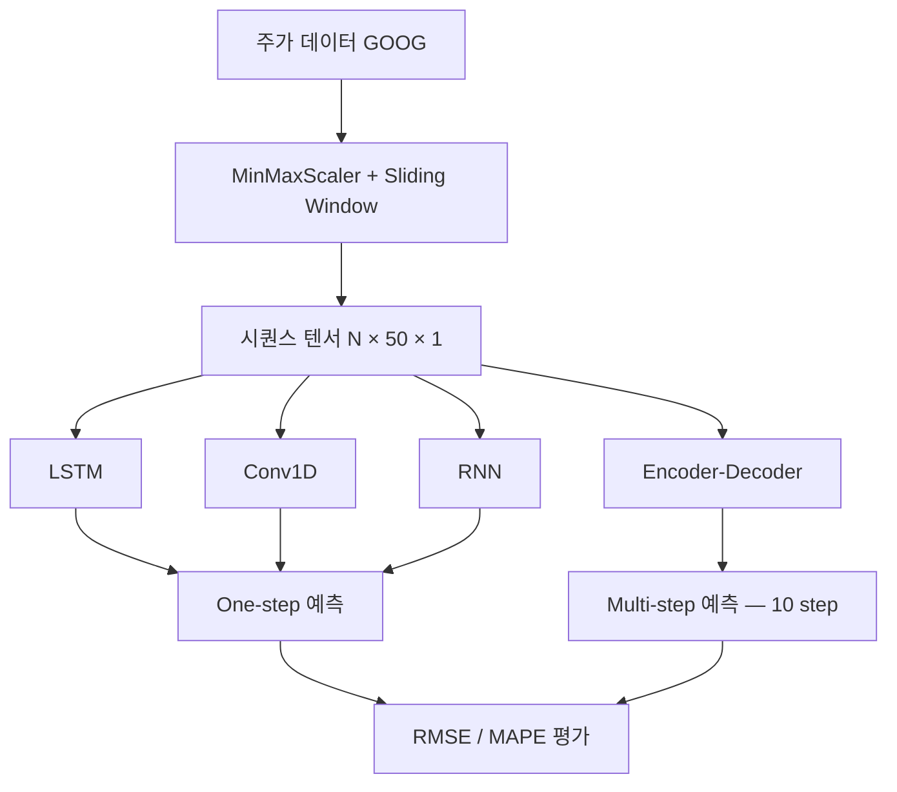
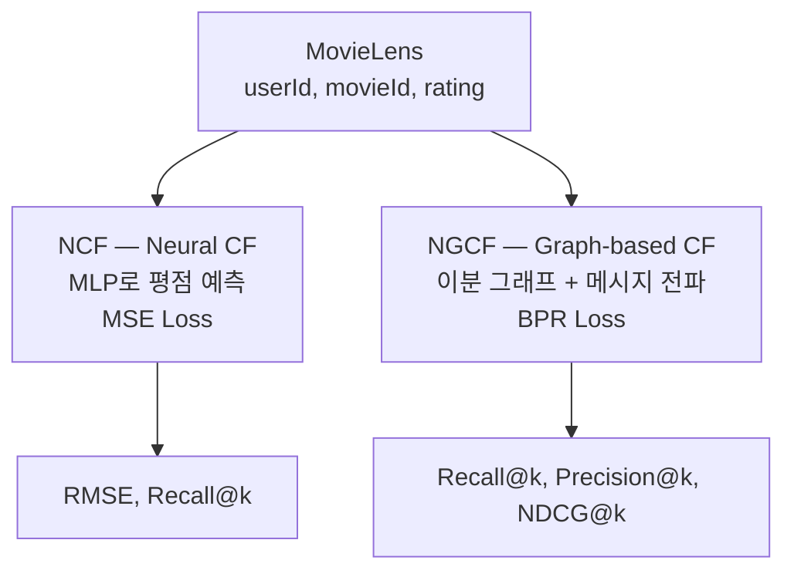

# 04.Time Series — 실습 코드 완전 해설

> 이 문서는 04.Time_Series 실습 노트북 5종(ts_practice / ts_solution, RecSys_NCF, RecSys_GCF_practice / RecSys_GCF_sol)의 핵심 코드를 단계별로 설명합니다.
> **`# TODO` 빈칸의 정답과 근거**를 2부에 별도로 정리했습니다.

---

## 전체 학습 흐름 한눈에 보기

**Part A. 시계열 예측 — Time Series Forecasting**



**Part B. 추천 시스템 — Recommender System**



**한 줄 요약**

| 노트북 | 과제 | 모델 | 손실 | 평가 지표 |
|---|---|---|---|---|
| `ts_practice` | 주가 예측 | LSTM / Conv1D / RNN / Enc-Dec | MSE | RMSE, MAPE |
| `RecSys_NCF` | 평점 예측 (Rating Prediction) | Embedding + MLP | **MSE** | RMSE, Recall@k, Precision@k |
| `RecSys_GCF` | 순위 예측 (Ranking) | NGCF (GNN) | **BPR** | Recall@k, Precision@k, NDCG@k |

**두 파트의 공통 주제 — 왜 한 과목에 묶여 있는가**

둘 다 **"과거의 상호작용 패턴에서 다음을 예측"** 하는 문제입니다.

- 시계열: "이 사용자(=종목)가 지난 50일간 이렇게 움직였으니 내일은?"
- 추천: "이 사용자가 이런 영화들을 봤으니 다음엔?"

또한 두 파트 모두 **순서/구조를 어떻게 표현할 것인가**가 핵심입니다. 시계열은 시간 축을 RNN/Conv로, 추천은 사용자-아이템 관계를 임베딩/그래프로 다룹니다.

---

# Part A. 시계열 예측

## A-1. 데이터 준비

```python
start_date, end_date = '2020-01-01', '2024-12-31'
df = yf.download('GOOG', start=start_date, end=end_date)
```

`yfinance`로 구글 주가를 받아옵니다. 컬럼은 `Open, High, Low, Close, Volume`이고, 실습은 **`Open`(시가) 하나만** 씁니다. 즉 **단변량(univariate) 시계열**입니다.

### Train-Test Split — 시계열의 철칙

```python
train_ratio = 0.8
training_data_len = math.ceil(len(df) * train_ratio)

train_data = df[:training_data_len][['Open']]     # 앞쪽 80%
test_data  = df[training_data_len:][['Open']]     # 뒤쪽 20%
# (1006, 1) / (251, 1)
```

**시계열에서는 절대 무작위 분할을 하면 안 됩니다 — 최다 출제 지점**

```
올바름:  [━━━━━━ train ━━━━━━][── test ──]     시간 순서 유지
                                ↑ 과거로 미래를 예측

틀림:    [━ tr ─][test][━ tr ━][test][━ tr ━]   무작위 섞기
                  ↑ 미래 데이터로 과거를 예측 → 정보 누출(leakage)
```

`train_test_split(..., shuffle=True)`을 쓰면 test 시점보다 **미래의 데이터가 train에 섞여** 들어갑니다. 실제로는 알 수 없는 정보를 쓰는 것이므로 성능이 비현실적으로 높게 나옵니다.

`math.ceil`을 쓰는 이유는 소수점이 나올 때 train 쪽에 한 개 더 배정하기 위함입니다.

**`df[:len][['Open']]`의 이중 대괄호**: `df['Open']`은 Series(1D), `df[['Open']]`은 DataFrame(2D)입니다. `MinMaxScaler`가 2D 입력을 요구하므로 DataFrame이어야 합니다.

### Scaling — fit은 train에만

```python
scaler = MinMaxScaler(feature_range=(0, 1))
train_scaled = scaler.fit_transform(train_data.values)   # fit + transform
test_scaled  = scaler.transform(test_data.values)        # transform만
```

**`fit_transform` vs `transform`의 구분이 두 번째 철칙입니다.**

`MinMaxScaler`는 다음 식으로 변환합니다.

$$
x' = \frac{x - x_{min}}{x_{max} - x_{min}}
$$

여기서 $x_{min}, x_{max}$가 **학습되는 파라미터**입니다. test 데이터로 `fit`하면 test 구간의 최댓값(미래 정보)이 스케일링에 반영되어 누출이 발생합니다.

**MinMax vs StandardScaler**

| | MinMaxScaler | StandardScaler |
|---|---|---|
| 결과 범위 | [0, 1] | 평균 0, 분산 1 |
| 이상치 | **민감** (max 하나에 좌우) | 상대적으로 강건 |
| 시계열 | 널리 쓰임 (범위가 명확) | 분포가 정규에 가까울 때 |

**주의**: test 값이 train의 min/max를 벗어나면 스케일링 결과가 [0,1]을 넘습니다. 주가처럼 지속적으로 상승하는 데이터에서 흔히 일어나며, 이 실습에서도 test 구간 값이 1을 초과할 수 있습니다.

### Sliding Window

```python
sequence_length = 50   # 며칠을 보고 예측할 것인가

def convert_data_into_tensors(data_seq):
    features, labels = [], []
    for i in range(len(data_seq) - sequence_length):
        features.append(data_seq[i:i + sequence_length])       # 50일치
        labels.append(data_seq[i + sequence_length, 0])        # 51일째 값
    features, labels = np.array(features), np.array(labels)
    return (torch.tensor(features, dtype=torch.float32),
            torch.tensor(labels,   dtype=torch.float32))

X_train, y_train = convert_data_into_tensors(train_scaled)
# torch.Size([956, 50, 1]) / torch.Size([956])
```

**shape 계산 검증**

```
train: 1006일 - 50 = 956개 샘플  → X_train (956, 50, 1), y_train (956,)
test :  251일 - 50 = 201개 샘플  → X_test  (201, 50, 1), y_test  (201,)
```

**`data_seq[i:i+50]`과 `data_seq[i+50, 0]`의 관계**

```
i=0 : [d0 ... d49]  →  d50
i=1 : [d1 ... d50]  →  d51
i=2 : [d2 ... d51]  →  d52
       ↑ 한 칸씩 밀며 창을 이동
```

**`, 0`이 붙는 이유**: `data_seq`가 `(N, 1)` 2D이므로 `data_seq[i+50]`은 `(1,)` 배열입니다. `, 0`으로 스칼라를 꺼냅니다. 결과적으로 `y`는 `(N,)` 1D가 됩니다.

**`(N, 50, 1)`의 마지막 1이 feature 개수**입니다. 다변량으로 확장하려면(Open, High, Low, Volume 등) 이 값이 4가 되고 `input_size`도 함께 바뀝니다.

**train_loader만 `shuffle=True`인 이유**

```python
train_loader = to_loader(X_train, y_train, batch_size, shuffle=True)
test_loader  = to_loader(X_test,  y_test,  batch_size, shuffle=False)
```

윈도우로 잘라낸 시점에서 **각 샘플은 이미 완결된 (입력 50일, 정답 1일) 쌍**입니다. 샘플 **간** 순서는 학습에 필요 없고, 오히려 섞어야 배치 간 상관이 줄어 학습이 안정됩니다. 반면 test는 예측 결과를 시간 순서대로 그려야 하므로 섞지 않습니다.

**시퀀스 내부 순서(50일 안의 순서)는 절대 섞이지 않습니다.** 섞는 것은 윈도우끼리의 순서일 뿐입니다.

## A-2. LSTM 모델

```python
input_size = X_train.shape[-1]   # 1
num_layers = 2
hidden_size = 64

class LSTMModel(nn.Module):
    def __init__(self, input_size, hidden_size, num_layers):
        super(LSTMModel, self).__init__()
        self.lstm = nn.LSTM(input_size, hidden_size, num_layers, batch_first=True)
        self.linear = nn.Linear(hidden_size, 1)

    def forward(self, x):
        out, _ = self.lstm(x)
        return self.linear(out)
```

**`batch_first=True`가 필수인 이유 — 흔한 함정**

| | shape |
|---|---|
| `batch_first=False` (기본값) | `(seq_len, batch, feature)` |
| **`batch_first=True`** | **`(batch, seq_len, feature)`** |

PyTorch RNN 계열의 **기본값이 `False`** 입니다. DataLoader가 만들어 주는 텐서는 배치가 앞에 오는 `(B, 50, 1)`이므로, `True`로 바꾸지 않으면 시퀀스 축과 배치 축이 뒤바뀌어 **에러 없이 완전히 잘못된 학습**이 진행됩니다.

**`out, _ = self.lstm(x)`의 반환값**

```python
out, (h_n, c_n) = self.lstm(x)
```

| 반환 | shape | 의미 |
|---|---|---|
| `out` | `(B, 50, 64)` | **모든 시점**의 hidden state |
| `h_n` | `(2, B, 64)` | 마지막 시점의 hidden state (층별) |
| `c_n` | `(2, B, 64)` | 마지막 시점의 cell state (층별) |

이 코드는 `out`만 쓰고 `(h_n, c_n)`은 `_`로 버립니다.

**`self.linear(out)`이 모든 시점에 적용됩니다.**

```
out    (B, 50, 64)
  ↓ Linear(64, 1)  ← 마지막 축에만 작용
결과   (B, 50, 1)   ← 50개 시점 각각에 대한 예측
```

그래서 학습 루프에서 마지막 시점만 골라 씁니다.

```python
pred = model(batch_x)[:, -1, 0]     # (B, 50, 1) → (B,)
```

- `:` → 배치 전체
- `-1` → **마지막 시점** (50일치를 다 본 뒤의 예측)
- `0` → 유일한 출력 특징

**`h_n[-1]`을 쓰지 않고 `out[:, -1]`을 쓰는 이유**: 두 값은 (단방향 LSTM에서) 같습니다. 다만 `out`을 쓰면 Conv1D 모델처럼 시퀀스 길이가 달라지는 경우에도 동일한 학습 코드를 재사용할 수 있습니다.

**`num_layers=2`**: LSTM을 2층으로 쌓습니다. 첫 층의 출력이 둘째 층의 입력이 되며, 더 복잡한 시간 패턴을 학습할 수 있습니다.

**RNN vs LSTM — 시험 포인트**

| | RNN | LSTM |
|---|---|---|
| 게이트 | 없음 | **forget / input / output** 3개 |
| 상태 | hidden만 | hidden + **cell state** |
| 장기 의존성 | 기울기 소실로 약함 | cell state가 정보를 길게 보존 |
| 파라미터 | 적음 | 약 **4배** |

LSTM의 cell state는 게이트로만 조절되는 "고속도로"라, 잔차 연결처럼 기울기가 멀리까지 전달됩니다.


### ❓ 빈칸 Q4. RNN 모델

```python
self.rnn = nn.RNN(, , , batch_first=True)
self.fc = nn.Linear(, 1)

def forward(self, x):
    # TODO
```

**정답**

<pre><code>self.rnn = nn.RNN(<mark>input_size, hidden_size, num_layers</mark>, batch_first=True)
self.fc = nn.Linear(<mark>hidden_size</mark>, 1)

def forward(self, x):
    <mark>out, _ = self.rnn(x)
    return self.fc(out)</mark>
</code></pre>

**이유**

**`nn.RNN`의 인자 순서는 `(input_size, hidden_size, num_layers)`** 입니다. `nn.LSTM`, `nn.GRU`도 완전히 같습니다.

**`batch_first=True`가 이미 주어진 이유**: 이걸 빠뜨리면 `(seq, batch, feature)`로 해석되어 조용히 잘못된 학습이 일어납니다. 문제에서 미리 넣어 준 것은 그만큼 중요한 함정이라는 뜻입니다.

**`out, _ = self.rnn(x)` 언패킹**

```python
out, h_n = self.rnn(x)
```

`nn.RNN`은 `(output, h_n)` 튜플을 반환합니다. LSTM이 `(output, (h_n, c_n))`인 것과 달리 RNN/GRU는 hidden state 하나뿐입니다.

**`self.fc(out)`이 `out` 전체에 적용됩니다.** `(B, 50, 64)` → `(B, 50, 1)`. 학습 루프의 `[:, -1, 0]`이 마지막 시점을 골라내므로 여기서는 자르지 않습니다.

**LSTMModel과 완전히 같은 구조**입니다. `nn.LSTM` → `nn.RNN`으로 바꾼 것뿐이라 학습/평가 코드를 그대로 재사용할 수 있습니다.

---

---

## A-3. 학습 루프

```python
def train(model, train_loader, test_loader):
    num_epochs = 10
    loss_fn = nn.MSELoss(reduction='mean')
    optimizer = optim.Adam(model.parameters(), lr=1e-3)

    for epoch in range(num_epochs):
        model.train()
        for batch_x, batch_y in train_loader:
            batch_x, batch_y = batch_x.to(device), batch_y.to(device)
            pred = model(batch_x)[:, -1, 0]
            loss = loss_fn(pred, batch_y)

            optimizer.zero_grad()
            loss.backward()
            optimizer.step()
            total_train_loss += loss.item()

        model.eval()
        with torch.no_grad():
            for test_x, test_y in test_loader:
                test_pred = model(test_x)[:, -1, 0]
                test_loss = loss_fn(test_pred, test_y)
```

**분류가 아니라 회귀(regression) 문제입니다.**

| | 분류 | **회귀 (이 실습)** |
|---|---|---|
| 손실 | CrossEntropyLoss | **MSELoss** |
| 출력 | 클래스 로짓 | **연속값 1개** |
| 평가 | Accuracy | **RMSE, MAPE** |

**`pred`와 `batch_y`의 shape이 반드시 같아야 합니다.**

```python
pred = model(batch_x)[:, -1, 0]   # (B,)
batch_y                            # (B,)
```

`[:, -1]`까지만 하면 `pred`가 `(B, 1)`이 되어 `(B,)`인 `batch_y`와 브로드캐스팅됩니다. 그러면 **`(B, B)` 크기의 손실 행렬**이 만들어져 값이 완전히 틀어집니다. **에러가 나지 않기 때문에** 더 위험한 함정입니다.

**4단계 학습 순서**

```
optimizer.zero_grad()  → 이전 기울기 초기화
loss.backward()        → 역전파
optimizer.step()       → 가중치 갱신
```

**`total_train_loss / len(train_loader)`**: `len(loader)`는 **배치 개수**입니다(샘플 수가 아님). `loss.item()`이 이미 배치 평균이므로 배치 개수로 나누면 epoch 평균이 됩니다.


### ❓ 빈칸 Q1. 학습 루프 6단계

```python
# 빈칸
batch_x, batch_y =
pred =
loss =
optimizer.
loss.
optimizer.
```

**정답**

<pre><code>batch_x, batch_y = <mark>batch_x.to(device), batch_y.to(device)</mark>
pred = <mark>model(batch_x)[:, -1, 0]</mark>
loss = <mark>loss_fn(pred, batch_y)</mark>
optimizer.<mark>zero_grad()</mark>
loss.<mark>backward()</mark>
optimizer.<mark>step()</mark>
</code></pre>

**이유 — 단계별로**

| 번호 | 코드 | 설명 |
|---|---|---|
| (1) | `.to(device)` | 모델이 GPU에 있으면 데이터도 GPU로. 안 하면 `Expected all tensors to be on the same device` |
| (2) | `model(batch_x)[:, -1, 0]` | 출력 `(B, 50, 1)`에서 **마지막 시점**(`-1`)의 **유일한 특징**(`0`) → `(B,)` |
| (3) | `loss_fn(pred, batch_y)` | MSE. 두 텐서 shape이 `(B,)`로 같아야 함 |
| (4) | `optimizer.zero_grad()` | PyTorch는 기울기를 누적하므로 매 배치 초기화 |
| (5) | `loss.backward()` | 역전파 |
| (6) | `optimizer.step()` | 가중치 갱신 |

**`[:, -1, 0]`을 `[:, -1]`로 쓰면 안 되는 이유 — 최다 함정**

```python
pred = model(batch_x)[:, -1]    # (B, 1)
loss = loss_fn(pred, batch_y)   # (B, 1) vs (B,) → 브로드캐스팅으로 (B, B)!
```

**에러가 나지 않습니다.** 손실값만 조용히 틀어져 학습이 이상해집니다. 시험에서 "왜 학습이 안 되는가"를 묻는 전형적인 문제입니다.

**평가 구간도 동일합니다.**

```python
test_x, test_y = test_x.to(device), test_y.to(device)
test_pred = model(test_x)[:, -1, 0]
test_loss = loss_fn(test_pred, test_y)
```

단, 평가 구간은 이미 `model.eval()`과 `with torch.no_grad():` 안에 있으므로 `zero_grad/backward/step`이 **없습니다**.

---

---

## A-4. Conv1D 모델

```python
class Conv1DModel(nn.Module):
    def __init__(self, input_size, hidden_size):
        super(Conv1DModel, self).__init__()
        self.conv1d = nn.Conv1d(in_channels=input_size, out_channels=hidden_size,
                                kernel_size=2, stride=1)
        self.fc = nn.Linear(hidden_size, 1)

    def forward(self, x):
        x = x.transpose(1, 2)     # (B, 50, 1) → (B, 1, 50)
        x = self.conv1d(x)        # (B, 64, 49)
        x = x.transpose(1, 2)     # (B, 49, 64)
        return self.fc(x)         # (B, 49, 1)
```

**`transpose(1, 2)`가 두 번 나오는 이유 — 핵심**

`nn.Conv1d`는 `(B, C, L)` = **(배치, 채널, 길이)** 를 요구합니다. RNN은 `(B, L, C)`를 요구합니다. **채널 축과 길이 축의 위치가 반대**입니다.

```
RNN 규약   (B, seq_len, feature)  =  (B, 50, 1)
                ↓ transpose(1,2)
Conv 규약  (B, channel, length)   =  (B, 1, 50)
                ↓ conv1d
           (B, 64, 49)
                ↓ transpose(1,2)  다시 RNN 규약으로
           (B, 49, 64)
```

`fc`가 마지막 축(64)에 작용해야 하므로 되돌립니다. 이 덕에 `train()` 함수의 `[:, -1, 0]`을 그대로 재사용할 수 있습니다.

**출력 길이가 49가 되는 이유**

$$
L_{out} = \frac{L_{in} + 2p - k}{s} + 1 = \frac{50 + 0 - 2}{1} + 1 = 49
$$

padding이 없어 `kernel_size - 1 = 1`만큼 줄어듭니다. LSTM은 50을 유지하지만 Conv1D는 49가 되며, 그래도 `[:, -1, 0]`이 마지막 시점을 잘 골라 주므로 학습 코드는 동일합니다.

**Conv1D를 시계열에 쓰는 이유**

| | RNN/LSTM | Conv1D |
|---|---|---|
| 계산 | **순차적** (병렬화 불가) | **병렬** (빠름) |
| 참조 범위 | 이론상 전체 | kernel_size (rf를 늘리려면 층/dilation 필요) |
| 장기 의존성 | 강함 | 약함 (여기선 kernel=2라 인접 2일만) |

`kernel_size=2`는 **인접한 이틀만** 봅니다. 층이 하나뿐이라 receptive field가 2에 불과하지만, 주가처럼 최근값이 지배적인 데이터에서는 이것만으로도 꽤 잘 동작합니다. 실제로 노트북에서 RNN(RMSE 0.0862)이 LSTM(0.1194)보다 좋게 나오는 것도 같은 맥락입니다. **모델이 복잡하다고 항상 좋은 것은 아니라는 점**이 이 실습의 교훈 중 하나입니다.


### ❓ 빈칸 Q3. Conv1D 모델 인자

```python
self.conv1d = nn.Conv1d(in_channels=, out_channels=, kernel_size=2, stride=1)
self.fc = nn.Linear(, 1)
```

**정답**

<pre><code>self.conv1d = nn.Conv1d(in_channels=<mark>input_size</mark>, out_channels=<mark>hidden_size,</mark>
                        kernel_size=2, stride=1)
self.fc = nn.Linear(<mark>hidden_size</mark>, 1)
</code></pre>

**이유 — 채널의 의미를 이해해야 풉니다**

| 인자 | 값 | 근거 |
|---|---|---|
| `in_channels` | `input_size` (=1) | 시계열의 **feature 개수**가 곧 입력 채널. 단변량이므로 1 |
| `out_channels` | `hidden_size` (=64) | Conv가 만들어 낼 특징 맵 개수 = hidden 차원 |
| `nn.Linear` 입력 | `hidden_size` (=64) | conv 출력 채널을 그대로 받아 1개 값으로 사영 |

**`forward`의 transpose와 연결해서 보면 명확합니다.**

```
x           (B, 50, 1)     RNN 규약 (B, seq, feature)
 ↓ transpose(1,2)
            (B, 1, 50)     Conv 규약 (B, channel, length) — feature가 channel이 됨
 ↓ conv1d(1 → 64, k=2)
            (B, 64, 49)
 ↓ transpose(1,2)
            (B, 49, 64)
 ↓ fc(64 → 1)
            (B, 49, 1)
```

`in_channels`에 `sequence_length`(50)를 넣는 것이 흔한 오답입니다. **길이가 아니라 채널**입니다.

---

---

## A-5. 평가 지표

```python
def test(model, X_test, y_test):
    model.eval()
    with torch.no_grad():
        X_test = X_test.to(device)
        y_hat = model(X_test)            # (N, seq_len, 1)
        test_predictions = y_hat[:, -1, 0]

    test_predictions = test_predictions.cpu().numpy()
    y_test = y_test.cpu().numpy()

    rmse = root_mean_squared_error(y_test, test_predictions)
    mape = mean_absolute_percentage_error(y_test, test_predictions)
    return rmse, mape
```

**인자 순서가 `(정답, 예측)`입니다.** sklearn 메트릭의 공통 규약(`y_true, y_pred`)이며, 반대로 넣으면 RMSE는 대칭이라 같지만 **MAPE는 달라집니다**(분모가 바뀌므로).

**RMSE (Root Mean Squared Error)**

$$
\text{RMSE} = \sqrt{\frac{1}{N}\sum(y_i - \hat{y}_i)^2}
$$

- 원래 값과 **같은 단위**
- 제곱하므로 **큰 오차에 민감**

**MAPE (Mean Absolute Percentage Error)**

$$
\text{MAPE} = \frac{1}{N}\sum\left|\frac{y_i-\hat{y}_i}{y_i}\right|
$$

- **비율(%)** 이라 스케일에 무관 → 서로 다른 종목 비교 가능
- **$y_i$가 0에 가까우면 발산**하는 치명적 약점

**이 실습에서 반드시 알아야 할 주의점**

두 지표 모두 **MinMax 스케일된 값**(0~1)에 대해 계산됩니다. 실제 달러 단위 오차가 아닙니다.

- RMSE 0.1194는 "정규화 범위의 12%"라는 뜻입니다
- MAPE는 분모 $y_i$가 0에 가까운 구간(train 최솟값 근처)에서 크게 부풀 수 있습니다

원래 단위로 보려면 `scaler.inverse_transform`을 적용한 뒤 계산해야 합니다. 시험에서 "이 RMSE는 무엇의 단위인가"를 묻는다면 **정규화된 값**이 정답입니다.

**`.cpu().numpy()`가 필요한 이유**: sklearn은 numpy 배열만 받습니다. GPU 텐서는 먼저 CPU로 옮겨야 합니다.


### ❓ 빈칸 Q2. 평가 지표 인자

```python
rmse = root_mean_squared_error(, )  # TODO
mape = mean_absolute_percentage_error(, )  # TODO
```

**정답**

<pre><code>rmse = root_mean_squared_error(<mark>y_test, test_predictions</mark>)
mape = mean_absolute_percentage_error(<mark>y_test, test_predictions</mark>)
</code></pre>

**이유**: sklearn 메트릭의 공통 시그니처는 **`(y_true, y_pred)`** 입니다. 정답이 먼저입니다.

**순서를 바꾸면**

- **RMSE**: $(y-\hat{y})^2$은 대칭이라 **값이 같습니다**
- **MAPE**: $\left|\frac{y-\hat{y}}{y}\right|$의 **분모가 바뀌어 값이 달라집니다**

MAPE 하나 때문에 순서를 지켜야 합니다.

**앞선 두 줄도 함께 보세요.**

```python
test_predictions = test_predictions.cpu().numpy()
y_test = y_test.cpu().numpy()
```

sklearn은 numpy만 받으므로 GPU 텐서를 CPU numpy로 변환해야 합니다.

---

---

## A-6. Recursive Forecasting (미래 예측)

```python
def plot_forecasting(model, X_test, y_test):
    num_forecast_steps = 30
    input_data = X_test[-num_forecast_steps].cpu().numpy().squeeze()   # (50,)

    forecasted_values = []
    with torch.no_grad():
        for i in range(2 * num_forecast_steps):        # 60번 반복
            input_tensor = torch.as_tensor(input_data).view(1, -1, 1).to(device)
            predicted = model(input_tensor)[0, -1, 0].item()
            forecasted_values.append(predicted)

            input_data = np.roll(input_data, shift=-1)  # 한 칸 왼쪽으로
            if i < num_forecast_steps:
                input_data[-1] = y_test[-num_forecast_steps + i]   # 실제값 주입
            else:
                input_data[-1] = predicted                          # 예측값 주입
```

**두 구간의 성격이 완전히 다릅니다 — 시험 포인트**

| 구간 | 마지막 칸에 넣는 값 | 이름 | 특징 |
|---|---|---|---|
| `i < 30` | **실제값** `y_test[...]` | **Teacher Forcing** | 오차가 누적되지 않음 |
| `i >= 30` | **예측값** `predicted` | **Autoregressive** | 오차가 **누적** |

Autoregressive 구간에서는 잘못된 예측이 다음 입력이 되어 오차가 눈덩이처럼 커집니다(error accumulation). 그래서 뒤로 갈수록 예측이 실제와 벌어지며, 그래프에서 붉은 선이 점점 평평해지거나 발산하는 이유입니다.

**`np.roll(input_data, shift=-1)`**: 배열을 왼쪽으로 한 칸 회전시킵니다. `[a,b,c,d]` → `[b,c,d,a]`. 맨 앞의 오래된 값이 뒤로 밀려나면, 그 자리(`[-1]`)에 새 값을 덮어써 슬라이딩 윈도우를 한 칸 전진시킵니다.

**`.view(1, -1, 1)`**: `(50,)` 1D를 모델 입력 `(batch=1, seq=50, feature=1)`로 만듭니다. `-1`은 나머지를 자동 계산하라는 뜻입니다.

**`scaler.inverse_transform`**: 예측값이 스케일된 상태이므로 원래 주가 단위로 되돌려야 그래프에 그릴 수 있습니다.

```python
forecasted_cases = scaler.inverse_transform(np.expand_dims(forecasted_values, axis=0)).flatten()
```

`inverse_transform`은 2D 입력을 요구하므로 `expand_dims`로 차원을 만들어 줍니다.

## A-7. Encoder-Decoder (Multi-step 예측)

### 데이터 준비의 차이

```python
sequence_length = 50
target_len = 10          # ← 새로 등장

def create_enc_dec_sequences(data):
    features, labels = [], []
    for i in range(len(data) - sequence_length - target_len):
        features.append(data[i:i + sequence_length])                        # 50개
        labels.append(data[i + sequence_length : i + sequence_length + target_len])  # 10개
```

**One-step vs Multi-step**

| | 기존 모델 | Encoder-Decoder |
|---|---|---|
| `y` shape | `(N,)` — 값 1개 | **`(N, 10, 1)`** — 값 10개 |
| 예측 | 다음 1일 | **다음 10일 한꺼번에** |
| 루프 범위 | `len - 50` | `len - 50 - 10` |

`- target_len`이 추가된 이유는, 마지막 윈도우에서도 정답 10개를 확보할 수 있어야 하기 때문입니다.

### 구조

```python
class EncoderRNN(nn.Module):
    def __init__(self, input_size, hidden_size, num_layers):
        super(EncoderRNN, self).__init__()
        self.rnn = nn.RNN(input_size, hidden_size, num_layers, batch_first=True)

    def forward(self, x):
        _, h = self.rnn(x)      # out은 버리고 hidden state만 반환
        return h

class DecoderRNN(nn.Module):
    def __init__(self, input_size, hidden_size, num_layers):
        super(DecoderRNN, self).__init__()
        self.rnn = nn.RNN(input_size, hidden_size, num_layers, batch_first=True)
        self.fc = nn.Linear(hidden_size, input_size)

    def forward(self, x, h):
        out, h = self.rnn(x, h)   # 이전 hidden state를 받아 이어감
        out = self.fc(out)
        return out, h
```

**Encoder가 `out`을 버리고 `h`만 반환하는 이유 — 핵심**

Encoder의 역할은 입력 50일을 **하나의 요약 벡터(context vector)** 로 압축하는 것입니다. 중간 시점의 출력은 필요 없고, 마지막 hidden state `h`에 전체 정보가 담깁니다.

**Decoder가 `h`를 인자로 받는 이유**: `nn.RNN(x, h0)`처럼 초기 hidden state를 지정하면 "Encoder가 이해한 문맥에서 시작"하게 됩니다. 이것이 Encoder와 Decoder를 잇는 유일한 통로입니다.

**`fc`의 출력이 `input_size`(=1)인 이유**: Decoder의 출력이 **다음 스텝의 입력**이 되어야 하므로, 입력과 같은 차원이어야 합니다.

### Autoregressive Decoding

```python
class RNNRNN(nn.Module):
    def forward(self, source, target_len):
        h = self.encoder(source)                     # context vector
        predictions = []
        input = source[:, -1, :].unsqueeze(1)        # 입력의 마지막 값으로 시작
        for t in range(target_len):
            out, h = self.decoder(input, h)
            predictions.append(out.squeeze(1))
            input = out                              # 예측값을 다음 입력으로
        return torch.stack(predictions, dim=1)       # (B, target_len, 1)
```

**`source[:, -1, :].unsqueeze(1)`**: 입력 시퀀스의 **마지막 값**을 Decoder의 첫 입력으로 씁니다. `(B, 1)` → `unsqueeze(1)` → `(B, 1, 1)`로 시퀀스 길이 1을 만듭니다. 자연어 번역의 `<SOS>` 토큰에 해당하는 역할입니다.

**`h`를 매 스텝 갱신**: `out, h = self.decoder(input, h)`에서 갱신된 `h`를 다음 반복에 넘겨 상태를 이어갑니다.

**`torch.stack(predictions, dim=1)`**: `(B, 1)` 텐서 10개를 새 차원으로 쌓아 `(B, 10, 1)`을 만듭니다. `cat`이 아니라 `stack`인 이유는 **새 축을 만들어야** 하기 때문입니다.

**Teacher Forcing이 없다는 점에 주의**: 학습 중에도 예측값을 다음 입력으로 씁니다(`input = out`). 정답을 넣어 주는 teacher forcing을 쓰면 학습이 빨라지지만, 추론 시 분포가 달라지는 exposure bias가 생깁니다. 이 코드는 학습과 추론 조건을 일치시킨 방식입니다.

**성능이 낮게 나오는 이유**: 노트북 결과가 RMSE 0.2088로 one-step 모델들보다 나쁩니다. 10 step을 한꺼번에 예측하는 것이 본질적으로 더 어려운 문제이므로 **정상적인 결과**입니다. 같은 지표로 직접 비교하면 안 됩니다.

---

# Part B. 추천 시스템


### ❓ 빈칸 Q5. Encoder-Decoder

```python
class EncoderRNN(nn.Module):
    def __init__(self, input_size, hidden_size, num_layers):
        # TODO
    def forward(self, x):
        # TODO

class DecoderRNN(nn.Module):
    def __init__(self, input_size, hidden_size, num_layers):
        # TODO
    def forward(self, x, h):
        # TODO
```

**정답**

<pre><code>class EncoderRNN(nn.Module):
    def __init__(self, input_size, hidden_size, num_layers):
        <mark>super(EncoderRNN, self).__init__()
        self.rnn = nn.RNN(input_size, hidden_size, num_layers, batch_first=True)</mark>

    def forward(self, x):
        <mark>_, h = self.rnn(x)
        return h</mark>

class DecoderRNN(nn.Module):
    def __init__(self, input_size, hidden_size, num_layers):
        <mark>super(DecoderRNN, self).__init__()
        self.rnn = nn.RNN(input_size, hidden_size, num_layers, batch_first=True)
        self.fc = nn.Linear(hidden_size, input_size)</mark>

    def forward(self, x, h):
        <mark>out, h = self.rnn(x, h)
        out = self.fc(out)
        return out, h</mark>
</code></pre>

**이유 — 4가지 포인트**

**① Encoder는 `out`을 버리고 `h`만 반환합니다.**

```python
_, h = self.rnn(x)
return h
```

Encoder의 역할은 입력 50일을 **하나의 context vector**로 압축하는 것입니다. 중간 시점 출력은 쓰지 않습니다. `RNNRNN.forward`에서 `h = self.encoder(source)`로 받는 것과 일치합니다.

**② Encoder에는 `fc`가 없습니다.** 값을 예측하지 않고 상태만 넘기기 때문입니다.

**③ Decoder의 `fc` 출력이 `input_size`(=1)입니다.**

```python
self.fc = nn.Linear(hidden_size, input_size)
```

Decoder의 출력이 **다음 스텝의 입력**이 되어야 하므로(`input = out`), 입출력 차원이 같아야 합니다. `nn.Linear(hidden_size, 1)`이라고 써도 값은 같지만, `input_size`로 쓰는 것이 의도를 명확히 합니다.

**④ Decoder의 `forward`가 `h`를 받고 `h`를 반환합니다.**

```python
def forward(self, x, h):
    out, h = self.rnn(x, h)     # h를 초기 상태로 주입, 갱신된 h를 받음
    return out, h
```

`nn.RNN(x, h0)`처럼 두 번째 인자로 초기 hidden state를 지정할 수 있습니다. 이것이 Encoder와 Decoder를 잇는 통로이며, 루프에서 상태를 이어가는 수단입니다.

**주어진 `RNNRNN.forward`를 보면 위 설계가 강제됩니다.**

```python
h = self.encoder(source)              # ③ Encoder는 h만 반환해야 함
input = source[:, -1, :].unsqueeze(1) # 마지막 값으로 시작
for t in range(target_len):
    out, h = self.decoder(input, h)   # ④ Decoder는 (out, h)를 반환해야 함
    predictions.append(out.squeeze(1))
    input = out                       # ③ out의 차원이 input과 같아야 함
```

빈칸을 풀 때는 **이미 주어진 코드가 무엇을 요구하는지**를 역으로 읽는 것이 정석입니다.

---

---

## B-1. NCF (Neural Collaborative Filtering)

### 데이터 준비

```python
lbl_user = preprocessing.LabelEncoder()
lbl_movie = preprocessing.LabelEncoder()
df.userId  = lbl_user.fit_transform(df.userId.values)
df.movieId = lbl_movie.fit_transform(df.movieId.values)
```

**LabelEncoder가 필수인 이유 — 시험 포인트**

MovieLens의 `movieId`는 1, 3, 6, 47, 50, ... 처럼 **띄엄띄엄한 실제 ID**입니다. `nn.Embedding(n, d)`은 `[0, n-1]`의 **연속된 인덱스**를 요구하므로, 그대로 쓰면

- 최대 ID가 193609이면 임베딩 테이블을 193610행이나 만들어야 함 (대부분 미사용)
- 또는 `IndexError: index out of range`

`LabelEncoder`가 실제 ID를 0부터 시작하는 연속 정수로 변환해 이 문제를 해결합니다. NGCF 노트북에서는 딕셔너리로 같은 일을 합니다.

```python
user_encoder = {user: idx for idx, user in enumerate(rating_df['userId'].unique())}
```

**stratify 옵션**

```python
df_train, df_test = model_selection.train_test_split(
    df, test_size=0.1, random_state=42, stratify=df.rating.values)
```

평점 분포(0.5~5.0)를 train/test에 **동일한 비율로** 유지합니다. 평점 5가 많은 데이터에서 test에 낮은 평점만 몰리는 것을 방지합니다.

**시계열과 달리 무작위 분할을 해도 되는 이유**: 추천 실습은 "이 사용자-영화 쌍의 평점"을 맞히는 문제로 정의했으므로 시간 순서가 본질이 아닙니다. (다만 실무에서는 시간 기반 분할이 더 현실적입니다.)

### Dataset 클래스

```python
class MovieLens:
    def __init__(self, users, movies, ratings):
        self.users, self.movies, self.ratings = users, movies, ratings

    def __len__(self):
        return len(self.users)

    def __getitem__(self, item):
        return {'users':   torch.tensor(self.users[item],   dtype=torch.long).to(device),
                'movies':  torch.tensor(self.movies[item],  dtype=torch.long).to(device),
                'ratings': torch.tensor(self.ratings[item], dtype=torch.long).to(device)}
```

**`dtype=torch.long`인 이유**: user/movie는 임베딩 조회용 **인덱스**이므로 정수여야 합니다. float를 넣으면 `nn.Embedding`이 에러를 냅니다.

**딕셔너리를 반환하는 점**: DataLoader가 자동으로 배치를 만들어 `{'users': (B,), 'movies': (B,), 'ratings': (B,)}`로 묶어 줍니다. 튜플 대신 딕셔너리를 쓰면 코드 가독성이 좋아집니다.

**`ratings`가 `long`인 것은 아쉬운 부분**: 평점이 0.5, 3.5 같은 소수인데 `long`으로 변환하면 잘립니다. 그래서 학습 루프에서 `.to(torch.float32)`로 다시 바꿉니다.

### 모델

```python
class Neural_Collaborative_Filtering(nn.Module):
    def __init__(self, n_users, n_movies):
        super().__init__()
        self.user_embedding  = nn.Embedding(n_users,  32)
        self.movie_embedding = nn.Embedding(n_movies, 32)

        self.fc1  = nn.Linear(64, 32)   # 64 = 32 + 32
        self.relu = nn.ReLU()
        self.fc2  = nn.Linear(32, 1)

    def forward(self, users, movies, ratings=None):
        user_embedding  = self.user_embedding(users)     # (B, 32)
        movie_embedding = self.movie_embedding(movies)   # (B, 32)
        input_embedding = torch.cat([user_embedding, movie_embedding], dim=1)   # (B, 64)

        hidden_feature = self.relu(self.fc1(input_embedding))
        return self.fc2(hidden_feature)                   # (B, 1)
```

**Embedding은 학습되는 조회 테이블입니다.**

```
user_embedding.weight : (610, 32)      사용자 610명 × 32차원
movie_embedding.weight: (9724, 32)     영화 9724편 × 32차원
```

각 사용자와 영화가 32차원 **잠재 요인(latent factor)** 벡터로 표현되고, 학습을 통해 "액션 성향", "옛날 영화 선호" 같은 축이 자동으로 형성됩니다.

**`torch.cat(..., dim=1)`이 NCF의 핵심입니다.**

| | 전통적 MF | **NCF** |
|---|---|---|
| 결합 방식 | **내적** $u \cdot v$ | **concat + MLP** |
| 표현력 | 선형 상호작용만 | **비선형 상호작용 학습 가능** |
| 유연성 | 고정된 함수 | 데이터로부터 함수를 학습 |

내적은 "각 차원을 곱해서 더한다"는 **고정된 규칙**입니다. NCF는 두 벡터를 이어 붙인 뒤 MLP에 넣어, 상호작용 함수 자체를 학습합니다. 이것이 논문 제목 "Neural Collaborative Filtering"의 의미입니다.

**`dim=1`인 이유**: `(B, 32)` 두 개를 특징 축(1번)으로 붙여 `(B, 64)`를 만듭니다. `dim=0`이면 배치가 늘어나 완전히 잘못됩니다. `fc1`의 입력이 64인 것과 정확히 대응합니다.

**출력이 1개(회귀)**: NCF는 여기서 **평점을 예측**합니다. 원 논문은 클릭 여부(0/1) 이진 분류였으나, 이 실습은 회귀로 구성했습니다. 그래서 손실이 `MSELoss`입니다.

### 학습

```python
loss_func = nn.MSELoss(reduction='mean')

prediction = model(train_data['users'], train_data['movies'])          # (B, 1)
ground_truth = train_data['ratings'].view(batch_size, -1).to(torch.float32)   # (B, 1)
loss = loss_func(prediction, ground_truth)
```

**`.view(batch_size, -1)`이 필요한 이유**: `ratings`는 `(B,)`인데 `prediction`은 `(B, 1)`입니다. shape을 맞추지 않으면 브로드캐스팅으로 `(B, B)` 손실 행렬이 만들어집니다. 시계열 파트에서 본 것과 **같은 함정**입니다.

**`total_loss + (loss.item() * batch_size)`**: `MSELoss(reduction='mean')`이 배치 평균을 냈으므로, 배치 크기를 곱해 합으로 되돌린 뒤 전체 샘플 수로 나눠야 정확한 전체 평균이 됩니다. 마지막 배치 크기가 다를 수 있으므로 이 방식이 정확합니다.

### 평가 — Recall@k / Precision@k

```python
user_est_true = defaultdict(list)
for batched_data in test_loader:
    model_output = model(batched_data['users'], batched_data['movies'])
    for i in range(len(users)):
        user_est_true[users[i].item()].append((pred_rating, true_rating))
```

```python
k = 10
threshold = 3.5    # relevant item 기준

for user_id, user_ratings in user_est_true.items():
    user_ratings.sort(key=lambda x: x[0], reverse=True)    # 예측 평점 내림차순

    n_real_relevant = sum((true_r >= threshold) for (_, true_r) in user_ratings)
    recommended_k = user_ratings[:k]
    n_real_relevant_in_top_k = sum((true_r >= threshold) for (est, true_r) in recommended_k)

    precisions[user_id] = n_real_relevant_in_top_k / 10
    recalls[user_id] = n_real_relevant_in_top_k / n_real_relevant if n_real_relevant else 0
```

**Precision@k vs Recall@k — 반드시 구분**

$$
\text{Precision@k} = \frac{\text{추천 k개 중 실제로 좋아한 개수}}{k}
$$

$$
\text{Recall@k} = \frac{\text{추천 k개 중 실제로 좋아한 개수}}{\text{그 사용자가 좋아한 전체 개수}}
$$

**분모가 다릅니다.** Precision은 k(추천 개수), Recall은 실제 관련 아이템 총 개수입니다.

- **Precision**: "추천이 얼마나 정확한가" — 사용자 경험
- **Recall**: "좋아할 만한 것을 얼마나 놓치지 않았나" — 커버리지

**`threshold = 3.5`**: 평점 3.5 이상을 "관련 있음(relevant)"으로 봅니다. 평점 예측 문제를 순위 평가로 바꾸기 위한 **이진화 기준**입니다.

**`sort(key=lambda x: x[0], reverse=True)`**: `x[0]`이 예측 평점입니다. 예측이 높은 순으로 정렬해야 "모델이 상위 k개로 추천한 것"이 됩니다.

**`n_real_relevant == 0`일 때 recall을 0으로 두는 처리**: 0으로 나누는 것을 막는 방어 코드입니다. 엄밀하게는 이런 사용자를 평균에서 제외하는 것이 더 정확합니다.

**RMSE와의 관계**: RMSE는 "평점을 정확히 맞혔는가", Recall@k는 "좋은 것을 상위에 올렸는가"입니다. **RMSE가 낮아도 Recall이 낮을 수 있습니다.** 실무에서 중요한 것은 대개 후자입니다.

## B-2. NGCF (Neural Graph Collaborative Filtering)

### 이분 그래프 구성

```python
def create_edge_index(df, rating_threshold=1.0):
    src, dst = [], []
    for _, row in df.iterrows():
        if row['rating'] >= rating_threshold:
            src.append(row['userId'])
            dst.append(row['movieId'] + num_users)     # ← 오프셋!
    return torch.tensor([src, dst], dtype=torch.long)
```

**`+ num_users` 오프셋이 가장 중요한 설계입니다.**

```
노드 인덱스 배치
┌──────────────────────┬────────────────────────────────────┐
│  0 ~ num_users-1     │  num_users ~ num_users+num_movies-1│
│      사용자          │            영화                    │
└──────────────────────┴────────────────────────────────────┘
```

사용자와 영화를 **하나의 노드 공간**에 담기 위해 영화 인덱스를 사용자 수만큼 밀어냅니다. 그래야 `nn.Embedding(num_users + num_items, dim)` 하나로 모든 노드를 다룰 수 있습니다.

**반대로 꺼낼 때는 빼 줍니다.**

```python
it = test_edge_index[1, i].item() - num_users     # 영화 인덱스 복원
pos_item_indices = train_edge_index[1, indices] - num_users
```

**`edge_index` 형식**: `(2, E)` 텐서로, `[0]`행이 출발 노드(user), `[1]`행이 도착 노드(item)입니다. PyTorch Geometric의 표준 표현이며, 인접 행렬(`|V|×|V|`)보다 훨씬 메모리 효율적입니다. MovieLens small은 610×9724 인접 행렬 대신 약 10만 개의 엣지만 저장하면 됩니다.

**`rating_threshold=1.0`**: 평점 1 이상, 즉 **평점을 매겼다는 사실 자체**를 상호작용으로 봅니다. NGCF는 평점 값이 아니라 **연결 여부**만 사용하는 **implicit feedback** 모델입니다.

### 이분 그래프(bipartite graph)의 성질

```
사용자                영화
  u0 ────────────────► i0
     ╲              ╱
  u1  ╲───────────╳──► i1
       ╲         ╱ ╲
  u2 ───╲───────╱   ►  i2

  사용자끼리는 직접 연결되지 않음
  영화끼리도 직접 연결되지 않음
  → 정보는 반드시 반대편을 거쳐 전파됨
```

**이것이 협업 필터링과 그래프의 연결고리입니다.** 2-hop(user → item → user)을 따라가면 "나와 같은 영화를 본 사람"이 되고, 3-hop이면 "그 사람이 본 다른 영화"가 됩니다. **GNN 층을 쌓는 것이 곧 고차 협업 신호(high-order connectivity)를 모으는 것**입니다.

### NGCF Layer

```python
class NGCFLayer(nn.Module):
    def __init__(self, input_dim, output_dim, dropout=0.1):
        super().__init__()
        self.W1 = nn.Linear(input_dim, output_dim)
        self.W2 = nn.Linear(input_dim, output_dim)
        self.leaky_relu = nn.LeakyReLU(0.2)

    def forward(self, edge_index, node_features, user_num, item_num):
        src, dst = edge_index

        # ① degree 계산
        deg = torch.zeros(node_features.size(0), device=node_features.device)
        deg.index_add_(0, src, torch.ones_like(src, dtype=torch.float))
        deg.index_add_(0, dst, torch.ones_like(dst, dtype=torch.float))

        # ② 정규화 계수
        norm = 1.0 / torch.sqrt(deg[src] * deg[dst])

        src_feat = node_features[src]    # H_u
        dst_feat = node_features[dst]    # H_i

        # ③ 메시지 생성
        edge_messages_for_src = self.W1(dst_feat) + self.W2(dst_feat * src_feat)
        edge_messages_for_src *= norm.unsqueeze(1)
        edge_messages_for_dst = self.W1(src_feat) + self.W2(src_feat * dst_feat)
        edge_messages_for_dst *= norm.unsqueeze(1)

        # ④ 집계 + self-connection
        aggregated_messages = torch.zeros_like(node_features)
        aggregated_messages.index_add_(0, src, edge_messages_for_src)
        aggregated_messages[:user_num] += self.W1(node_features[:user_num])
        aggregated_messages.index_add_(0, dst, edge_messages_for_dst)
        aggregated_messages[user_num:] += self.W1(node_features[user_num:])

        return self.leaky_relu(aggregated_messages)
```

**NGCF 논문의 메시지 수식**

$$
m_{u \leftarrow i} = \frac{1}{\sqrt{|N_u||N_i|}}\Big(W_1 e_i + W_2 (e_i \odot e_u)\Big)
$$

$$
m_{u \leftarrow u} = W_1 e_u
$$

$$
e_u^{(l)} = \text{LeakyReLU}\Big(m_{u\leftarrow u} + \sum_{i \in N_u} m_{u\leftarrow i}\Big)
$$

코드와 1:1로 대응합니다.

**`W2(e_i ⊙ e_u)` 항이 NGCF의 핵심 기여입니다.**

| | GCN | **NGCF** |
|---|---|---|
| 메시지 | $W e_i$ (이웃 특징만) | $W_1 e_i + W_2(e_i \odot e_u)$ |
| 상호작용 | 없음 | **원소별 곱으로 유사도 반영** |

$e_i \odot e_u$는 두 벡터의 **원소별 곱(element-wise product)** 입니다. 두 벡터가 같은 차원에서 모두 크면 그 성분이 강조되므로, **취향이 비슷할수록 메시지가 강해집니다**. 협업 필터링의 "유사한 사용자/아이템" 개념을 메시지 전달에 직접 넣은 것입니다.

**대칭 정규화 $\frac{1}{\sqrt{|N_u||N_i|}}$**

```python
norm = 1.0 / torch.sqrt(deg[src] * deg[dst])
```

인기 있는 영화(degree가 큰 노드)는 엣지가 많아 메시지 총합이 커집니다. 정규화 없이 두면 인기 아이템의 임베딩만 커지고 학습이 불안정해집니다. 양쪽 degree의 기하평균으로 나눠 균형을 맞춥니다. GCN의 $D^{-1/2}AD^{-1/2}$와 같은 발상입니다.

**`index_add_`의 동작 — 그래프 집계의 핵심**

```python
aggregated_messages.index_add_(0, src, edge_messages_for_src)
```

`src`에 같은 인덱스가 여러 번 나오면 **누적해서 더합니다**. 사용자 u0이 영화 5편을 봤다면 `src`에 0이 5번 등장하고, 5개 메시지가 모두 `aggregated_messages[0]`에 더해집니다. 이것이 $\sum_{i \in N_u}$의 구현입니다.

**언더스코어(`index_add_`)가 중요합니다.** `index_add`(언더스코어 없음)는 새 텐서를 반환할 뿐 원본을 바꾸지 않아, 결과가 버려집니다. `solution` 코드에도 첫 줄에 언더스코어가 빠진 부분이 남아 있는데, 실제로는 `index_add_`가 맞습니다.

**self-connection $m_{u\leftarrow u} = W_1 e_u$**

```python
aggregated_messages[:user_num]  += self.W1(node_features[:user_num])   # 사용자 자기 자신
aggregated_messages[user_num:] += self.W1(node_features[user_num:])   # 영화 자기 자신
```

이웃 정보만 모으면 자기 자신의 정보가 사라집니다. 자기 자신을 $W_1$으로 변환해 더하는 것이 잔차 연결과 비슷한 역할을 합니다. 슬라이싱이 `[:user_num]`과 `[user_num:]`으로 나뉘는 이유는 **오프셋 설계** 때문입니다.

**`norm.unsqueeze(1)`**: `norm`이 `(E,)`이고 메시지가 `(E, dim)`이므로, `(E, 1)`로 만들어 브로드캐스팅합니다.

**LeakyReLU(0.2)를 쓰는 이유**: ReLU는 음수를 완전히 죽여 임베딩 정보가 손실됩니다. LeakyReLU는 음수도 0.2배로 통과시켜 정보를 보존하면서 비선형성을 얻습니다. NGCF 논문의 설정입니다.


#### ❓ 빈칸 Q6. 정규화 계수

```python
norm = ## fill this part ##
```

**정답**

<pre><code>norm = <mark>1.0 / torch.sqrt(deg[src] * deg[dst])</mark>
</code></pre>

**이유**

NGCF 논문의 대칭 정규화 계수입니다.

$$
\frac{1}{\sqrt{|N_u|\,|N_i|}}
$$

앞선 두 줄에서 `deg`를 계산해 두었습니다.

```python
deg.index_add_(0, src, torch.ones_like(src, dtype=torch.float))   # 사용자 degree
deg.index_add_(0, dst, torch.ones_like(dst, dtype=torch.float))   # 영화 degree
```

`deg[src]`, `deg[dst]`는 **각 엣지의 양 끝 노드 degree**를 뽑아 `(E,)` 벡터를 만듭니다.

**왜 필요한가**: 인기 영화는 엣지가 수백 개라 메시지 합이 커집니다. 정규화 없이 두면 인기 아이템 임베딩만 폭증해 학습이 불안정해집니다. 기하평균으로 나눠 양쪽 degree를 균형 있게 반영합니다.

**`sqrt`를 빼고 `1/(deg[src]*deg[dst])`로 하면 지나치게 강한 감쇠가 걸립니다.** GCN의 $D^{-1/2}AD^{-1/2}$와 같은 이유로 제곱근을 씁니다.

---

---

#### ❓ 빈칸 Q7. 영화 방향 메시지

```python
edge_messages_for_dst = ## fill this part ##
edge_messages_for_dst *= ## fill this part ##
```

**정답**

<pre><code>edge_messages_for_dst = <mark>self.W1(src_feat) + self.W2(src_fe</mark>at <mark>* dst_feat)</mark>
edge_messages_for_dst *= <mark>norm.unsqueeze(1)</mark>
</code></pre>

**이유**

$$
m_{i \leftarrow u} = \frac{1}{\sqrt{|N_u||N_i|}}\Big(W_1 e_u + W_2(e_u \odot e_i)\Big)
$$

바로 위의 `edge_messages_for_src`와 **대칭**입니다.

```python
# user ← movie
edge_messages_for_src = self.W1(dst_feat) + self.W2(dst_feat * src_feat)
# movie ← user   (dst_feat와 src_feat의 역할만 바뀜)
edge_messages_for_dst = self.W1(src_feat) + self.W2(src_feat * dst_feat)
```

**첫 항의 인자가 바뀝니다.** "메시지를 **보내는 쪽**"의 특징이 $W_1$에 들어갑니다.

- user가 받는 메시지 → 보내는 쪽은 movie → `W1(dst_feat)`
- movie가 받는 메시지 → 보내는 쪽은 user → `W1(src_feat)`

**둘째 항 `W2(src_feat * dst_feat)`는 원소별 곱이라 순서가 무관합니다.** $e_u \odot e_i = e_i \odot e_u$이므로 두 줄이 실질적으로 같습니다. 다만 수식과의 대응을 위해 순서를 맞춰 적는 것이 좋습니다.

**`norm.unsqueeze(1)`**: `norm`이 `(E,)`, 메시지가 `(E, out_dim)`이므로 `(E, 1)`로 만들어 브로드캐스팅합니다. `unsqueeze(1)`을 빼면 shape 에러가 납니다.

---

---

#### ❓ 빈칸 Q8. 영화 자기 자신 메시지

```python
# m_(i<-i) = self.W1(h_i) 계산해 더해주기
## Fill this part ##
```

**정답**

<pre><code><mark>aggregated_messages.index_add_(0, dst, edge_messages_for_dst)
aggregated_messages[user_num:] +</mark>= self.W1(<mark>node_features[user_num:]</mark>)
</code></pre>

**이유**

바로 위 사용자 처리와 대칭입니다.

```python
# 사용자
aggregated_messages.index_add_(0, src, edge_messages_for_src)
aggregated_messages[:user_num] += self.W1(node_features[:user_num])
# 영화 ← 여기를 채워야 함
aggregated_messages.index_add_(0, dst, edge_messages_for_dst)
aggregated_messages[user_num:] += self.W1(node_features[user_num:])
```

**두 줄이 각각 다른 역할입니다.**

| 줄 | 역할 | 수식 |
|---|---|---|
| `index_add_(0, dst, ...)` | 이웃(사용자)들로부터 온 메시지 집계 | $\sum_{u\in N_i} m_{i\leftarrow u}$ |
| `[user_num:] += W1(...)` | **self-connection** | $m_{i\leftarrow i} = W_1 e_i$ |

**`[user_num:]` 슬라이싱의 근거**: `+ num_users` 오프셋 설계 때문에 `num_users` 이후가 영화 노드입니다. 사용자는 `[:user_num]`, 영화는 `[user_num:]`입니다.

**`index_add_`의 언더스코어**: in-place 연산이어야 `aggregated_messages`가 실제로 갱신됩니다. `index_add`(언더스코어 없음)는 새 텐서를 반환할 뿐이라 결과가 버려집니다.

**self-connection이 왜 필요한가**: 이웃 정보만 모으면 자기 자신의 특징이 사라집니다. 잔차 연결과 비슷하게, 자기 자신을 $W_1$으로 변환해 더해 정보를 보존합니다.

---

---

### NGCF 전체 모델

```python
class NGCF(nn.Module):
    def __init__(self, num_users, num_items, embedding_dim, layer_dims, dropout=0.1):
        self.node_embeddings = nn.Embedding(num_users + num_items, embedding_dim)
        nn.init.xavier_uniform_(self.node_embeddings.weight)
        self.layers = nn.ModuleList([
            NGCFLayer(input_dim=(embedding_dim if i == 0 else layer_dims[i-1]),
                      output_dim=layer_dims[i], dropout=dropout)
            for i in range(len(layer_dims))
        ])

    def forward(self, edge_index):
        node_features = self.node_embeddings.weight
        layer_outputs = [node_features]                      # H^(0) 포함
        for layer in self.layers:
            node_features = layer(edge_index, node_features, self.num_users, self.num_items)
            layer_outputs.append(node_features)

        final_features = torch.concat(layer_outputs, dim=-1)  # concat!
        user_features = final_features[:self.num_users]
        item_features = final_features[self.num_users:]
        return user_features, item_features
```

**layer_outputs에 `H^(0)`을 먼저 넣는 이유**: 최종 표현이 "0차(자기 자신) + 1차 이웃 + 2차 이웃"을 모두 포함해야 하기 때문입니다.

**`torch.concat(layer_outputs, dim=-1)` — NGCF의 특징적 설계**

```
layer_dims = [64, 64], embedding_dim = 64 인 경우

H^(0): (V, 64)  ─┐
H^(1): (V, 64)  ─┼─ concat(dim=-1) ─► (V, 192)
H^(2): (V, 64)  ─┘
```

**합(sum)이나 평균이 아니라 concat입니다.** 각 층은 서로 다른 차수(hop)의 협업 신호를 담고 있어, 합치면 정보가 섞여 버립니다. Concat하면 최종 내적 계산에서 각 차수의 기여가 자동으로 반영됩니다.

**단점**: 층을 늘릴수록 차원이 선형으로 커집니다. 후속 연구인 LightGCN은 이를 가중 평균으로 바꾸고 $W_1, W_2$와 비선형까지 제거해 더 좋은 성능을 냈습니다.

**`final_features[:num_users]` / `[num_users:]`**: 오프셋 설계 덕에 슬라이싱만으로 사용자/아이템 표현이 분리됩니다.

**`nn.init.xavier_uniform_`**: 입출력 차원을 고려해 초기 분산을 맞추는 초기화입니다. 임베딩이 학습의 출발점이므로 초기화가 수렴에 큰 영향을 줍니다.


#### ❓ 빈칸 Q9. NGCF forward — 층 통과

```python
for layer in self.layers:
    node_features = ## fill this part ##
    layer_outputs.append(node_features)
```

**정답**

<pre><code>node_features = layer<mark>(edge_index,</mark> node_features<mark>, self.num_users, self.num_items</mark>)
</code></pre>

**이유**: `NGCFLayer.forward(self, edge_index, node_features, user_num, item_num)`의 시그니처와 정확히 일치시켜야 합니다.

**`node_features`를 덮어쓰는 구조가 핵심입니다.** 이전 층의 출력이 다음 층의 입력이 되어 hop이 하나씩 늘어납니다.

```
H^(0) → layer0 → H^(1) → layer1 → H^(2)
        1-hop 이웃         2-hop 이웃
```

`layer_outputs`에는 `H^(0)`부터 차례로 쌓입니다.

---

---

#### ❓ 빈칸 Q10~Q12. 최종 표현 결합과 분리

```python
final_features = ## fill this part ##
user_features = ## fill this part ##
item_features = ## fill this part ##
```

**정답**

<pre><code>final_features = <mark>torch.concat(layer_outputs, dim=-1)</mark>
user_features  = fi<mark>nal_features[:self.num_users]</mark>
item_features  = fi<mark>nal_features[self.num_users:]</mark>
</code></pre>

**이유 — 힌트 두 줄이 정답을 지시합니다**

> "NGCF의 final feature는 layer 별 feature에 대한 **concatenated vector**"
> "최종 final feature matrix에는 [feature_vector for users + feature_vector for items]가 들어있음"

**① `torch.concat(layer_outputs, dim=-1)`**

```
H^(0): (V, 64)
H^(1): (V, 64)   →  concat(dim=-1)  →  (V, 192)
H^(2): (V, 64)
```

**`dim=-1`(마지막 축, 특징 축)이어야 합니다.** `dim=0`으로 하면 노드 수가 3배가 되어 완전히 잘못됩니다.

**왜 sum이 아니라 concat인가**: 각 층이 서로 다른 차수(hop)의 협업 신호를 담고 있습니다. 더하면 정보가 섞이지만, concat하면 각 차수가 독립적으로 보존되어 최종 내적에서 자동으로 가중됩니다. NGCF 논문의 설계입니다.

**② / ③ 슬라이싱으로 분리**

`+ num_users` 오프셋 덕분에 앞쪽이 사용자, 뒤쪽이 영화입니다. 별도 마스크 없이 슬라이싱만으로 분리됩니다.

**`torch.concat` vs `torch.cat`**: 완전히 같은 함수입니다(`concat`이 별칭). numpy 사용자를 위한 이름입니다.

---

---

### BPR Loss

```python
def bpr_loss(self, user_emb, pos_item_emb, neg_item_emb, reg_weight=1e-4):
    pos_scores = torch.sum(user_emb * pos_item_emb, dim=1)
    neg_scores = torch.sum(user_emb * neg_item_emb, dim=1)
    loss = -torch.mean(F.logsigmoid(pos_scores - neg_scores))
    reg_loss = reg_weight * (user_emb.norm(2).pow(2) + pos_item_emb.norm(2).pow(2)
                             + neg_item_emb.norm(2).pow(2)) / user_emb.size(0)
    return loss + reg_loss
```

**BPR(Bayesian Personalized Ranking) — NCF의 MSE와 근본적으로 다릅니다**

$$
L_{BPR} = -\sum \ln \sigma(\hat{y}_{ui} - \hat{y}_{uj}) + \lambda\|\Theta\|^2
$$

| | NCF (MSE) | **NGCF (BPR)** |
|---|---|---|
| 목표 | 평점을 **정확한 값**으로 맞힘 | **순서**를 맞힘 |
| 문제 유형 | 회귀 (rating prediction) | **랭킹** (ranking) |
| 필요한 데이터 | 명시적 평점 | **암묵적 피드백**(클릭, 시청) |
| 학습 단위 | (user, item, rating) | **(user, pos_item, neg_item) 삼중항** |

**핵심 아이디어**: "정확한 점수"가 아니라 **"본 아이템이 안 본 아이템보다 점수가 높기만 하면 된다"**. 추천은 결국 상위 k개를 고르는 문제이므로 절대값보다 **상대 순서**가 중요합니다.

**`F.logsigmoid(pos - neg)`**

$$
\sigma(x) = \frac{1}{1+e^{-x}}
$$

- `pos_scores > neg_scores`이면 $\sigma > 0.5$, $\log\sigma$가 0에 가까움 → 손실 작음
- `pos_scores < neg_scores`이면 $\log\sigma$가 큰 음수 → **손실 큼**

`-torch.mean(...)`으로 부호를 뒤집어 최소화 문제로 만듭니다.

**`logsigmoid`를 쓰는 이유**: `torch.log(torch.sigmoid(x))`를 따로 계산하면 sigmoid가 0에 가까울 때 `log(0) = -inf`가 됩니다. `logsigmoid`는 하나의 안정적인 식으로 계산합니다. (Language 노트북의 `log_softmax`와 같은 이유입니다.)

**`torch.sum(user_emb * item_emb, dim=1)`은 내적입니다.** 배치의 각 행에 대해 요소별 곱을 합산합니다. NGCF는 최종 점수 계산에서는 단순 내적을 씁니다. 복잡한 상호작용은 이미 GNN 층에서 처리했기 때문입니다.

**Negative Sampling**

```python
neg_item_indices = torch.randint(0, num_movies, (batch_size,), device=device)
```

사용자가 **보지 않은** 아이템을 무작위로 하나 뽑습니다. 전체 아이템이 9724개인데 한 사용자가 본 것은 수십~수백 개이므로, 무작위로 뽑으면 대부분 실제 negative입니다. 엄밀하게는 positive와 겹치는지 확인해야 하지만, 확률이 낮아 실무에서도 흔히 생략합니다.

**L2 정규화 항**: `reg_weight * (∥e_u∥² + ∥e_i∥² + ∥e_j∥²) / batch_size`. 임베딩이 무한정 커지는 것을 막습니다. BPR은 점수의 **차이**만 보므로 정규화가 없으면 임베딩 크기가 발산할 수 있습니다.

### NGCF 학습 루프

```python
for _ in range(num_batches):
    indices = torch.randint(0, train_edge_index.size(1), (batch_size,), device=device)
    user_indices     = train_edge_index[0, indices]
    pos_item_indices = train_edge_index[1, indices] - num_users
    neg_item_indices = torch.randint(0, num_movies, (batch_size,), device=device)

    user_features, item_features = model(train_edge_index)    # ← 매 배치마다 전체 그래프!
    u_emb   = user_features[user_indices]
    pos_emb = item_features[pos_item_indices]
    neg_emb = item_features[neg_item_indices]

    loss = model.bpr_loss(u_emb, pos_emb, neg_emb)
    optimizer.zero_grad(); loss.backward(); optimizer.step()
```

**`model(train_edge_index)`를 매 배치마다 호출하는 점에 주목하세요.** 그래프 전체에 대해 메시지 전파를 다시 수행합니다. 임베딩이 갱신되었으므로 전파 결과도 달라지기 때문입니다. MovieLens small에서는 감당 가능하지만, 대규모 그래프에서는 이웃 샘플링(GraphSAGE 방식) 같은 기법이 필요합니다.

**엣지를 배치 단위로 샘플링**: `torch.randint`로 엣지 인덱스를 무작위로 뽑습니다. 각 엣지가 (user, positive item) 쌍이 되고, negative는 별도로 샘플링해 삼중항을 완성합니다.

**train_edge_index만 사용**: validation/test 엣지는 **모델이 보면 안 됩니다**. 평가 시에도 `model(train_edge_index)`로 표현을 만든 뒤 test 엣지로 채점합니다. 이것이 추천 시스템에서의 올바른 평가 방식입니다.

### 평가 — NDCG 추가

```python
def evaluate(user_features, item_features, test_edge_index, k):
    user_pos_items = defaultdict(list)
    for i in range(test_edge_index.size(1)):
        u  = test_edge_index[0, i].item()
        it = test_edge_index[1, i].item() - num_users
        user_pos_items[u].append(it)

    for user, pos_items in user_pos_items.items():
        scores = torch.matmul(item_features, user_features[user])   # 모든 아이템 점수
        topk_scores, topk_indices = torch.topk(scores, k=k)

        hits, dcg, idcg = 0, 0.0, 0.0
        for rank, item_idx in enumerate(topk_indices):
            if item_idx in pos_items:
                hits += 1
                dcg += 1.0 / math.log2(rank + 2)
        for rank in range(min(len(pos_items), k)):
            idcg += 1.0 / math.log2(rank + 2)

        recall_u    = hits / len(pos_items)
        precision_u = hits / k
        ndcg_u      = dcg / idcg if idcg > 0 else 0.0
```

**`torch.matmul(item_features, user_emb)`**: `(num_items, D) @ (D,)` → `(num_items,)`. 한 사용자와 **모든 아이템**의 내적을 한 번에 계산합니다.

**NDCG (Normalized Discounted Cumulative Gain) — 순위를 반영하는 지표**

$$
\text{DCG@k} = \sum_{r=1}^{k}\frac{rel_r}{\log_2(r+1)}, \qquad \text{NDCG@k} = \frac{\text{DCG}}{\text{IDCG}}
$$

**Precision/Recall과의 결정적 차이**: Precision@10은 정답이 1등에 있든 10등에 있든 **똑같이 셉니다**. NDCG는 순위가 낮을수록 $\log_2(r+1)$로 나눠 **할인(discount)** 합니다.

```
rank 1 → 1/log2(2) = 1.000     ← 가중치 최대
rank 2 → 1/log2(3) = 0.631
rank 3 → 1/log2(4) = 0.500
rank 10→ 1/log2(11)= 0.289     ← 뒤로 갈수록 기여 감소
```

**`math.log2(rank + 2)`에서 `+2`인 이유**: `enumerate`가 0부터 시작하므로 `rank=0`이 실제 1등입니다. 수식의 $\log_2(r+1)$에서 $r = \text{rank}+1$이므로 $\log_2(\text{rank}+2)$가 됩니다. `rank=0`일 때 $\log_2 2 = 1$로 분모가 1이 되어 최대 가중치를 받습니다.

**IDCG (Ideal DCG)**: 정답들이 **전부 최상위에 몰려 있는 이상적인 경우**의 DCG입니다. `min(n_pos, k)`개가 1등부터 차례로 있다고 가정해 계산합니다. 이것으로 나누면 NDCG가 [0, 1] 범위가 되어 사용자 간 비교가 가능합니다.

**세 지표의 역할 분담**

| 지표 | 답하는 질문 | 순위 반영 |
|---|---|---|
| Precision@k | 추천이 얼마나 정확한가 | ✗ |
| Recall@k | 좋아할 것을 얼마나 놓치지 않았나 | ✗ |
| **NDCG@k** | **좋은 것을 얼마나 위에 올렸나** | **✓** |

---
---
---

# 2부. `TODO` 빈칸 완전 해설

> `ts_practice.ipynb`와 `RecSys_GCF_practice.ipynb`의 `# TODO` / `## fill this part ##` 구간을
> **"빈칸 → 정답 → 왜 이 코드인가"** 순서로 정리합니다.

---

| 노트북 | 빈칸 | 정답 | 핵심 개념 |
|---|---|---|---|
| ts | 학습 루프 | `.to(device)`, `[:, -1, 0]`, `zero_grad/backward/step` | `[:, -1]`만 쓰면 shape 함정 |
| ts | 평가 지표 | `(y_test, test_predictions)` | sklearn은 `(y_true, y_pred)` |
| ts | Conv1D | `in_channels=input_size`, `out_channels=hidden_size` | feature = channel |
| ts | RNN | `nn.RNN(input_size, hidden_size, num_layers)`, `out, _ = rnn(x)` | 인자 순서 |
| ts | Encoder | `_, h = self.rnn(x)` / `return h` | context vector만 넘김 |
| ts | Decoder | `fc = Linear(hidden, input_size)`, `out, h = rnn(x, h)` | 출력이 다음 입력 |
| GCF | norm | `1.0/torch.sqrt(deg[src]*deg[dst])` | 대칭 정규화 |
| GCF | dst 메시지 | `W1(src_feat) + W2(src_feat*dst_feat)` | 보내는 쪽이 W1 |
| GCF | dst 집계 | `index_add_(0, dst, ...)` + `[user_num:] += W1(...)` | self-connection |
| GCF | 층 통과 | `layer(edge_index, node_features, num_users, num_items)` | 시그니처 일치 |
| GCF | final | `torch.concat(layer_outputs, dim=-1)` | sum이 아니라 concat |
| GCF | 분리 | `[:num_users]` / `[num_users:]` | 오프셋 설계 |

---
---

# 3부. 구조 도식화 해설

## 1. Sliding Window — 시계열을 지도학습으로 바꾸기

```
원본 시계열 (스케일링 후)
d0  d1  d2  d3 ... d48 d49 d50 d51 d52 ...
│───────── 50일 ─────────│ ↑
                          정답

윈도우를 한 칸씩 이동

i=0:  [d0  d1  ... d49] → d50
i=1:  [d1  d2  ... d50] → d51
i=2:  [d2  d3  ... d51] → d52
        ...
i=955:[d955 ...  d1004] → d1005

  X_train (956, 50, 1)      y_train (956,)
           │   │   │
           │   │   └── feature 개수 (단변량이므로 1)
           │   └────── sequence_length
           └────────── 샘플 개수 = 1006 - 50
```

**핵심**: 이 변환 덕분에 시계열 예측이 평범한 **지도학습 회귀 문제**가 됩니다.

---

## 2. Train/Test 분할과 스케일링 — 두 가지 누출 방지

```
┌────────────────────────────────────────────────────────────┐
│  ① 시간 순서 분할 (무작위 분할 금지)                       │
│                                                            │
│  2020 ─────────────────────────────────► 2024              │
│  [━━━━━━━━━ train 80% ━━━━━━━━━][─ test 20% ─]             │
│   1006일                          251일                    │
│                                                            │
│  ✗ shuffle=True → 미래 데이터가 train에 섞임 → 정보 누출   │
└────────────────────────────────────────────────────────────┘
                          │
                          ▼
┌────────────────────────────────────────────────────────────┐
│  ② 스케일러는 train에만 fit                                │
│                                                            │
│  scaler.fit_transform(train_data)   ← min/max 학습 + 변환  │
│  scaler.transform(test_data)        ← 변환만               │
│                                                            │
│  ✗ test에 fit → test 구간의 max(미래 정보)가 반영됨        │
└────────────────────────────────────────────────────────────┘
                          │
                          ▼
┌─────────────────────────────────────────────────────────────┐
│  ③ DataLoader shuffle                                       │
│                                                             │
│  train_loader: shuffle=True   ← 윈도우 '간' 순서는 섞어도 됨│
│  test_loader : shuffle=False  ← 시간 순서로 그려야 하므로   │
│                                                             │
│  ※ 윈도우 '내부'의 50일 순서는 절대 섞이지 않음             │
└─────────────────────────────────────────────────────────────┘
```

---

## 3. 네 모델의 텐서 흐름 비교

```
입력 x : (B, 50, 1)

┌─────────────────── LSTM / RNN ────────────────────┐
│                                                   │
│  (B, 50, 1)                                       │
│      ↓ nn.LSTM(1, 64, 2, batch_first=True)        │
│  out (B, 50, 64)   h_n (2, B, 64)                 │
│      ↓ Linear(64, 1)                              │
│  (B, 50, 1)                                       │
│      ↓ [:, -1, 0]                                 │
│  (B,)  ← 다음 1일 예측                            │
└───────────────────────────────────────────────────┘

┌─────────────────── Conv1D ────────────────────────┐
│                                                   │
│  (B, 50, 1)                                       │
│      ↓ transpose(1,2)   RNN규약 → Conv규약        │
│  (B, 1, 50)                                       │
│      ↓ Conv1d(1, 64, k=2, s=1)                    │
│  (B, 64, 49)     ← 길이가 50→49 (padding 없음)    │
│      ↓ transpose(1,2)   Conv규약 → RNN규약        │
│  (B, 49, 64)                                      │
│      ↓ Linear(64, 1)                              │
│  (B, 49, 1)                                       │
│      ↓ [:, -1, 0]                                 │
│  (B,)                                             │
└───────────────────────────────────────────────────┘

┌──────────────── Encoder-Decoder ──────────────────┐
│                                                   │
│  source (B, 50, 1)                                │
│      ↓ EncoderRNN                                 │
│  h (2, B, 64)  ← context vector (out은 버림)      │
│      │                                            │
│      ▼                                            │
│  input = source[:, -1, :].unsqueeze(1)  (B, 1, 1) │
│      │                                            │
│      ├──► DecoderRNN(input, h) → out, h  ─┐       │
│      │         ↓                          │       │
│      │    predictions.append(out)         │       │
│      │         ↓                          │       │
│      └──── input = out ◄──────────────────┘       │
│              (target_len=10회 반복)               │
│      ↓ torch.stack(dim=1)                         │
│  (B, 10, 1)  ← 다음 10일 예측                     │
└───────────────────────────────────────────────────┘
```

---

## 4. Recursive Forecasting — Teacher Forcing과 오차 누적

```
        i = 0 ~ 29 (Teacher Forcing)       i = 30 ~ 59 (Autoregressive)
       ┌──────────────────────────┐    ┌──────────────────────────┐
       │  실제값을 입력에 주입    │    │  예측값을 입력에 주입    │
       └──────────────────────────┘    └──────────────────────────┘

  window: [d1 ... d50]                     window: [p20 ... p49]
             ↓ model                                  ↓ model
          예측 p1                                  예측 p50
             ↓ np.roll(shift=-1)                      ↓ np.roll(shift=-1)
  window: [d2 ... d50, y_test[0]]          window: [p21 ... p49, p50]
                       ↑ 실제값!                              ↑ 예측값!

  오차 누적 없음                            오차가 눈덩이처럼 커짐
       │                                            │
       ▼                                            ▼
  그래프: 실제와 잘 붙어 감                   그래프: 점점 벌어지거나 평평해짐


  값                                        ╱ 실제
   │                              ╱────────╱
   │                    ╱────────╱
   │   ───────────────╱  ─ ─ ─ ─ ─ ─ ─ ─ ─  예측 (평평해짐)
   │                  ↑
   └──────────────────┼──────────────────────► 시간
                 Teacher Forcing 종료
```

---

## 5. NCF 구조

```
  user_id: 42            movie_id: 137
      │                       │
      ▼                       ▼
┌─────────────┐    ┌──────────────┐
│ Embedding   │    │  Embedding   │
│ (610, 32)   │    │ (9724, 32)   │
└─────────────┘    └──────────────┘
      │                       │
   (B, 32)                 (B, 32)
      │                       │
      └───── torch.cat(dim=1) ┘
                  │
              (B, 64)
                  │
                  ▼
          ┌───────────────┐
          │ Linear(64,32) │
          │ ReLU          │
          │ Linear(32, 1) │
          └───────────────┘
                  │
              (B, 1)  ← 예측 평점
                  │
                  ▼
          MSELoss(pred, rating)


  ┌──────────────────────────────────────────────────┐
  │  전통적 MF vs NCF                                │
  │                                                  │
  │  MF : score = e_u · e_i    (내적, 고정된 규칙)   │
  │  NCF: score = MLP([e_u ; e_i])                   │
  │              ↑ 상호작용 함수 자체를 학습         │
  └──────────────────────────────────────────────────┘
```

---

## 6. NGCF — 이분 그래프와 노드 오프셋

```
┌────────────────── 노드 인덱스 공간 ───────────────────┐
│                                                       │
│  0        1        2   ...  609 │ 610  611  ... 10333 │
│  └──────── 사용자 610명 ────────┘└──── 영화 9724편 ──┘│
│                                   ↑                   │
│                              + num_users 오프셋       │
└───────────────────────────────────────────────────────┘

edge_index (2, E)
  [0] src: [  0,   0,   1,   2, ... ]   ← 사용자
  [1] dst: [615, 703, 615, 892, ... ]   ← 영화 + 610


        사용자                    영화
         u0 ●━━━━━━━━━━━━━━━━━━━● i0(=610)
            ╲                 ╱
         u1 ●━╲━━━━━━━━━━━━━━╳━━● i1(=611)
              ╲             ╱ ╲
         u2 ●━━╲━━━━━━━━━━━╱   ●  i2(=612)

  사용자끼리 직접 연결 없음 / 영화끼리도 없음
  → 정보는 반드시 반대편을 거쳐 전파 (= 협업 필터링)

  1-hop : u → i          내가 본 영화
  2-hop : u → i → u      나와 같은 영화를 본 사람
  3-hop : u → i → u → i  그 사람이 본 다른 영화  ← 추천 후보!
```

---

## 7. NGCF Layer 내부

```
입력: edge_index (2,E), node_features H^(l-1) (V, d)

┌──────────────────────────────────────────────────────────┐
│ ① degree 계산                                            │
│   deg.index_add_(0, src, 1)   ← 사용자별 엣지 수         │
│   deg.index_add_(0, dst, 1)   ← 영화별 엣지 수           │
├──────────────────────────────────────────────────────────┤
│ ② 정규화 계수                                            │
│   norm = 1 / √(deg[src] × deg[dst])        (E,)          │
├──────────────────────────────────────────────────────────┤
│ ③ 메시지 생성 (엣지마다)                                 │
│                                                          │
│   m(u←i) = norm × ( W1·h_i + W2·(h_i ⊙ h_u) )            │
│   m(i←u) = norm × ( W1·h_u + W2·(h_u ⊙ h_i) )            │
│                    └──┬──┘   └──────┬──────┘             │
│                  이웃 특징      상호작용 (NGCF의 핵심)   │
├──────────────────────────────────────────────────────────┤
│ ④ 집계 + self-connection                                 │
│                                                          │
│   agg.index_add_(0, src, m_src)      ∑ 이웃 메시지       │
│   agg[:U]  += W1·h_u                 m(u←u) self         │
│   agg.index_add_(0, dst, m_dst)                          │
│   agg[U:]  += W1·h_i                 m(i←i) self         │
├──────────────────────────────────────────────────────────┤
│ ⑤ LeakyReLU(0.2)                                         │
└──────────────────────────────────────────────────────────┘
                        ↓
                  H^(l) (V, d_out)
```

**전체 모델에서의 결합**

```
H^(0) (V, 64) ─┐
   ↓ layer0    │
H^(1) (V, 64) ─┼── torch.concat(dim=-1) ──► (V, 192)
   ↓ layer1    │                                │
H^(2) (V, 64) ─┘                    ┌───────────┴───────────┐
                                    ▼                       ▼
                            [:num_users]            [num_users:]
                            user_features           item_features
                              (610, 192)             (9724, 192)
```

---

## 8. BPR Loss — 순위 학습

```
  삼중항 (u, i⁺, i⁻) 을 샘플링

  u  : train_edge_index[0, idx]              (본 사용자)
  i⁺ : train_edge_index[1, idx] - num_users  (실제로 본 영화)
  i⁻ : torch.randint(0, num_movies)          (무작위 = 안 본 영화)

              ┌─────────────────────────┐
              │  pos_score = e_u · e_i⁺ │
              │  neg_score = e_u · e_i⁻ │
              └─────────────────────────┘
                          │
                          ▼
        loss = -mean( logsigmoid(pos - neg) )

  pos > neg  →  σ(양수) > 0.5  →  log σ ≈ 0    →  손실 작음  ✓
  pos < neg  →  σ(음수) < 0.5  →  log σ ≪ 0    →  손실 큼    ✗

  ┌──────────────────────────────────────────────────────┐
  │  MSE (NCF)          vs        BPR (NGCF)             │
  │                                                      │
  │  "평점 4.2를 맞혀라"          "본 것 > 안 본 것"     │
  │  회귀 문제                     랭킹 문제             │
  │  명시적 평점 필요               암묵적 피드백로 충분 │
  └──────────────────────────────────────────────────────┘
```

---

## 9. 추천 평가 지표 3종

```
  사용자 u의 실제 선호 아이템: {A, C, F, H}   (n_pos = 4)
  모델이 예측한 Top-10 순위:

  rank:  1    2    3    4    5    6    7    8    9   10
        [A]  [X]  [C]  [Y]  [Z]  [F]  [W]  [V]  [U]  [T]
         ✓         ✓              ✓
        hits = 3

┌─────────────────────────────────────────────────────────┐
│ Precision@10 = hits / k        = 3 / 10  = 0.30         │
│                       ↑ 분모가 추천 개수                │
│                                                         │
│ Recall@10    = hits / n_pos    = 3 / 4   = 0.75         │
│                       ↑ 분모가 실제 선호 총 개수        │
│                                                         │
│ NDCG@10      = DCG / IDCG                               │
│   DCG  = 1/log₂(1+1) + 1/log₂(3+1) + 1/log₂(6+1)        │
│        = 1.000     + 0.500      + 0.356   = 1.856       │
│   IDCG = 1/log₂2 + 1/log₂3 + 1/log₂4 + 1/log₂5          │
│        = 1.000 + 0.631 + 0.500 + 0.431    = 2.562       │
│   NDCG = 1.856 / 2.562 = 0.724                          │
└─────────────────────────────────────────────────────────┘

  순위별 가중치 (할인 계수)
  rank  1 : 1/log₂(2)  = 1.000  ████████████
  rank  2 : 1/log₂(3)  = 0.631  ███████
  rank  3 : 1/log₂(4)  = 0.500  ██████
  rank  5 : 1/log₂(6)  = 0.387  ████
  rank 10 : 1/log₂(11) = 0.289  ███

  → Precision/Recall은 순위를 무시하지만
    NDCG는 위쪽에 맞힐수록 높은 점수를 줌
```

**코드의 `math.log2(rank + 2)`**: `enumerate`가 0부터 시작하므로 `rank=0`이 실제 1등입니다. 수식 $\log_2(r+1)$에서 $r=\text{rank}+1$이므로 $\log_2(\text{rank}+2)$가 됩니다.

---

## 10. NCF vs NGCF 비교

```
┌──────────────────┬──────────────────────┬────────────────────────────┐
│                  │  NCF                 │  NGCF                      │
├──────────────────┼──────────────────────┼────────────────────────────┤
│ 데이터 표현      │ (user, item, rating) │ 이분 그래프 edge_index     │
│                  │ 개별 쌍              │ 전체 구조                  │
├──────────────────┼──────────────────────┼────────────────────────────┤
│ 사용하는 정보    │ 1-hop (직접 상호작용)│ **다중 hop** (고차 신호)   │
├──────────────────┼──────────────────────┼────────────────────────────┤
│ 결합 방식        │ concat + MLP         │ 메시지 전파 + concat       │
├──────────────────┼──────────────────────┼────────────────────────────┤
│ 손실             │ MSELoss (회귀)       │ BPR Loss (랭킹)            │
├──────────────────┼──────────────────────┼────────────────────────────┤
│ 필요한 라벨      │ 명시적 평점          │ 상호작용 여부만            │
├──────────────────┼──────────────────────┼────────────────────────────┤
│ 평가             │ RMSE, Precision@k,   │ Recall@k, Precision@k,     │
│                  │ Recall@k             │ **NDCG@k**                 │
├──────────────────┼──────────────────────┼────────────────────────────┤
│ 학습 단위        │ 배치 = (u, i) 쌍     │ 배치 = (u, i⁺, i⁻) 삼중항  │
│                  │                      │ + **매번 전체 그래프 전파**│
├──────────────────┼──────────────────────┼────────────────────────────┤
│ Cold start       │ 취약                 │ 그래프 이웃으로 완화       │
└──────────────────┴──────────────────────┴────────────────────────────┘
```

**후속 연구 참고**: LightGCN(2020)은 NGCF에서 $W_1$, $W_2$와 비선형 활성화를 **모두 제거**하고 단순 가중 평균만 남겼는데 오히려 성능이 향상되었습니다. 협업 필터링에서는 "이웃 정보를 그대로 전달하는 것"이 핵심이고 복잡한 변환은 과적합을 유발한다는 발견입니다.

---

## 11. 두 파트의 공통 함정 정리

| 함정 | 시계열 | 추천 |
|---|---|---|
| **shape 불일치** | `[:, -1]` vs `[:, -1, 0]` → `(B,B)` 손실 | `ratings.view(B, -1)` 누락 |
| **인덱스 규약** | `batch_first=True` 누락 | `LabelEncoder` 없이 원본 ID 사용 |
| **축 순서** | Conv1D의 `transpose(1,2)` | `torch.cat(dim=1)` vs `dim=0` |
| **데이터 누출** | test에 `fit_transform` | test 엣지를 모델에 입력 |
| **평가 함수 인자** | `(y_true, y_pred)` 순서 | 예측 평점 내림차순 정렬 |
| **in-place 연산** | — | `index_add_`의 언더스코어 |

---

*이 문서는 04.Time_Series 실습 노트북(3_4-ts-practice/ts_practice.ipynb, ts_solution.ipynb, 7_8-recsys-practice/RecSys_NCF.ipynb, RecSys_GCF_practice.ipynb, RecSys_GCF_sol.ipynb)의 코드를 기반으로 작성되었습니다.*
