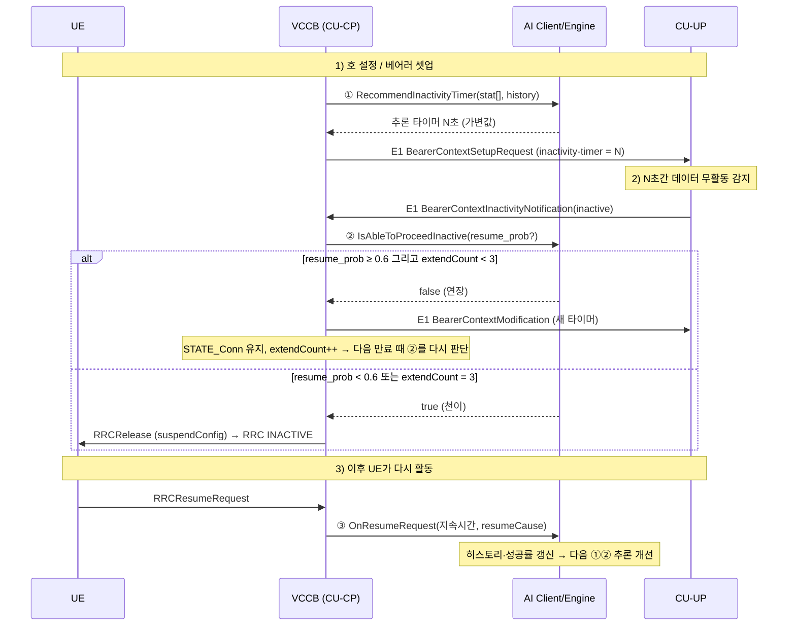

# VCCB AI 연동 상세 설계서

> **목적**: gNB-CU-CP VCCB SW에 GRU 기반 RRC Inactivity Timer 최적화 AI를 연동하기 위한 설계 가이드 (시나리오 B — C++ 직접 포팅 확정)
>
> **대상 독자**: Cursor IDE + Claude LLM 환경에서 코드 작성을 수행하는 개발자
>
> **코드베이스**: 삼성 5G gNB-CU-CP VCCB (C++, 사내 MDS/POSIX 기반)
>
> **아키텍처 전제**: AI 추론은 `vccb.xcc` 내부에서 동기로 직접 수행한다(별도 추론 프로세스 없음). SHM은 **추론 경로가 아니라** itscp 거버넌스 통계 노출(§7-3)에만 제한적으로 사용한다.

---

## 목차

0. [동작 흐름 개요 — AI 개입 RRC Inactive 천이](#0-동작-흐름-개요--ai-개입-rrc-inactive-천이)
1. [메시지 처리 영역 — 기존 VCCB 코드 개입](#1-메시지-처리-영역--기존-vccb-코드-개입)
2. [AI 연동 영역 — 신규 개발](#2-ai-연동-영역--신규-개발)
3. [추론 엔진 구현 — 시나리오 B (GRU C++ 직접 포팅)](#3-추론-엔진-구현--시나리오-b-gru-c-직접-포팅)
4. [callInfo_type 연동 영역](#4-callinfo_type-연동-영역)
5. [빌드 및 환경 영역](#5-빌드-및-환경-영역)
6. [단위 테스트 검증 영역](#6-단위-테스트-검증-영역)
7. [AI 거버넌스 및 평가 영역](#7-ai-거버넌스-및-평가-영역)
부록 E. [참고문헌](#부록-e--참고문헌-2026-07-04-사용자-제공-url-10개-원문-대조)

---

## 핵심 소스 파일 맵 (구현 완료)

| 파일 | 역할 |
|---|---|
| `Base/VccbItscpDefine/include/VccbAiTypes.h` | **공유 POD 타입/모델 차원 상수** (VCCB·itscp 공용) |
| `VCCB_MAIN/hdr·src/VccbAiEngine.*` | GRU 순전파 엔진 + `VccbAi_InitContext` |
| `VCCB_MAIN/hdr·src/VccbAiClient.*` | AI Client(개입 포인트 로직) + 정책 상수 + SHM publish |
| `VCCB_MAIN/hdr·src/VccbAiPersistStore.*` | UE-keyed 영속 추론 상태 저장소(§2-7) |
| `Base/VccbItscpDefine/include/VccbStruct.h` | `callInfo_type.aiCtx`, SHM `VccbAiStatShm_type aiStat` |
| `VCCB_MSG/E1AP/src/MsgE1apMake.cpp` | 포인트① 타이머 주입 |
| `VCCB_FEAT/RRC_INACTIVE/src/FeatRrcInactive.cpp` | 포인트②/④ |
| `VCCB_STATE/FEAT_SA/src/StateSaRrcInact.cpp` | 포인트③ Resume 이력 |
| `VCCB_STATE/FEAT_HO/src/StateSaHo.cpp` | 포인트⑤ XnAP 시드 + `handover_count_24h` 갱신(HO_Succ peg) |
| `VCCB_STATE/FEAT_COMM/src/StateCommon.cpp` | 포인트⑤ `handover_count_24h` 갱신 (SA/NG HO finalize) |
| `ITSCP_VCCB/src/getCmd.cpp`·`main.cpp` | `get stat ai` 거버넌스 리포트(§7-3) |

---

## 0. 동작 흐름 개요 — AI 개입 RRC Inactive 천이

> 이 섹션은 AI가 RRC Inactive 천이 흐름의 **어디에, 왜, 어떻게** 끼어드는지를 처음 보는 사람도 이해할 수 있도록 정리한 개요다. 세부 설계는 1장 이후를 참고한다.

### 0-1. 핵심 전제 — inactivity 타이머는 누가 돌리는가?

**inactivity 타이머의 카운트다운은 VCCB(CU-CP)가 아니라 CU-UP(UP 측)에서 수행한다.** VCCB는 그 **타이머 "값"만** E1AP 메시지로 CU-UP에 내려보낸다.

- VCCB → CU-UP: `E1_BearerContextSetupRequest`(또는 `BearerContextModification`)에 inactivity-timer 값(N초)을 실어 전달
- CU-UP: 해당 베어러에서 N초간 데이터 무활동을 감지하면 → `E1_BearerContextInactivityNotification(inactive)` 를 VCCB로 올림
- 즉, VCCB 입장에서 "타이머 만료"는 **CU-UP가 올려주는 이벤트**로 도착한다 (VCCB가 직접 카운트다운하지 않음 = event-driven).

따라서 VCCB가 관리하는 것은 타이머 자체가 아니라 **① 어떤 값을 내려보낼지**, **② 만료 이벤트가 왔을 때 어떻게 반응할지**, **③ 결과를 학습 데이터로 쌓을지** 이다. 이 세 곳이 곧 AI 개입 포인트다.

### 0-2. AI 개입 포인트 3곳 한눈에 보기

| 포인트 | 시점 | AI가 하는 일 | 결과 |
|---|---|---|---|
| **① 타이머 값 추론** | 호 셋업 / E1 베어러 셋업·수정 시 | `stat[]`(5QI·DRB수·AMBR·RSRP·RNA 등) + 히스토리로 inactivity-timer **값(초)** 추론 | E1 메시지에 **고정값 대신 가변 추론값** 주입 |
| **② 천이 vs 연장 결정** | CU-UP가 무활동 통지를 올린 순간 | "이 UE 곧 다시 깨어날까?"(`resume_prob`) 판단 | **즉시 INACTIVE 천이** 또는 **연장(연결 유지)** |
| **③ Resume 학습** | UE가 실제로 RRCResume 할 때 | 실제 INACTIVE 지속 시간·resume 원인을 히스토리에 기록, 성공률 갱신 | 다음 추론(①②)의 입력 `stat[]`·`seq[]` 개선 |

- **포인트 ①** = "타이머를 **몇 초**로?" → `MsgE1apMake.cpp`의 timer fill 함수에서 `FnVCCBAiClient_RecommendInactivityTimer()` 호출
- **포인트 ②** = "지금 **내려보낼까 / 더 기다릴까**?" → `FeatRrcInactive.cpp:FnVCCB_IsAbleToProceedRRCInactive()`에서 `FnVCCBAiClient_IsAbleToProceedInactive()` 호출
- **포인트 ③** = "이번 결과로 **배우기**" → RRCResume 처리에서 `FnVCCBAiClient_OnResumeRequest()` 호출

### 0-3. 포인트 ② 결정 로직 (천이 vs 연장)

CU-UP의 무활동 통지가 올 때마다 AI가 한 번씩 판단한다 (`VCCB_AI_KEEP_THRESHOLD = 0.6`):

- `resume_prob ≥ 0.6` (곧 깨어날 듯) → **연장**: `BearerContextModification`으로 새 타이머(`ceil(resume_time × 1.2)`, 1~3600초)를 CU-UP에 내려보내고 `STATE_Conn` 유지, `extendCount++`, `false` 반환
- `resume_prob < 0.6` (당분간 조용할 듯) → **즉시 INACTIVE 천이**, `true` 반환

연장은 "언제까지"가 정해진 게 아니라 **만료 이벤트마다 다시 판단**하는 루프다. 다음 셋 중 하나가 먼저 일어나면 끝난다:

1. 이후 라운드에서 `resume_prob < 0.6` → 그 시점에 INACTIVE 천이
2. **연장 횟수가 상한 도달** (`VCCB_AI_MAX_EXTEND_COUNT = 3`) → AI 판단과 무관하게 **강제 천이**, `extendCount` 리셋 (무한 연장 방지)
3. UE가 실제로 resume(데이터 발생) → 포인트 ③ 동작, `extendCount` 리셋, 천이하지 않고 연결 유지

### 0-4. 전체 흐름 (시퀀스)



### 0-5. 안전장치 (Fallback)

AI는 기존 동작을 절대 깨지 않도록 설계되어, 아래 경우 **항상 정적 기본값/기존 로직으로 폴백**한다.

- AI 비활성(`FnVCCBAiClient_SetEnabled(false)`), 추론 실패(NaN/Inf), 추론 시간 초과(1ms), 연속 실패 누적으로 Fallback 진입
- `IS_REDCAP_UE` / `IS_NRDC_MN` / `IS_NRDC_SN` UE는 초기 구현에서 AI 미적용
- 포인트 ①은 폴백 시 `defaultTimer`(정적 설정값) 그대로 반환, 포인트 ②는 폴백 시 `true`(즉시 천이) 반환

> **요약**: 타이머 카운트다운은 **CU-UP**가, "값 추론(①)·천이 판단(②)·학습(③)"은 **VCCB 내부 AI**가 담당한다. 연장은 만료 이벤트마다 재판단하는 루프이며 최대 3회까지만 미루고 그 뒤엔 강제로 INACTIVE로 천이한다.

---

## 1. 메시지 처리 영역 — 기존 VCCB 코드 개입

이 영역은 **기존 VCCB 코드를 최소한으로 수정**하여 AI 개입 지점을 삽입하는 작업이다. 기존 동작을 깨지 않는 것이 최우선이다.

---

### 1-1. E1AP InactivityNotification 수신 → INACTIVE 천이 판단 (AI 개입 포인트 ②)

#### 개입 대상 함수

`FeatRrcInactive.cpp` 내의 `FnVCCB_IsAbleToProceedRRCInactive()`

#### 현재 동작

이 함수는 E1AP InactivityNotification 수신 후 호출 체인의 끝에서 최종적으로 RRC INACTIVE 천이 여부를 `bool`로 반환한다. 호출 체인은 다음과 같다.

```
E1AP InactivityNotification 수신
  → RscCall::setDataActivityStatus(ActivityStatus_INACTIVE)
  → FnVCCB_UpdateUserInactStateAndDoActionIfExpiry(DATA_EXPIRY)
  → FnVCCB_DoInactivityActionInIdleState()       [FeatCallProc.cpp]
  → FnVCCB_CheckRRCInactive()                    [FeatRrcInactive.cpp]
  → FnVCCB_IsAbleToProceedRRCInactive()          ← 개입 위치
```

SA basic call(`E_CALLTYPE_SA`) 분기에서 `activityStatus == ActivityStatus_INACTIVE` 조건 충족 시 현재는 무조건 `true`를 반환하여 즉시 INACTIVE 천이를 진행한다.

#### 개입 설계

- `activityStatus == ActivityStatus_INACTIVE` 조건이 만족된 시점에, 무조건 `true`를 반환하는 대신 **AI Client 판단 함수를 호출**하여 그 반환값을 사용한다.
- AI 판단 결과가 **"즉시 천이"** 이면 기존과 동일하게 `true` 반환.
- AI 판단 결과가 **"타이머 연장"** 이면 두 가지 동작을 수행한다.
  - `VEIL_sendE1SetupModRelRequest(ptCi, E1Procedure_BearerContextModification)` 를 호출하여 갱신된 타이머 값을 포함한 BearerContextModificationRequest를 CU-UP에 전송한다 (fire-and-forget).
  - `false`를 반환하여 INACTIVE 천이를 보류한다.
- AI Client가 **Fallback 상태**이거나 **추론 실패** 시에는 반드시 `true`를 반환하여 기존 동작을 보장한다.

#### 주의사항

- `IS_NRDC(ptCi)` 분기 (NRDC MN/SN 케이스) 는 AI 개입 대상이 아니다. SA basic call 분기에만 적용한다.
- `IS_REDCAP_UE(ptCi)` 인 경우, 초기 구현에서는 AI 적용 없이 기존 로직을 유지한다.
- 타이머 연장 선택 시 STATE 전환은 발생하지 않으며 `STATE_Conn` 을 유지한다. BearerContextModify 응답 대기를 위한 별도 STATE 추가는 불필요하다 (fire-and-forget).
- 연속 연장 횟수에 상한을 두어야 한다. `ptCi->aiCtx.extendCount` 가 설정된 임계값(`VCCB_AI_MAX_EXTEND_COUNT`) 이상이면 AI 판단과 무관하게 즉시 천이를 강제하고 카운터를 리셋한다.
- 연장 선택 시 INACTIVE 진입 타임스탬프(`ptCi->aiCtx.inactiveEntryTs`)를 반드시 기록해야 한다. 이 타임스탬프는 추후 포인트③에서 실제 INACTIVE 지속 시간을 계산하는 데 사용된다.

---

### 1-2. E1AP BearerContextSetupRequest / BearerContextModifyRequest 내 inactivityTimer IE 주입 (AI 개입 포인트 ①)

#### 개입 대상 함수

`MsgE1apMake.cpp` 내의 `VEIL_fillE1_Inactivity_Timer(callInfo_type*, callDRBInfo_type*, E1_Inactivity_Timer*)`

이 함수가 DRB 레벨 inactivityTimer를 E1AP IE에 채우는 **최종 함수**이다.

#### 현재 동작

`IS_SUPPORT_RRC_INACTIVE(ptCi)` 분기 내에서 `ptCi->qosFlow[ptDi->drbQosIdxInCall]` 에서 5QI 값을 추출하고, `FnVCCB_GetRRCInactiveTimerValue(call, qos5qi)` 를 호출하여 정적으로 설정된 타이머 값을 반환받아 IE에 설정한다.

#### 5QI 접근 방법 (확인됨)

```
ptDi->drbQosIdxInCall  →  ptCi->qosFlow[] 의 인덱스
ptCi->qosFlow[drbQosIdxInCall].usage == CI_use 인지 확인 후
VLIB_getFiveQi(ptQi, &qos5qi) 로 uint8_t qos5qi 획득
```

#### 개입 설계

- `IS_SUPPORT_RRC_INACTIVE(ptCi)` 분기에서, `FnVCCB_GetRRCInactiveTimerValue()` 호출을 AI 래퍼 호출로 교체한다.
- AI 래퍼는 내부적으로 다음 우선순위로 타이머 값을 결정한다.
  1. AI Client가 Active 상태이고 `ptCi->aiCtx.lastInferTimerSec` 이 유효한 값(0 초과)이면 해당 값 사용.
  2. AI 추론을 새로 수행할 수 있으면 추론 결과 사용.
  3. 위 두 경우 모두 아니면 기존 `FnVCCB_GetRRCInactiveTimerValue()` 반환값 사용 (Fallback).
- 최종 타이머 값은 반드시 3GPP TS 38.413 허용 범위(1초 ~ 3600초) 내로 클램핑해야 한다.
- `IS_REDCAP_UE(ptCi)` 인 경우 초기 구현에서는 AI 적용 없이 기존 로직 유지.

#### 이 함수가 호출되는 맥락

이 함수는 INACTIVE 천이 과정 중 아래 두 시점에 호출된다.

- **BearerContextModification (타이머 포함)**: `VLIB_StartRRCInactive()` → F1 ModQuery 응답 수신 → `VEIL_sendE1SetupModRelRequest(E1Procedure_BearerContextModification)` 내부.
- **BearerContextSetup (초기 타이머)**: 일부 절차에서 Bearer를 새로 설정할 때.

#### UE-level 타이머도 AI 적용 (DRB-level과 별개 경로)

`ActivityNotificationLevel`이 `ue` 인 경우, 타이머는 위 DRB-level 함수가 아니라 **UE-level 필드(`ueInactivityTimer`)** 로 전달된다. 이 경로는 별도라서 `MsgE1apMake.cpp`의 아래 4개 지점에 동일하게 `FnVCCBAiClient_RecommendInactivityTimer()` 를 적용했다.

| 메시지 | 경로 | 정적 기본값(AI default 인자) |
|---|---|---|
| `BearerContextSetupRequest` | RRC-inactive UE-level | `RrcInactiveInfo.rrcInactiveTimer` (REDCAP은 `redCapRrcInactiveTimer`) |
| `BearerContextSetupRequest` | legacy UserInactivity | `FnVCCB_FillUeInactivityTimerValue()` 결과 |
| `BearerContextModification` | RRC-inactive UE-level | `FnVCCB_GetRRCInactiveTimerValue(call, MAX_5QI_VALUE)` |
| `BearerContextModification` | legacy UserInactivity | `FnVCCB_FillUeInactivityTimerValue()` 결과 |

- AI Client는 Fallback / REDCAP / NRDC 상황에서 전달받은 정적 기본값을 그대로 반환하므로, 위 4곳 모두 **"정적값을 default 인자로 넘기고 AI가 가능할 때만 추론값으로 대체"** 하는 동일 패턴이다.
- 결과적으로 **UE-level·DRB-level 양쪽 모두** AI 추론값이 E1 메시지에 실린다 (로그 검증은 §6-7 참조).

---

### 1-3. RRCResumeRequest1 수신 핸들러 — AI 이력 기록 (AI 개입 포인트 ③)

#### 개입 대상 함수

`StateSaRrcInact.cpp` 내의 `FnVCCB_Inact_ProcRRCResumeRequest1()`

#### 현재 동작

이 함수는 `FnVCCB_Inact_Suspend_CallResumeInd()` 또는 `FnVCCB_Inact_ResumeReq_CallResumeInd()` 에서 호출된다. 내부에서 다음 순서로 동작한다.

1. F1 메시지 unpack 및 store.
2. `RscCall::getDataActivityStatus(*ptCi)` 로 현재 data activity 상태 확인.
3. `FnVCCB_SetRRCInactiveAction_after_RRCResumeRequest(ptCi, dataActivityStatus)` 로 다음 상태 결정 (`stateCmd` 변경: RRCResume_cmd / RRCSuspend_cmd / RRCIdle_cmd).
4. stateCmd에 따라 각 절차 진행.

#### 개입 설계

- `FnVCCB_SetRRCInactiveAction_after_RRCResumeRequest()` **호출 직전**에 AI 이력 갱신 처리를 삽입한다.
- 이 시점에 INACTIVE 지속 시간을 계산한다. 계산 방법: 현재 시각 - `ptCi->aiCtx.inactiveEntryTs` (포인트②에서 기록한 타임스탬프). 단, `inactiveEntryTs` 가 기록되지 않은 경우(포인트②를 거치지 않은 RNA Update 등)는 이력 갱신을 skip한다.
- `ptCi->ueInfo.RrcInactiveInfo.resumeCause` 에서 Resume 원인값을 읽어 이력에 함께 기록한다.
- 이 삽입 코드는 `ptCi->stateCmd == RRCIdle_cmd` 분기(E1/NG reset 케이스) 에서는 실행하지 않는다.

#### Resume Cause 매핑

`ptCi->ueInfo.RrcInactiveInfo.resumeCause` 의 타입은 NRRRC enum이다. AI 이력 구조체·`seq[][1]` 입력에는 uint8_t로 저장하며, `preprocess.py` / `synth_data_gen.py` 와 동일한 정수 인코딩을 쓴다 (`0~5`).

| 코드 | 의미 | 비고 |
|---|---|---|
| 0 | emergency | `NRRRC_emergency` — 성공률 EMA에서 예측 실패로 처리 |
| 1 | mo_Data | 보고·fig05에서는 **others**로 묶음 |
| 2 | mo_Signalling | |
| 3 | mt_Access | `NRRRC_mt_Access` |
| 4 | rna_Update | `NRRRC_rna_Update` |
| 5 | others | 헤드라인 4종 외 cause (`CAUSE_OTHERS`) |

> `resumeCause` 는 **입력 feature(`seq[][1]`)로만** 쓰이고 학습 타깃(prob/time)은 지속시간 기반이다. 데이터셋 전역 분포는 `GLOBAL_CAUSE_MIX`(§D-1)로 리밸런싱한다.

---

### 1-4. RNA Update 수신 시 AI 처리 (AI 개입 포인트 ④)

#### 개입 대상 함수

`FeatRrcInactive.cpp` 내의 `FnVCCB_SetRRCInactiveAction_after_RRCResumeRequest()`

#### 현재 동작

`resumeCause == NRRRC_rna_Update` 이고 `dlDataFlag == VCCB_FLAG_OFF` 인 경우, 다음 stateCmd를 `RRCSuspend_cmd`로 설정하여 RRC INACTIVE 상태를 유지한다.

#### 개입 설계

- 해당 분기에서 `SET_STATE_CMD(RRCSuspend_cmd)` 이전에 AI RNA 크기 권고값을 조회하고 로그로 기록한다.
- 현 시점에서는 RNA 크기를 직접 변경하는 메커니즘이 VCCB 코드에 없으므로, AI 권고값은 **로그 기록에만 사용**한다.
- 향후 RNA 크기 파라미터 조정 메커니즘이 확인되면 실제 적용 로직을 추가한다.

---

### 1-5. XnAP HandoverRequest 수신 시 AI Context 초기화 (AI 개입 포인트 ⑤)

#### 개입 대상 함수

XnAP HandoverRequest 처리 핸들러. `StateHandleSa.cpp` 또는 관련 파일에서 Cursor에서 직접 검색한다.

```
Codebase Search: "XN_HandoverRequest" 또는 "RetrieveUEContextRequest"
```

#### 개입 설계

- 신규 UE Context가 초기화된 직후(`VLIB_InitCallInfo()` 호출 이후), XnAP 메시지에서 UE History 정보(소스 셀 체류 시간 등)를 읽어 AI Context의 이력 버퍼에 seed 데이터로 기록한다.
- XnAP UE History에서 획득 가능한 `Time UE Stayed in Cell` 값을 활용한다. 이 필드의 실제 접근 방법은 Cursor에서 코드베이스를 검색하여 확인해야 한다.

#### 개입 설계 — 핸드오버 카운트 (`handover_count_24h`, stat[4]) (구현 완료)

이동성 feature(stat[4])를 위해, UE의 **성공한 SA 핸드오버**를 24h 슬라이딩 윈도우로 집계한다. `resume_count_24h`(stat[10])와 완전히 동일한 링 방식이다.

- **API**: `FnVCCBAiClient_OnHandover(callInfo_type *ptCi)` — `aiCtx.handoverTs[]` 링에 timestamp를 push하고 `handoverCount24h`를 재계산한 뒤 `FnVCCBAiPersist_Save()`로 영속화한다. master-enable 플래그와 무관한 **관측 전용**이다.
- **훅 위치 (기존 `HO_Succ` 통계 peg과 co-locate)**: 코드베이스에서 `VHCM_SA_HO_STAT(ptCi, HO_Succ)`를 pegging하는 지점은 정확히 2곳이며, 각각이 서로 다른 역할(소스/타깃)이라 gNB당 HO당 정확히 1회만 집계된다 — 기존 HO 성공 통계와 동일한 semantics.
  - `StateSaHo.cpp :: VCCM_INTER_Compl_S_XN_UEContextRelease()` — Inter-gNB Xn HO 소스측 완료.
  - `StateCommon.cpp :: VHCM_FinalizeHandover_SaHandoverStat()` — SA/NG HO finalize (IntraCellHO·NSA·SN 제외).
- **영속**: `handoverTs[]`/`handoverTsWriteIdx`/`handoverCount24h`를 §2-7 저장소에 추가하여 UE(5G-S-TMSI) 단위로 호 경계를 넘어 이동성 이력을 유지한다.
- 이 카운트는 stat[4] **입력 feature로만** 쓰이며, 학습 타깃(prob/time)에 대한 영향은 §D 라벨 규칙(mobility factor)으로 부여한다.

---

## 2. AI 연동 영역 — 신규 개발

이 영역은 `vccb.xcc` 내부에 포함될 신규 AI Client 코드를 작성하는 작업이다. **추론 자체**는 Call Task 내에서 **동기 방식으로 직접 호출**되며 별도 프로세스나 SHM을 쓰지 않는다. 단, **운영 거버넌스 지표를 별개 프로세스인 `itscp_vccb`로 노출**하기 위해서는 SHM 스냅샷이 불가피하다(§7-3) — 추론 경로가 아닌 통계 조회 경로에 한정된다.

---

### 2-1. 신규 파일 구성

| 파일 | 역할 | 포함 대상 |
|---|---|---|
| `Base/VccbItscpDefine/include/VccbAiTypes.h` | **공유 POD 타입/상수** | `VccbAiInput/Output`, `VccbAiHistory_type`, `VccbAiCallContext_type`, 모델 차원 상수(`VCCB_AI_HISTORY_LEN` 등) |
| `VccbAiClient.h` | AI Client 함수 선언 + 정책 상수 | VCCB 코드에서 호출할 모든 AI 인터페이스, `VCCB_AI_KEEP_THRESHOLD` 등 |
| `VccbAiClient.cpp` | AI Client 공통 구현 | 초기화, Feature 벡터 구성, 이력 관리, Fallback, SHM publish |
| `VccbAiEngine.h` / `.cpp` | 추론 엔진 구현 | GRU 순전파(§3) + `VccbAi_InitContext()` |
| `VccbAiPersistStore.h` / `.cpp` | **UE-keyed 영속 추론 상태 저장소** (§2-7) | 호 간 이력 유지(5G-S-TMSI 키), 샤딩 맵 + LRU/TTL |

> **거버넌스 노출(§7-3)로 함께 변경되는 기존 공유/타 모듈 파일**(신규 아님):
> `Base/VccbItscpDefine/include/VccbStruct.h` (SHM에 `VccbAiStatShm_type aiStat` append), `VCCB_MAIN/src/MainInit.cpp` (`FnVCCBAiClient_BindStatShm` 바인딩), `ITSCP_VCCB/src/getCmd.cpp`·`hdr/getCmd.h` (`GetStatAiReport`), `ITSCP_VCCB/src/main.cpp` (`get stat ai` 등록). → VCCB/itscp_vccb/UT 동시 재빌드 필요.

#### 2-1-1. 헤더 아키텍처 — `VccbAiTypes.h` 공유 경계 (중요)

`callInfo_type`(`VccbStruct.h`)에 `aiCtx`(`VccbAiCallContext_type`) 필드가 들어가므로, **`VccbStruct.h`는 그 타입 정의를 볼 수 있어야 한다**. 그런데 `VccbStruct.h`는 VCCB뿐 아니라 **별개 프로세스인 `itscp_vccb`와 `Base` 모듈도 포함**한다. 만약 `VccbStruct.h`가 `VCCB_MAIN/hdr/VccbAiEngine.h`를 직접 include하면, itscp/Base 빌드가 `-I.../VCCB_MAIN/hdr` 없이는 깨진다(`VccbAiEngine.h: No such file`).

이를 막기 위해 **AI 타입 중 POD 부분만** `Base/VccbItscpDefine/include/VccbAiTypes.h`로 분리하여 공유 경계에 둔다.

```
VccbAiTypes.h  (Base/VccbItscpDefine/include — 공유, POD/상수만)
   ▲ include                       ▲ include
VccbStruct.h (callInfo.aiCtx)   VccbAiEngine.h (엔진 API)
   ▲                                ▲
itscp_vccb / Base / VCCB 전역    VCCB 추론 코드(VccbAiClient.cpp 등)
```

- `VccbStruct.h` → `#include "VccbAiTypes.h"` (엔진 헤더 미참조)
- `VccbAiEngine.h` → `#include "VccbAiTypes.h"` + 엔진 함수 선언만
- 규칙: **POD 타입/모델 차원 상수는 `VccbAiTypes.h`, 엔진 API는 `VccbAiEngine.h`, 정책 상수·클라이언트 API는 `VccbAiClient.h`.** itscp/Base는 `VccbAiEngine.h`/`VccbAiClient.h`를 절대 include하지 않는다.
- 엔진/클라이언트 함수를 호출하는 VCCB `.cpp`는 해당 헤더를 직접 include해야 한다(예: `MainInit.cpp`는 `FnVCCBAiEngine_Init()` 호출 → `#include "VccbAiEngine.h"` 필수). → §5-3 빌드 에러 로그 참조.

---

### 2-2. AI Client 초기화

#### 구현 위치

`MainInit.cpp` 의 `FnVCCB_InitBlock()` 내부.

#### 동작 요구사항

- 추론 엔진 초기화를 시도한다 (섹션 3의 시나리오에 따라 내용이 다름).
- 초기화 실패 시 AI Client를 **Fallback 모드**로 설정하고, 에러 로그를 출력한 후 계속 진행한다. VCCB 기동에는 영향을 주지 않는다.
- 초기화 성공 시 AI Client 내부 상태를 **Active 모드**로 설정하고, 연속 실패 카운터, 통계 카운터 등을 초기화한다.
- 모듈 내부에는 싱글턴 방식의 전역 제어 구조체를 하나만 유지한다.

---

### 2-3. 추론 호출 설계

#### 호출 위치

Call Task의 메시지 처리 흐름 내에서, 섹션 1의 각 개입 포인트에서 직접 호출된다.

#### 스레드 안전 요구사항

VCCB의 Call Task는 `MAX_CALL_THREAD_NUM_VCCB` 개의 스레드가 독립적으로 동작한다. 각 스레드는 `ptCi->myThreadId` 로 고유 식별된다.

- **시나리오 B (GRU C++ 직접 포팅)**: `VccbAiWeights.h` 의 가중치 배열은 읽기 전용(`static const`)이므로 스레드 안전하다. 중간 연산 버퍼는 `ptCi->aiCtx` 에 보관되어 스레드별로 독립적이다.

#### 블로킹 금지 원칙

Call Task는 블로킹이 허용되지 않는다. 추론 자체가 1ms 이내에 완료되어야 한다. 추론이 이 시간을 초과할 경우 Fallback 처리로 즉시 전환한다.

#### Fallback 동작

AI Client가 Fallback 상태이거나 추론 실패 시, 기존 `FnVCCB_GetRRCInactiveTimerValue()` 를 직접 호출하여 정적 타이머 값을 반환한다. VCCB 서비스에는 영향이 없다.

---

### 2-4. Feature 벡터 구성

#### 시퀀스 Feature (과거 이력, 10 x 2)

`ptCi->aiCtx.inactivityHistory` 의 순환 버퍼에서 최신 순으로 최대 10개의 이력을 읽는다. 이력이 10개 미만이면 앞 부분은 0으로 패딩한다. 각 타임스텝은 `[durationSec, resumeCause]` 2개 값으로 구성된다.

#### 정적 Feature (14개)

아래 Feature들의 실제 `ptCi` 필드명은 `VccbStruct.h` 를 Cursor에서 직접 열어 확인해야 한다.

> **이력 정정(완료)**: 기존 `stat[12] avg_inactive_duration` 은 `stat[9] avg_inactive_duration_sec` 와 **완전히 동일한 값**(`avgDurationSec`)이라 중복이었다. 이를 **제거**하여 정적 feature가 15→14개로 줄었고, `hour_of_day`/`day_of_week` 인덱스가 13/14 → **12/13** 으로 당겨졌다. 모델 차원·파라미터 수(§3)도 함께 재계산되었으며, **재학습 + `VccbAiWeights.h` 재생성 + VCCB/UT 재빌드**는 2026-06에 완료했다(`train.py` v1.6.0, 파라미터 1,266, UT **26 tests PASS**).

> **Feature 재활용(설계 갱신)**: 상시 0으로 죽어 있던 슬롯 2개를 **의미 있는 signaling-plane feature로 교체**했다. `STATIC_INPUT`은 **14로 불변**(MLP 16×14, 파라미터 1,266, `Parameter_count_is_1266`/`Dimensions_match_design` UT 무변경)이며, 채우는 값만 0→실값으로 바뀐다.
> - `stat[4]`: `cn_expected_idle_period`(항상 0) → **`handover_count_24h`**(이동성 proxy). VCCB(CU-CP)는 실시간 traffic/throughput을 볼 수 없으나 핸드오버는 자신이 처리하는 시그널링이므로 관측 가능하다. `resume_count_24h`(stat[10])와 동일한 24h 링 방식(§2-5).
> - `stat[7]`: `neighbor_cell_count`(C++ 추론은 `numNeighborCell`을 넣었으나 학습 파이프라인은 상수 0 → 모델이 무시하도록 학습된 train/infer skew 상태였음) → **`secondary_5qi`**(혼합 서비스군). skew도 함께 제거된다.
> - `stat[5]`(`cn_stationary`)는 이동성 신호로 예약돼 있으나 이번 범위에서는 미배선(0 유지).
> - `hour_of_day`/`day_of_week`(stat[12]/[13])는 문헌 근거가 약하나, 차원 축소(재학습 파급)를 피하기 위해 **존치**한다(향후 별도 사이클에서 재검토).

| idx | Feature 이름 | 의미 | 접근 방법 힌트 |
|---|---|---|---|
| 0 | `primary_5qi` | 주 DRB의 5QI 값 | `ptCi->drb[]` 순회, `drbQosIdxInCall` → `ptCi->qosFlow[]` → `VLIB_getFiveQi()` |
| 1 | `drb_count` | 활성 DRB 수 | `ptCi->drb[]` 순회, `usage == CI_use` 카운트 |
| 2 | `ue_ambr_dl_mbps` | UE DL AMBR (Mbps) | `VccbStruct.h` 에서 `ambr`, `ueAmbr`, `ambrDl` 검색 |
| 3 | `has_gbr_flow` | GBR Flow 존재 여부 | `ptCi->qosFlow[]` 의 `gbrQosInfo` 또는 유사 필드 |
| 4 | `handover_count_24h` | 24h 슬라이딩 윈도우 내 성공한 SA 핸드오버 수 (이동성 proxy). 근거: US 11,109,442 (AMF/이동성 상태 기반 inactivity timer 조정) | `ptCi->aiCtx.handoverCount24h`. `FnVCCBAiClient_OnHandover()`가 기존 `HO_Succ` peg 지점(§1-5)에서 갱신, persist 저장(§2-7) |
| 5 | `cn_stationary` | (예약, 현재 0.0) UE Stationary 여부 | NGAP CoreNetworkAssistanceInformation "Expected UE Behaviour" (현 시점 미배선) |
| 6 | `last_rsrp` | 최근 RSRP 측정값 | `ptCi->servCellSsbRsrp` (255→0) |
| 7 | `secondary_5qi` | primary_5qi와 다른 첫 active DRB의 Non-Dynamic 5QI (혼합 서비스군 세션, 예: VoNR 5QI=1 + eMBB 데이터 5QI=9 → secondary=9). 0=단일 서비스군. 근거: Nokia 서비스군별 차등 timer | `ptCi->drb[]`→`drbQosIdxInCall`→`ptCi->qosFlow[]` 순회 (buildAiInput, primary_5qi 추출 미러) |
| 8 | `rna_cell_count` | RNA 내 셀 수 | `ptCi->ueInfo.RrcInactiveInfo.numInactTAI` (확인됨) |
| 9 | `avg_inactive_duration_sec` | 평균 INACTIVE 지속 시간 (EMA, `avgDurationSec`) | `ptCi->aiCtx.avgDurationSec` |
| 10 | `resume_count_24h` | 24시간 내 Resume 횟수 | `ptCi->aiCtx.resumeCount24h` |
| 11 | `resume_success_rate` | Resume 성공률 | `ptCi->aiCtx.resumeSuccessRate` |
| 12 | `hour_of_day` | 현재 시각 (0~23) | `time(NULL)` → `localtime()` → `tm_hour` |
| 13 | `day_of_week` | 요일 (0=일, 6=토) | `time(NULL)` → `localtime()` → `tm_wday` |

---

### 2-5. UE Context AI 이력 관리

#### 초기화

`VLIB_InitCallInfo()` 호출 시점에 `ptCi->aiCtx` 전체를 `memset` 으로 초기화하고, `resumeSuccessRate` 만 초기값 1.0f로 설정한다.

#### 이력 갱신 (순환 버퍼)

크기 10의 순환 버퍼에 이력을 추가하며, `writeIdx = (writeIdx + 1) % 10` 으로 갱신한다.

#### 통계 갱신

평균 INACTIVE 지속 시간을 **지수 이동 평균(α = 0.1)** 으로 업데이트한다.

- 첫 번째 기록: 초기값으로 그대로 사용.
- 이후: `avg = 0.9 × avg + 0.1 × newDuration`.

**24h 슬라이딩 윈도우 카운터** — 크기 10의 timestamp 링 2개를 각각 유지한다(공용 헬퍼 `calcCount24hFromTs`).
- `resume_count_24h`(stat[10]): `FnVCCBAiClient_OnResumeRequest()`에서 Resume마다 push.
- `handover_count_24h`(stat[4]): `FnVCCBAiClient_OnHandover()`에서 성공 HO마다 push (§1-5).

> **호 간 영속**: 위 이력/통계는 `callInfo_type` 수명에 묶이지 않고 **§2-7 영속 저장소**를 통해 UE(5G-S-TMSI) 단위로 호 경계를 넘어 유지된다. 따라서 같은 UE의 다음 호는 cold-start가 아니라 누적된 longitudinal 이력에서 추론을 시작한다.

---

### 2-6. 상태 출력 (디버그용)

`itscp_vccb get stat ai` 로 출력하는 항목은 다음과 같다(크로스-프로세스 SHM 스냅샷 경로는 §7-3 참조).

- 현재 AI Client 상태 (Active / Fallback / Disabled)
- 사용 중인 추론 엔진 종류 (GRU C++ 직접 포팅 — 시나리오 B)
- 연속 실패 횟수
- 총 요청 수, 성공·실패·timeout·Fallback 수 및 파생 비율(%)
- 트리거별 요청 수 (포인트①②③④⑤)
- 평균 추론 소요 시간 (us), `extendCapHit` (Point2 MAX_EXTEND 강제 천이)
- 영속 저장소 통계: resident entries / restore hit·miss rate / save / evict / noKey (§2-7)

---

### 2-7. UE-keyed 영속 추론 상태 저장소 (`VccbAiPersistStore`)

#### 배경 — 왜 필요한가

`VccbAiCallContext_type`(`aiCtx`)는 `callInfo_type` 의 멤버라 호가 끝나면 누적된 GRU 입력(`history[]`, `avgDurationSec`, 24h 윈도우, `resumeSuccessRate`)이 함께 사라진다. 짧은 호가 반복되면 모델은 매번 거의 빈 시퀀스(cold-start)만 보게 되어 **UE별 개인화가 불가능**하다. 본 저장소는 `aiCtx` 의 *누적/학습성* 부분만 **안정적 UE 식별자(5G-S-TMSI) 키**로 호 수명 밖에 보관하여, 같은 UE의 다음 호가 자신의 longitudinal 이력에서 추론을 이어가게 한다.

#### 자료구조

| 항목 | 내용 |
|---|---|
| 영속 엔트리 | `VccbAiPersistEntry_type` — `history[]`/`writeIdx`/`count`, `resumeTs[]`/`resumeTsWriteIdx`/`resumeCount24h`, **`handoverTs[]`/`handoverTsWriteIdx`/`handoverCount24h`**, `avgDurationSec`, `resumeSuccessRate`, `h[]`, `lastUpdateTs`. (runtime 전용 필드 `inactiveEntryTs`/`extendCount`/`lastInferTimerSec` 는 **영속하지 않음**) |
| 인덱스 | 64-shard `unordered_map<uint64_t, {entry, lru_it}>` + shard별 `std::mutex` (전역 락 회피) |
| 교체 정책 | shard별 LRU(`std::list`) + 조회 시 TTL(`VCCB_AI_PERSIST_TTL_SEC`, 7일) 만료, 용량 상한(`VCCB_AI_PERSIST_CAPACITY`, 50k) 초과 시 LRU evict |
| 키 도출 | `FnVCCBAiPersist_DeriveKey()` = `fnv1a64(ueInfo.ueId.sTmsi.fiveGTmsi.data, seed=.n)`. `.n == 0xFFFFFFFF`(미할당)이면 **0 반환 → 영속 비활성** |

#### 공개 API (`VccbAiPersistStore.h`)

```c
void     FnVCCBAiPersist_Init(void);                 // 부팅 1회 (idempotent)
bool     FnVCCBAiPersist_Restore(callInfo_type *ptCi); // 엔트리 → aiCtx 복원 (없으면 false)
void     FnVCCBAiPersist_Save(const callInfo_type *ptCi); // aiCtx 누적분 → 엔트리 write-back
void     FnVCCBAiPersist_Reset(void);                // 전체 삭제 (gtest 격리)
uint64_t FnVCCBAiPersist_DeriveKey(const callInfo_type *ptCi);
void     FnVCCBAiPersist_GetStats(VccbAiPersistStats_type *out); // hit/miss/save/evict/noKey
```

#### 훅 위치

| 훅 | 위치 | 동작 |
|---|---|---|
| 초기화 | `MainInit.cpp` `FnVCCB_InitBlock()` (엔진 init 직후) | `FnVCCBAiPersist_Init()` |
| **지연 복원** | `VccbAiClient.cpp` Point ①/②/④ 진입(`shouldSkipAi` 통과 직후) | `maybeRestorePersisted(ptCi)` |
| **저장** | `FnVCCBAiClient_OnResumeRequest()` 말미(통계 갱신 후) | `FnVCCBAiPersist_Save(ptCi)` |
| 격리 | `FnVCCBAiClient_Reset()` | `FnVCCBAiPersist_Reset()` |

> **왜 호 init(`VLIB_InitCallInfo`)이 아니라 지연 복원인가**: 5G-S-TMSI는 NGAP 처리 후에야 `aiCtx` 가 속한 호에 채워지므로, `VLIB_InitCallInfo` 시점엔 키가 없다. 따라서 **첫 AI 추론 시점**에 1회만 복원한다(가드: `aiCtx.persistRestored`). 또한 `count==0`(빈 컨텍스트)일 때만 복원하여 Point⑤ XnAP HO 시드나 호 내 누적 이력을 덮어쓰지 않는다.

#### 안전장치 (회귀 무위험)

- 키 미도출(`DeriveKey==0`)·엔트리 없음·TTL 만료 → **모두 기존 cold-start로 graceful degrade**. 기존 동작과 동일하므로 회귀 위험이 없다.
- `aiCtx` 에 `bool persistRestored` / `uint64_t persistKey` 필드 추가(`VccbAi_InitContext` 의 `memset(0)` 이 자동 초기화).
- 빌드: `Makefile.body` 의 `VCCB_MAIN/src/*.cpp` wildcard로 `VccbAiPersistStore.cpp` 자동 포함(§5-2).

---

## 3. 추론 엔진 구현 — 시나리오 B (GRU C++ 직접 포팅)

AI 추론 엔진은 **외부 라이브러리 없이 C++에서 GRU 순전파를 직접 구현**하는 시나리오 B로 확정한다. `VccbAiEngine.h` / `VccbAiEngine.cpp` 인터페이스로 추상화되어 있어, `VccbAiClient.cpp` 는 엔진 내부 구현과 무관하게 동일한 API로 호출한다.

> **결정 이유**: 크로스 컴파일 환경(ARM xcc)에서 정적 라이브러리 링크 의존성을 제거하고, 임베디드 보드 파일시스템에 별도 모델 파일 배포가 불필요하며, 총 파라미터 수가 1,266개로 충분히 작아 C++ 직접 포팅에 적합하다.

---

### 3-1. 아키텍처 개요

```
Python (PyTorch 학습 — GRU 모델)
  → 학습 완료 후 가중치(weight, bias) 수치 추출
  → export_weights.py 스크립트로 C++ 헤더 파일 자동 생성 (VccbAiWeights.h)
  → C++에서 GRU + MLP 순전파 연산 직접 구현 (VccbAiEngine.cpp)
  → vccb.xcc에 포함 (외부 라이브러리 의존 없음)
```

---

### 3-2. GRU 모델 구조

외부 라이브러리 없이 직접 구현하므로 모델을 최대한 단순하게 유지한다. **학습(`train.py::RrcGruModel`)과 C++ 추론(`VccbAiEngine.cpp`)은 동일한 블록·차원·게이트 순서로 1:1 일치**해야 한다.

| 항목 | 적용값 |
|---|---|
| GRU hidden size | **16** |
| GRU 레이어 수 | 1 |
| 정적 Feature MLP | 1층 (14 → 16, ReLU) |
| Output Head | 2개 (resume_prob / resume_time) |
| 총 파라미터 수 | **1,266개** (정적 feature 15→14로 MLP −16) |
| 추론 소요 시간 목표 | < 0.5ms |

#### 모델 구조 (학습 = C++ 추론 1:1)

`train.py`의 `RrcGruModel` 기준 블록 구성:

| 블록 | 구조 | 출력 차원 |
|---|---|---|
| GRU | `input_size=2`, `hidden_size=16`, `num_layers=1` | 16 |
| MLP | `Linear(14 → 16)` + ReLU | 16 |
| 결합 | `concat(GRU_out, MLP_out)` | 32 |
| Head1 | `Linear(32 → 1)` + Sigmoid | `resume_prob` |
| Head2 | `Linear(32 → 1)` (선형) | `resume_time` |

**공통 상수** (`VccbAiTypes.h` / `train.py` / `VccbAiWeights.h` lockstep):

| 상수 | 값 | 의미 |
|---|---|---|
| `HIDDEN_SIZE` / `VCCB_AI_HIDDEN_SIZE` | 16 | GRU hidden, MLP 출력 |
| `SEQ_INPUT` / `VCCB_AI_SEQ_INPUT` | 2 | 시퀀스 feature `[durationSec, resumeCause]` |
| `STATIC_INPUT` / `VCCB_AI_STATIC_INPUT` | 14 | 정적 feature `stat[14]` |
| `SEQ_LEN` / `VCCB_AI_HISTORY_LEN` | 10 | 과거 resume 이력 타임스텝 수 |

> **파라미터 vs 입력 길이**: `seq[10][2]`는 **같은 GRU 가중치를 10회 반복 적용**하는 것이지, 파라미터가 10배로 늘어나는 것이 아니다. 학습 가능 파라미터는 아래 블록 합(1,266)만 해당한다.

#### 블록별 파라미터 계산 (1,266개 근거)

PyTorch GRU 1층은 게이트 3개(reset / update / new)마다 weight·bias가 있다. `export_weights.py`가 `model.pt`에서 추출해 `VccbAiWeights.h` 배열로 덤프한다.

**1) GRU — 960개** (정적 feature 변경과 무관, 변경 없음)

| 텐서 (PyTorch) | C++ 배열 | 크기 | 개수 |
|---|---|---|---|
| `gru.weight_ih_l0` | `GRU_WEIGHT_IH` | 3×H × input = 3×16×2 | **96** |
| `gru.weight_hh_l0` | `GRU_WEIGHT_HH` | 3×H × H = 3×16×16 | **768** |
| `gru.bias_ih_l0` | `GRU_BIAS_IH` | 3×H = 48 | **48** |
| `gru.bias_hh_l0` | `GRU_BIAS_HH` | 3×H = 48 | **48** |
| | | **소계** | **960** |

**2) MLP (정적 feature) — 240개** (정적 15→14로 **−16**)

| 텐서 (PyTorch) | C++ 배열 | 크기 | 개수 |
|---|---|---|---|
| `mlp.0.weight` | `MLP_WEIGHT` | H × static = 16×**14** | **224** |
| `mlp.0.bias` | `MLP_BIAS` | 16 | **16** |
| | | **소계** | **240** |

> 예전(정적 15개): 16×15 + 16 = **256** → 이번(정적 14개): 16×14 + 16 = **240** (−16). 중복 `stat[12] avg_inactive_duration` 제거가 MLP 입력 차원만 줄인 변경이다.

**3) Output Head 2개 — 66개** (변경 없음)

| 텐서 (PyTorch) | C++ 배열 | 크기 | 개수 |
|---|---|---|---|
| `head_prob.weight` + `head_prob.bias` | `HEAD_PROB_WEIGHT` + `HEAD_PROB_BIAS` | 32 + 1 | **33** |
| `head_time.weight` + `head_time.bias` | `HEAD_TIME_WEIGHT` + `HEAD_TIME_BIAS` | 32 + 1 | **33** |
| | | **소계** | **66** |

**합계**

```
960 (GRU) + 240 (MLP) + 66 (Head) = 1,266
```

한 줄 전개: `96 + 768 + 48 + 48 + 224 + 16 + 32 + 1 + 32 + 1 = 1,266`

gtest `VccbAiWeights.Parameter_count_is_1266` 및 `export_weights.py` 출력(`Total parameters : 1,266`)과 일치해야 한다.

#### 전체 연산 흐름

```
입력:
  seq[10][2]   ← 시퀀스 Feature (10 타임스텝 × [durationSec, resumeCause])
  stat[14]     ← 정적 Feature (14개)

① GRU 순전파 (seq → h[16]):
   for t = 0..9:
     r = sigmoid(W_ir·x + b_ir + W_hr·h + b_hr)        ← reset gate
     z = sigmoid(W_iz·x + b_iz + W_hz·h + b_hz)        ← update gate
     n = tanh   (W_in·x + b_in + r * (W_hn·h + b_hn))  ← new gate
     h = (1-z)*n + z*h                                  ← hidden state 갱신

② MLP 순전파 (stat[14] → mlp_out[16]):
   mlp_out = ReLU(MLP_WEIGHT · stat + MLP_BIAS)

③ 결합:
   combined[32] = concat(h[16], mlp_out[16])

④ Output Head:
   resume_prob = sigmoid(HEAD_PROB_WEIGHT · combined + HEAD_PROB_BIAS)
   resume_time = linear (HEAD_TIME_WEIGHT · combined + HEAD_TIME_BIAS)
```

> **LSTM과의 차이**: GRU는 reset / update / new 3개 게이트를 사용하며 cell state(`c_t`)가 없다. 따라서 `VccbAiCallContext_type` 은 `h[VCCB_AI_HIDDEN_SIZE]`만 보관하며, LSTM의 `c[]` 배열은 불필요하다.

---

### 3-3. 추론 후 타이머 계산

```
resume_prob >= VCCB_AI_KEEP_THRESHOLD (기본 0.6):
  → recommendedTimer = resume_time × VCCB_AI_MARGIN_FACTOR (기본 1.2), 올림

resume_prob <= VCCB_AI_RELEASE_THRESHOLD (기본 0.3):
  → recommendedTimer = VCCB_AI_TIMER_MIN_SEC (기본 1초)

중간 범위:
  → recommendedTimer = 설정 기반 정적 타이머 (Fallback 값)

공통 후처리:
  → recommendedTimer = clamp(result, VCCB_AI_TIMER_MIN_SEC, VCCB_AI_TIMER_MAX_SEC)
```

---

### 3-4. Python → C++ 가중치 변환 흐름

학습 완료 후 Python에서 아래 가중치들을 NumPy 배열로 추출하고, `export_weights.py` 스크립트로 C++ 헤더 파일(`VccbAiWeights.h`)로 변환한다. **블록별 파라미터 개수·차원 근거는 §3-2 참조.**

```
추출 대상 가중치:
  GRU (3개 게이트: reset, update, new 순):
    weight_ih  [3*H × input_size]    → GRU_WEIGHT_IH[3*16*2  = 96]
    weight_hh  [3*H × hidden_size]   → GRU_WEIGHT_HH[3*16*16 = 768]
    bias_ih    [3*H]                 → GRU_BIAS_IH[48]
    bias_hh    [3*H]                 → GRU_BIAS_HH[48]

  MLP (Static Feature 처리용):
    weight     [H × static_size]     → MLP_WEIGHT[16*14 = 224]
    bias       [H]                   → MLP_BIAS[16]

  Output Head:
    resume_prob용: weight[H*2], bias[1]  → HEAD_PROB_WEIGHT[32], HEAD_PROB_BIAS[1]
    resume_time용: weight[H*2], bias[1]  → HEAD_TIME_WEIGHT[32], HEAD_TIME_BIAS[1]

  총 파라미터: 96+768+48+48 + 224+16 + 32+1+32+1 = 1,266
```

자동 생성된 `VccbAiWeights.h` 의 형태 (직접 수정 금지):

```cpp
// Auto-generated file — modify only with export_weights.py
// Generated: YYYY-MM-DD, Model version: vX.X
namespace VccbAiWeights {
    static const int HIDDEN_SIZE      = 16;
    static const int SEQ_INPUT_SIZE   = 2;
    static const int STATIC_INPUT_SIZE = 14;
    static const int SEQ_LEN          = 10;

    // GRU weights  [gates order: reset | update | new]
    static const float GRU_WEIGHT_IH[96]  = { ... };   // [3*H × input_size]
    static const float GRU_WEIGHT_HH[768] = { ... };   // [3*H × hidden_size]
    static const float GRU_BIAS_IH[48]    = { ... };   // [3*H]
    static const float GRU_BIAS_HH[48]    = { ... };   // [3*H]

    // MLP weights
    static const float MLP_WEIGHT[224] = { ... };      // [H × static_input_size]
    static const float MLP_BIAS[16]    = { ... };      // [H]

    // Output Head weights
    static const float HEAD_PROB_WEIGHT[32] = { ... }; // resume_prob (+ sigmoid)
    static const float HEAD_PROB_BIAS[1]    = { ... };
    static const float HEAD_TIME_WEIGHT[32] = { ... }; // resume_time (linear)
    static const float HEAD_TIME_BIAS[1]    = { ... };
}
```

---

### 3-5. C++ 직접 구현 대상 연산

| 연산 | 구현 방법 |
|---|---|
| 행렬 × 벡터 곱 | 이중 for 루프 (`dot()` 함수) |
| 벡터 덧셈 | 단순 for 루프 |
| sigmoid | `1.0f / (1.0f + expf(-x))` |
| tanh | `tanhf(x)` (C 표준 라이브러리) |
| ReLU | `x > 0.0f ? x : 0.0f` |
| GRU 게이트 연산 | 위 연산의 조합 (`gru_step()` 함수) |

---

### 3-6. 중간 연산 버퍼 관리

GRU 은닉 상태(`h_t`) 는 `ptCi->aiCtx.h[VCCB_AI_HIDDEN_SIZE]` 에 보관한다. LSTM과 달리 cell state가 없으므로 추가 배열이 불필요하다. Call Task별로 독립된 `ptCi` 를 사용하므로 동기화는 불필요하다.

---

### 3-7. 모델 갱신

재학습 후 가중치를 변경하려면 `export_weights.py` 를 재실행하여 `VccbAiWeights.h` 를 새로 생성하고, VCCB를 재빌드 및 재배포해야 한다.

---

### 3-8. 빌드

외부 라이브러리 링크 불필요. 신규 `.cpp`는 `Makefile.body` wildcard로 자동 포함된다(상세 §5).

---

## 4. callInfo_type 연동 영역

이 영역은 기존 VCCB 핵심 구조체에 AI Context 필드를 추가하고, 관련 초기화/해제 코드를 수정하는 작업이다.

---

### 4-1. VccbAiCallContext_type 필드 (구현 완료)

- `VccbStruct.h`의 `callInfo_type` 구조체에 **값 타입(embedded)** 멤버 `VccbAiCallContext_type aiCtx;` 추가.
- 타입 정의는 `VccbAiTypes.h`에 있고, `VccbStruct.h` 상단이 `#include "VccbAiTypes.h"` 한다(§2-1-1).
- 포인터/별도 풀 할당 방식은 채택하지 않음 — `aiCtx`는 `callInfo` 수명에 묶이고, 호 경계를 넘는 누적분만 §2-7 영속 저장소로 따로 유지한다.

---

### 4-2. UE Context 초기화/해제 (구현 완료)

- **초기화**: `FeatCallInfo.cpp`의 `VLIB_InitCallInfo()`에서 0xFF memset 직후 `VccbAi_InitContext(&ptCi->aiCtx)` 호출 → 인덱스/카운터 0, `resumeSuccessRate=1.0f`, `h[]`=0으로 시드(NaN 방지).
- **해제**: `aiCtx`는 값 타입(embedded)이라 `VLIB_FreeCallInfo()`에서 별도 처리 불필요.

---

## 5. 빌드 및 환경 영역

시나리오 B(C++ 직접 포팅)는 외부 라이브러리가 없어 빌드 제약이 없다.

---

### 5-1. 빌드 자동 포함 (Makefile 수정 불필요)

- **소스**: `Makefile.body`의 `OBJECTS_CANDIDATE += ... $(wildcard $(VCCB_MAIN_SRC_DIR)/*.cpp)` 로 `VccbAiEngine.cpp`/`VccbAiClient.cpp`/`VccbAiPersistStore.cpp` 자동 수집.
- **VCCB 헤더 경로**: `BLOCK_IFLAGS += -I$(NR_CP_DIR)/VCCB/VCCB_MAIN/hdr` 이미 등록 → `VccbAiEngine.h`/`VccbAiClient.h`/`VccbAiWeights.h` 자동 해석.
- **공유 헤더 경로**: `VccbAiTypes.h`는 `Base/VccbItscpDefine/include`에 있고 이 경로는 VCCB·itscp·UT 모두 이미 `-I`에 포함 → 추가 등록 불필요.
- **C++ 표준**: `BLOCK_CXXFLAGS += -std=c++11` 확인됨 → `VccbAiClient.cpp`의 `<atomic>`(`std::atomic<int32_t/bool>`) 사용 가능. (특정 아키텍처 문제 시 GCC 빌트인 `__atomic_*`로 대체 후 `#ifdef` 분기)
- ⚠️ VCCB 빌드는 `-Werror` + 엄격 경고(`-Wconversion/-Wsign-conversion/-Wfloat-conversion/-Wshadow/-Wshorten-64-to-32` 등) → 신규 `.cpp`는 경고-clean이어야 한다.

---

### 5-2. SHM 레이아웃 동시 재빌드 (필수)

`VccbStruct.h`에 `aiStat`(§7-3)가 append되어 `VccbStatInfo_type` 크기가 커졌다. **VCCB · itscp_vccb · UT를 동일 `VccbStruct.h`로 동시 재빌드**해야 SHM 레이아웃이 일치한다(부분 빌드 시 매핑 불일치 crash). UT는 VCCB 산출물 `vccbx.a`/`itscp_vccbx.a`를 링크하므로 **VCCB·itscp 먼저 빌드 후 UT** 순서.

```bash
# 다른 PC: p4 sync 후 (신규 VccbAiTypes.h/PersistStore 등 포함)
cd Application/NR_CALL_APP/VCCB      && make INPUT_ARCH=xcc -sj7   # vccbx.a (AI .cpp 자동 포함)
cd ../ITSCP_VCCB                     && make INPUT_ARCH=xcc -sj7   # itscp_vccbx.a
cd ../VCCB/Test/ut                   && make ...                  # UT (.a 링크)
```

---

### 5-3. 빌드 에러 로그 (실빌드 시 수정 이력)

| 증상 | 원인 | 조치 |
|---|---|---|
| `VccbStruct.h:17: VccbAiEngine.h: No such file` (itscp/Base) | 공유 헤더가 엔진 헤더를 직접 include | `VccbAiTypes.h` 분리(§2-1-1) — `VccbStruct.h`는 `VccbAiTypes.h`만 include |
| `MainInit.cpp: 'FnVCCBAiEngine_Init' was not declared` | `MainInit.cpp`가 엔진 헤더 미include (Client/Persist만) | `MainInit.cpp`에 `#include "VccbAiEngine.h"` 추가. 엔진 함수 호출 `.cpp`는 엔진 헤더 직접 include 규칙(§2-1-1) |
| 신규 파일이 빌드 PC에 없음 | p4 미제출 | 신규(`VccbAiTypes.h`/`VccbAiPersistStore.*` 등) `p4 add`+submit 후 sync |

---

### 5-4. 추론 시간 측정 방법

AI 추론이 Call Task 내에서 직접 수행되므로, 추론 소요 시간이 길면 해당 Call 스레드 전체가 지연된다. 반드시 추론 시간을 측정하고 목표(1ms 이내)를 충족하는지 검증해야 한다.

```
측정 방법 (시나리오 B — C++ GRU 직접 포팅):

clock_gettime(CLOCK_MONOTONIC, &t_start);

// ① GRU 순전파 (시퀀스 10 타임스텝 처리)
for (int t = 0; t < SEQ_LEN; t++)
{
    gru_step(input.seq[t], h, SEQ_INPUT_SIZE, HIDDEN_SIZE);
    // reset gate, update gate, new gate 계산
    // h_t 갱신 (cell state 없음)
}

// ② Static Feature MLP 순전파
//    mlp_out = ReLU(MLP_WEIGHT · stat + MLP_BIAS)

// ③ combined = concat(h, mlp_out)

// ④ Output Head
//    resume_prob = sigmoid(HEAD_PROB_WEIGHT · combined + HEAD_PROB_BIAS)
//    resume_time = linear (HEAD_TIME_WEIGHT · combined + HEAD_TIME_BIAS)

clock_gettime(CLOCK_MONOTONIC, &t_end);
latency_us = (t_end.tv_sec  - t_start.tv_sec)  * 1000000LL
           + (t_end.tv_nsec - t_start.tv_nsec) / 1000LL;

==> 측정 결과를 AI Client 통계 구조체(g_totalInferUs)에 누적하고
    2-6의 상태 출력 함수(FnVCCBAiClient_PrintStats)에서 평균값으로 확인
```

---

## 부록 B — Fallback 정책 요약

| 조건 | Fallback 동작 |
|---|---|
| AI Client Fallback 모드 | 기존 정적 타이머 값 그대로 사용 |
| 추론 엔진 초기화 실패 | AI Client Fallback 모드 설정, VCCB 기동 계속 |
| 추론 소요 시간 > 1ms | Fallback 응답 생성, 실패 카운터 증가 |
| 연속 10회 추론 실패 | AI Client Fallback 모드 전환 |
| 최대 연장 횟수 초과 | 즉시 INACTIVE 천이 강제, 카운터 리셋 |
| IS_REDCAP_UE 인 경우 | 초기 구현에서 AI 미적용, 기존 로직 유지 |
| IS_NRDC 케이스 | AI 미적용, 기존 로직 유지 |

---

## 부록 C — 주요 상수 정의 위치 (실제 헤더 기준)

**정책/런타임 상수 — `VccbAiClient.h`**

| 상수 이름 | 의미 | 기본값 |
|---|---|---|
| `VCCB_AI_INFER_TIMEOUT_US` | 추론 타임아웃 (us) | 1000 |
| `VCCB_AI_FALLBACK_COUNT` | Fallback 전환 연속 실패 횟수 | 10 |
| `VCCB_AI_MAX_EXTEND_COUNT` | 최대 타이머 연장 횟수 | 3 |
| `VCCB_AI_KEEP_THRESHOLD` | INACTIVE 유지(연장) 판단 확률 임계값 | 0.6f |
| `VCCB_AI_RELEASE_THRESHOLD` | 조기 해제 판단 확률 임계값 | 0.3f |
| `VCCB_AI_MARGIN_FACTOR` | 타이머 여유 배율 | 1.2f |
| `VCCB_AI_TIMER_MIN_SEC` | 최소 타이머 값 (초) | 1 |
| `VCCB_AI_TIMER_MAX_SEC` | 최대 타이머 값 (초) | 3600 |
| `VCCB_AI_24H_WINDOW_SEC` | 24h resume 집계 윈도우 (초) | 86400 |

**모델 차원 상수 — `VccbAiTypes.h`** (공유)

| 상수 이름 | 의미 | 값 |
|---|---|---|
| `VCCB_AI_HISTORY_LEN` | UE별 이력 버퍼 크기(시퀀스 길이) | 10 |
| `VCCB_AI_HIDDEN_SIZE` | GRU hidden size | 16 |
| `VCCB_AI_STATIC_INPUT` | 정적 Feature 수 | 14 |
| `VCCB_AI_SEQ_INPUT` | 시퀀스 타임스텝당 Feature 수 | 2 |

**영속 저장소 상수 — `VccbAiPersistStore.h`**: `VCCB_AI_PERSIST_TTL_SEC`(7일), `VCCB_AI_PERSIST_CAPACITY`(50000).

---

## 부록 D — Python 학습 및 배포 작업 요약 (시나리오 B — GRU)

### D-0. 2단계 파이프라인 · 데이터 출처 · 수치 안정화

**운영 흐름은 2단계**로 나뉜다 (한 번에 “합성+실측→학습”이 아니라, 사전학습 후 실측 반영 시 fine-tune).

| 단계 | 명령 흐름 | 산출물 |
|---|---|---|
| **① Phase-1 사전학습** | `preprocess.py` → `train.py`(scratch, 50 epoch) → `export_weights.py` → VCCB 재빌드 | `dataset.npz`, `model.pt`, `VccbAiWeights.h` |
| **② Phase-2/3 실측 반영** | 실측/sweep CSV 누적 → `preprocess.py` 재병합 → `VCCB_AI_FINETUNE=1 train.py` → `export_weights.py` → 재빌드 | 갱신된 `model.pt` / `VccbAiWeights.h` |

일괄 실행: host venv에서 `ML/run_all.sh` (= ①만). fine-tune은 §7-4·§7-5-4. 실측 전 검증: `gen_realish_csv.py` dry-run.

**데이터 3갈래** (역할이 다름 — 혼동 주의):

| 출처 | 스크립트/경로 | 역할 |
|---|---|---|
| **Method A** | `preprocess.py` 내장 (`VCCB_AI_SYNTH_N`, 기본 2만) | 학습용 `dataset.npz`의 합성 bulk — **매 preprocess마다 추가** |
| **Method B** | `VCCB_AI_DATA_FILE` + `VCCB_AI_DATA_DIR`(`ML/real/*.csv`) | 실측·sweep·dry-run CSV 병합 |
| **보고용 CSV** | `synth_data_gen.py` → `vccb_ai_dataset.csv` | fig05·부록 분포 (Method B 입력으로도 사용 가능) |

**수치 안정화** (학습·배포 일관성):

| 기법 | 위치 | 역할 |
|---|---|---|
| **정규화 fold** | `export_weights.py` | 학습 시 mean/std를 GRU_ih·MLP·head_time 가중치에 흡수 → C++ `buildAiInput()`은 **raw 값** 그대로 추론 |
| **타겟 클립** | `train.py` `REG_CLIP_SEC=600` | 회귀 라벨 `Y_time`을 600초 상한으로 잘라 heavy-tail 이상치가 손실을 지배하지 않게 함 (`resume_prob` 60s 임계는 별도) |
| **SmoothL1 회귀** | `train.py` | `resume_time`에 robust 회귀 손실(Huber형) — 큰 오차는 선형 기여로 time MSE 스파이크 방지; 분류는 BCE |

| 단계 | 내용 |
|---|---|
| **데이터 생성** | `ML/synth_data_gen.py` 로 페르소나 기반 합성 CSV(보고·Method B) + `preprocess.py` Method A(2만) |
| 학습 | PyTorch GRU 학습 (hidden size=16, 1층, 총 파라미터 1,266개) |
| 가중치 추출 | `model.state_dict()` 로 가중치 NumPy 배열 추출 |
| 변환 | `export_weights.py` 실행 → `VccbAiWeights.h` 자동 생성 |
| **품질 평가** | `train.py`가 학습 종료 시 Phase-1 지표 자동 출력 + `evaluate.py`(리포트/PNG) · `analyze_features.py`(feature 신호) — 공용 `metrics.py` 사용(§7-2 층위1) |
| 빌드 | `VccbAiWeights.h` 교체 후 VCCB 재빌드 (Makefile 수정 불필요) |
| 배포 | 재빌드된 `vccb.xcc` 바이너리 배포 (별도 모델 파일 없음) |
| 모델 갱신 | fine-tune 후 `export_weights.py` 재실행 → `VccbAiWeights.h` 재생성 → 재빌드 (gtest §6-9 품질 플로어 통과 확인) |

### D-1. 학습 데이터 — 현실적 합성 생성기 (`ML/synth_data_gen.py`)

실제 운용 로그 확보가 어려우므로, **가상 UE 모집단을 행동 기반으로 시뮬레이션**하여 학습 데이터를 만든다. 단순 cross-product sweep(아래 비교)과 달리 시퀀스·라벨·집계가 인과적으로 일관된다.

| 특성 | 내용 |
|---|---|
| 페르소나 | `iot_sensor` / `bursty_phone` / `fwa_fixed` / `commuter` — 각자 IAT(Weibull) 분포·QoS(5QI/DRB/AMBR/GBR)·RSRP·RNA 특성을 가짐 |
| resumeCause 분포 | 페르소나와 무관하게 **데이터셋 전역 목표 비율**(`GLOBAL_CAUSE_MIX`)에서 이벤트마다 샘플 → emergency 6% / mo_Signalling 32% / mt_Access 29% / rna_Update 19% / others 14%. 인코딩은 `preprocess.py` 와 동일(0=emergency, 2=mo_Signalling, 3=mt_Access, 4=rna_Update, 5=others; 그 외는 others) |
| 시퀀스 생성 | UE별 연속 세션을 renewal process로 시뮬레이션 → `label_durationSec` = 다음 INACTIVE 지속시간, `seq[]` = 직전 이력(oldest-first, zero-pad) |
| 집계 일치 | `avgDurationSec`/`resumeSuccessRate` EMA(α=0.1), 24h resume count를 **`VccbAiClient.cpp` 와 동일한 점화식**으로 산출 |
| 출력 스키마 | `aiDataCollectEmit`(§D-2)와 **완전히 동일한 CSV 헤더** → 기존 학습 파이프라인 그대로 사용 |
| 의존성 | Python 3 표준 라이브러리만 (numpy 불필요), `--seed` 로 결정론적 재현 |

```bash
python3 ML/synth_data_gen.py --out ML/vccb_ai_dataset.csv --ues 5000 --seed 0
# 수집된 실제/온디바이스 행에 합성 행을 덧붙이기:
python3 ML/synth_data_gen.py --out ML/vccb_ai_dataset.csv --ues 2000 --append
```

### D-2. 온디바이스 수집(`-DVCCB_AI_DATA_COLLECT`) 및 sweep — 보조 수단

`aiDataCollectEmit`(`VccbAiClient.cpp`)는 실제 Resume 이벤트마다 1행을 같은 스키마로 남긴다. gtest `AiClient_DataCollect_Sweep` 는 이 경로를 구동해 CSV를 채우지만, **특징을 독립적으로 cross-product 하고 라벨을 휴리스틱 공식으로 부여**하므로 시퀀스 동역학·특징 상관이 비현실적이다.

> **혼합 서비스군 sweep (3a, 구현 완료)**: sweep은 DRB0에 swept primary 5QI, 추가 DRB에 **다른 5QI**(데이터 8/9 → 음성 1, 그 외 → 데이터 9)를 넣어 `secondary_5qi`(stat[7])≠0 인 혼합 세션을 수집한다. `handover_count_24h`(stat[4])는 `ptCi->aiCtx.handoverCount24h`를 직접 sweep한다. 따라서 sweep은 **온디바이스 수집 경로의 smoke 및 소량 보강용**으로만 사용하고, 본격 학습 데이터는 §D-1 의 `synth_data_gen.py` 를 1차 소스로 쓴다. (장기적으로 §D-1 합성 + 실제 운용 로그 파인튜닝의 하이브리드를 권장)

### D-3. 학습 파이프라인 실행 결과 해석 (정상 기준)

`python3 preprocess.py && python3 train.py && python3 export_weights.py` 의 출력 각 수치가 무엇을 의미하고 무엇이 "정상"인지 정리한다. (아래는 `synth_data_gen.py --ues 5000` 으로 생성한 CSV로 실행한 실측 예)

#### ① `preprocess.py` — 데이터 병합

| 출력 | 의미 | 정상 기준 |
|---|---|---|
| `[Method B] real CSV : N unique samples from K file(s)` | 실측/`synth_data_gen.py` CSV 행 수. `VCCB_AI_DATA_FILE`(단일) + `VCCB_AI_DATA_DIR`(기본 `ML/real/`의 모든 `*.csv`)를 **병합·중복제거** | 수집량에 비례 |
| `Total : ... (real R% / synthetic ...)` | **real vs synthetic 비율** — Phase 2 진척(실측↑) 가시화 | 초기엔 real 0% |
| `[Method A] synthetic : 20,000` | `preprocess.py` 내장 3GPP 5QI 규칙 합성 (`VCCB_AI_SYNTH_N`, 기본 20k) | `=0` 으로 끄면 §D-1 데이터만 사용 |
| `resume_prob=1 (resume < 60s): P%` | `PROB_HORIZON_SEC`(기본 60s) 기준 양성 라벨 비율 | **40~60% 균형** (한쪽 쏠림이면 포화/편향 → `VCCB_AI_PROB_HORIZON` 조정) |
| `resume_time : mean/std` | 라벨 지속시간 분포 (학습 시 `REG_CLIP_SEC=600`으로 클립) | 페르소나 혼합에 따라 넓게 분포 |

#### ② `train.py` — GRU 학습 (50 epoch)

| 열 | 의미 |
|---|---|
| `Train` / `Val` | 종합 손실 = `BCE(prob) + 0.5×SmoothL1(time)`. Val이 best 저장 기준 |
| `P_loss` | resume_prob 분류 손실(BCELoss) — 보통 종합 손실의 대부분 |
| `T_loss` | resume_time 회귀 손실(SmoothL1, **양성 샘플만** 마스킹·정규화) |
| `*` | 그 epoch에서 Val 갱신(best 모델 저장) |

- **정상**: 손실이 매끄럽게 단조 감소하고 **Train↔Val 격차가 작다**(과적합 없음). 일부 epoch에 `*` 없음은 일시적 정체로 정상.
- **이상**: Val이 발산/진동하거나 Train≪Val(과적합) → 데이터 균형(①)·`PROB_HORIZON`·learning rate 점검.
- **v1.4.0~**: 학습 종료 시 **Phase-1 품질 블록**(AUROC/PR-AUC/ECE/F1 + 회귀 MAE 4베이스라인 + oracle 근접도 + 판정)을 자동 출력 → loss뿐 아니라 **품질**을 매 실행 확인(§7-2 층위1).

#### ③ `export_weights.py` — C++ 헤더 생성

| 출력 | 의미 | 정상 기준 |
|---|---|---|
| `Normalization folded into ...` | 학습 시 입력 정규화를 가중치에 흡수 → **C++ `buildAiInput()`은 raw 값 그대로** 사용 | 항상 출력되어야 함 |
| `Total parameters : 1,266` | 모델 파라미터 수 | §6-2 `Parameter_count_is_1266` 단위테스트와 **정확히 일치** |
| `Inference @feature-mean : resume_prob=X resume_time_raw≈Ys` | 평균 입력에 대한 자가점검 추론 | **`resume_prob ≠ 1.000`**(상수 붕괴/포화 아님), `resume_time` 수십 초의 현실적 값 |
| `FutureWarning: torch.load weights_only` | PyTorch 2.x 경고 | 동작 무해 — 무시 가능 |

> **핵심 합격 신호 3가지**: (i) ① 라벨 비율 40~60% 균형, (ii) ② Train/Val 매끄러운 수렴, (iii) ③ 자가점검 `resume_prob`이 1.000이 아님. 셋 다 만족하면 §D 가중치를 §5(재빌드)로 반영한다.

> **resumeCause 인코딩 통일(완료)**: 과거 `synth_data_gen.py` 의 `resumeCause` 정수 인코딩(`MO_DATA=4`, `RNA_UPDATE=5` 등)이 `preprocess.py` 인코딩(`MO_DATA=1`, `RNA_UPDATE=4` 등)과 어긋나 두 데이터 소스 간 cause 의미가 불일치했다. 이제 `synth_data_gen.py` 를 `preprocess.py` **표준 인코딩으로 통일**했다: `0=emergency, 1=mo_Data, 2=mo_Signalling, 3=mt_Access, 4=rna_Update, 5=others`(헤드라인 4종 외 cause는 `CAUSE_OTHERS=5`). 또한 cause는 페르소나가 아닌 **데이터셋 전역 목표 비율**(`GLOBAL_CAUSE_MIX`: emergency 6% / mo_Signalling 32% / mt_Access 29% / rna_Update 19% / others 14%)에서 샘플하여 분포가 보고 기준과 일치한다. `resumeCause` 는 `seq[][1]` **입력 feature로만** 쓰이고 학습 타깃(prob/time)은 지속시간 기반이므로, 이 리밸런싱은 모델 품질 지표를 거의 바꾸지 않고 데이터 구성/그림(fig05)에 반영된다.

---

### D-4. 라벨 규칙 — 서비스군 차등 + 이동성 결합 (3b, 구현 완료)

`secondary_5qi`(stat[7])와 `handover_count_24h`(stat[4])가 **입력 feature로 존재만 하면 모델이 저가중치(WEAK)로 무시**하므로, 학습 라벨(`next_dur` = 다음 INACTIVE 지속시간)에 두 신호를 결합해 예측력을 부여한다. 기존 `rsrp_factor`/`hist_factor`와 동일한 곱셈 방식이다.

| 계수 | 정의 | 근거 |
|---|---|---|
| `svc_factor` | `secondary_5qi ∈ {1,2}`(VoNR/영상 GBR 동반) → **×0.7**, 아니면 ×1.0 | Nokia "서비스군별 차등 timer" — latency-critical 동반 서비스가 있으면 세션을 더 warm하게 유지(짧은 dwell) |
| `mob_factor` | `1 − 0.05 × min(handover_count_24h, 6)` (최대 −30%) | US 11,109,442 — 고이동성 UE는 재연결 가능성↑ → 짧은 dwell |

`next_dur = clip(base × rsrp_factor × hist_factor × svc_factor × mob_factor, 1, MAX)` 이고 `Y_prob = (next_dur < PROB_HORIZON_SEC)`.

> **★ Lockstep (반드시 동시 수정)**: 이 라벨식은 **3곳**에 동일하게 존재한다 — `ML/preprocess.py`(Method A 본체), `ML/synth_data_gen.py`(페르소나 CSV; 실현 dwell 자체를 단축), `test_SaRrcInactiveAI.cpp::genEvalSet`(Phase-1 품질 테스트, §6-9). 한 곳만 바꾸면 학습/평가 분포가 어긋난다.

> **검증 시 주의**: 라벨이 짧아져 `Y_prob=1`(resume<60s) 비율이 오를 수 있다. `preprocess.py` 로그의 `resume_prob=1 (...)%`가 40–60% 범위를 벗어나면 `VCCB_AI_PROB_HORIZON`을 먼저 조정하고, 그래도 Phase-1 floor(§6-9) 미달이면 계수(0.7 / 0.05)를 3곳 동시에 낮춘다. 계수는 현재 floor 여유(AUROC 0.948)를 고려한 보수값이다.

### D-4-보충. 라벨 계수 문헌적 근거 (2026-07-04 1차 조사 + 2026-07-04 원문 대조로 갱신)

`label_dwell = base(primary_5qi) × rsrp_factor × hist_factor × svc_factor × mob_factor` 4개 계수의 개념·범위·계수값을 3GPP 표준 및 업계 문헌 대비 검증했다. **1차는 agent 기반 문헌 조사(원문 링크 없음)였고, 이후 사용자가 제공한 10개 실제 URL을 직접 fetch해 원문 대조를 진행**했다 — 그 결과 `svc_factor`는 근거가 강화됐지만, **`mob_factor`는 인용했던 특허의 실제 로직이 반대 방향임을 발견**해 신뢰도를 하향 조정했다. 상세 원문 대조 기록은 §부록 E(참고문헌) 참조.

| Factor | 공식 | 범위 | 핵심 근거 | 신뢰도 |
|---|---|---|---|---|
| `rsrp_factor` | `1 + (75 − rsrp) / 150` | 0.65 ~ 1.5 | 3GPP TS 38.331/38.304 (RSRP 측정·보고), path-loss → resume 성공률 관계. 중간값 −75 dBm = "우수 신호" 경계(CEPT/POYNTING 안테나 문헌); 96 dB 전체 RSRP 범위 중 실사용 구간(약 45 dB)에 대한 완만한 정규화가 1/150 | 70% — 개념·중간값 확인, 계수는 실측 calibration. 원문 대조 대상 아니었음 |
| `hist_factor` | `1 − 0.3 × (succ − 0.5)` | 0.85 ~ 1.15 | 3GPP TS 38.133, succ=0.5를 중립점으로 하는 이진분류 표준 결정 경계. 활동성 높음(succ↑)→짧은 timer(빠른 탈출), 낮음→긴 timer | 70% — ML 검증, 계수는 역공학적 추론. 원문 대조 대상 아니었음 |
| `svc_factor` | `0.7 (secondary_5qi∈{1,2})` else `1.0` | {0.7, 1.0} | 3GPP TS 23.501 5QI 정의 + **Rohde & Schwarz VoNR 백서 원문 확인**(5QI1=Conversational Voice, GBR, priority 20, **PDB 100ms**, PER 10⁻²) — VoNR이 실제로 이 프로파일 위에서 동작함을 재확인. "Nokia whitepaper" 인용 자체는 이번 10개 URL에 포함되지 않아 **원문 미확보 상태로 유지** | 85%→**88%** — 5QI 특성치는 원문 재확인, Nokia 문헌만 미확보 |
| `mob_factor` | `1 − 0.05 × min(ho_count_24h, 6)` | 0.70 ~ 1.0 | **US 11,109,442 원문 확인 결과 방향 불일치 발견**(아래 경고 참조). 개념(이동성이 timer 조정 요인)만 유효, 계수 부호/크기의 직접 근거로는 부적절 | 80%→**55%** — 실측 calibration(Phase-1 floor)에 더 의존 |

> **⚠️ mob_factor 특허 근거 방향 불일치**: US 11,109,442(AT&T, "Dynamically adjusting a network inactivity timer during user endpoint mobility states")를 실제로 읽어보면, 이 특허는 **"고속 이동 + 실시간 앱(예: connected car) → timer를 늘려서 불필요한 bearer 해제 방지"**, **"저속/정지 + latency 비민감 앱 → timer 감소"** 로직이다 — 즉 이동 중에는 오히려 timer를 **늘리는** 방향. 반면 우리 `mob_factor`는 `ho_count_24h`가 높을수록(고이동성) timer를 **줄인다**("HO가 잦으면 셀 간 컨텍스트 손실로 resume 성공률이 떨어지므로 일찍 놓아준다"는 별개 메커니즘). 두 메커니즘은 양립 가능하지만 동일하지 않으므로, 이 특허를 계수 방향의 직접 근거로 인용하는 것은 부정확했다. **개념적 근거(이동성 상태가 inactivity timer 조정 요인이 되어야 한다)로만 유효**하며, 정확한 부호/크기는 Phase-1 floor 실측 검증(§6-9)에 맡긴다.

**종합 효과**: 최소 timer = base × 0.27 (−73%), 최대 timer = base × 1.73 (+73%) — 4개 계수가 모두 극단으로 작용할 때.

> **가장 중요한 신규 근거**: 계수 하나하나보다, **ScienceDirect 2025 논문**(*Predictive modeling of RRC inactive transitions and latency impacts for energy optimization in live NR SA networks*)이 "실제 상용 NR SA 데이터로 RRC Inactive→Resume/Fallback을 ML로 예측해 gNB가 UE context를 선제 관리한다"는, 본 프로젝트와 **문제 설정이 거의 동일한 2025년 선행연구**라는 점이 가장 강력한 근거다. 상세는 §부록 E 참조.

---

## 6. 단위 테스트 검증 영역

이 영역은 AI 연동 코드의 정확성을 단위 테스트로 검증하는 작업이다. 테스트는 `VCCB/Test/ut/FlowTC/JSON/src/test_SaRrcInactiveAI.cpp` 에 구현되며, gtest 프레임워크로 실행된다.

### 6-0. 검증 설계 원칙

테스트 통과 자체가 "AI가 제대로 추론한다"를 의미하지 않는다. 단순 연동(contract)·Fallback 로직만 검증하는 테스트는 모델이 실제로 동작하는지 증명하지 못한다. 따라서 테스트를 **5개 계층**으로 분리하여, 추론 성공 경로(ACTIVE)·가중치 파이프라인·컨텍스트 초기화·정책 로직·**추론 품질 회귀**를 모두 독립적으로 검증한다.

| 계층 | gtest Suite | 검증 대상 | 픽스처 |
|---|---|---|---|
| Layer 1 | `VccbAiEngine` | GRU 순전파 엔진 (실제 추론) | 없음 (순수 연산) |
| Layer 2 | `VccbAiWeights` | `export_weights.py` 산출물 ↔ 설계 일치 | 없음 (정적 검사) |
| Layer 3 | `VccbAiContext` | `aiCtx` 초기화 (§4-2 회귀) | 없음 |
| Layer 4 | `test_SaRrcInactive_AI` | AI Client 정책 (포인트 ①②③) | `VccbBtCommonTestLegacy` |
| Layer 5 | `VccbAiEngine.Phase1_quality_floors...` | **Phase-1 품질 지표 회귀**(AUROC/F1/MAE) | 없음 (in-distribution 생성) |

**UT 집계** (`RT_OPTION=test_SaRrcInactiveAI`): **6 suite / 26 tests** — `test_SaRrcInactive` 1 · `VccbAiEngine` 7 · `VccbAiWeights` 5 · `VccbAiContext` 1 · `test_SaRrcInactive_AI` 10 · `test_SaRrcInactive_Json` 2.

#### 공용 헬퍼

- `makeValidEngineInput()`: 유한·현실적 값으로 채운 `VccbAiInput` 생성 (엔진 직접 구동용).
- `seedRealisticHistory(ptCi)`: `aiCtx.history[]` 를 유한 이력으로 시드하여 ACTIVE 추론 경로를 end-to-end로 구동.
- `allFinite<N>(arr)`: float 배열 전체의 `isfinite` 검사.
- 픽스처 `SetUp()` 에서 `VLIB_InitCallInfo()` + `FnVCCBAiClient_Reset()` + `SetEnabled(true)` 로 매 테스트 격리 (전역 통계 카운터 0으로 리셋).

---

### 6-1. Layer 1 — GRU 추론 엔진 (`TEST(VccbAiEngine, ...)`)

`FnVCCBAiEngine_Infer()` 를 직접 호출하여 모델이 실제로 유한·유계·입력 의존적 출력을 내는지 검증한다.

| 테스트 | 목적 | 검증 방법 |
|---|---|---|
| `Infer_valid_input_returns_bounded_output` | 정상 추론 + 출력 범위 보장 | 유한 입력 → `true`, `resume_prob∈[0,1]`, 두 출력 모두 `isfinite` |
| `Infer_is_deterministic` | 상태 누수 없음(재현성) | 동일 입력 2회 → `FLOAT_EQ` 동일 출력 |
| `Infer_responds_to_input_changes` | 모델 상수 붕괴 아님 | seq를 5 vs 300으로 달리 → 출력 상이 |
| `Infer_rejects_nan_in_sequence` | NaN 입력 가드 | `seq[3][0]=NAN` → `false` |
| `Infer_rejects_inf_in_static` | Inf 입력 가드 | `stat[5]=INFINITY` → `false` |
| `Infer_latency_under_timeout` | Call Task 1ms 예산 충족 | `clock_gettime` 측정 → `< VCCB_AI_INFER_TIMEOUT_US`(1000us) |

---

### 6-2. Layer 2 — 가중치 / Export 파이프라인 (`TEST(VccbAiWeights, ...)`)

`VccbAiWeights.h`(`export_weights.py` 자동 생성)가 설계서 §3-2 / §3-4 의 모델 아키텍처와 일치하는지 정적 검증한다.

| 테스트 | 목적 | 검증 방법 |
|---|---|---|
| `Dimensions_match_design` | 모델 차원 일치 | hidden=16, seq=2, static=14, len=10 + 엔진 상수(`VCCB_AI_*`)와 상호 일치 |
| `Array_sizes_match_architecture` | 각 가중치 배열 크기 | `sizeof/sizeof(float)` = 96/768/48/48/224/16/32/32/1/1 |
| `Parameter_count_is_1266` | 총 파라미터 수 | 전 배열 합산 ÷ `sizeof(float)` == **1266** (헤더 주석값과 일치) |
| `All_weights_finite` | export 손상 탐지 | 모든 가중치 배열에 NaN/Inf 없음 |
| `Weights_are_not_all_zero` | 실제 학습값 적재 | `GRU_WEIGHT_HH` 절댓값 합 `> 0` |

---

### 6-3. Layer 3 — UE 컨텍스트 초기화 (`TEST(VccbAiContext, ...)`)

§4-2 / §14-1 의 `aiCtx` 초기화 계약을 검증한다.

| 테스트 | 목적 | 검증 방법 |
|---|---|---|
| `InitContext_clears_0xFF_and_seeds_success_rate` | 0xFF memset 직후 초기화 | 0xFF로 채운 뒤 `VccbAi_InitContext()` → 인덱스/카운터=0, `resumeSuccessRate=1.0`, `h[]`=0 |

---

### 6-4. Layer 4 — AI Client 정책 (`TEST_F(test_SaRrcInactive_AI, ...)`)

포인트 ①②③ 의 정책 로직을 검증한다. **이전에 공백이던 ACTIVE 성공 경로**(정상 입력 → 추론 성공 → 유효 타이머)를 포함한다.

| 테스트 | 목적 | 검증 방법 |
|---|---|---|
| `VLIB_InitCallInfo_initializes_aiCtx` | §14-1 회귀 가드 | `VLIB_InitCallInfo()` 후 aiCtx 인덱스=0, `resumeSuccessRate=1.0`, `h[]` 유한 |
| `Point1_active_inference_returns_valid_timer` | **포인트① ACTIVE 성공 경로** | 유효 이력 시드 → 추론 성공(`IsFallbackMode()==false`), 타이머 ∈[1,3600], `successCount>0` & `failureCount==0` |
| `Point1_disabled_returns_default_unchanged` | 마스터 스위치 OFF | `SetEnabled(false)` → 기본값 그대로 반환 |
| `Point1_fallback_after_failures_returns_default` | Fallback 전환 | NaN 이력으로 10회 실패 → Fallback 진입 → 기본값 반환 |
| `Point2_active_decision_is_consistent_and_bounded` | 포인트② 천이 판단 불변식 | 추론 성공 후 — 연기 시 `extendCount==1`+타이머 범위 / 즉시천이 시 `extendCount==0` |
| `Point2_extendCount_cap_forces_inactive` | 포인트② 연장 상한 안전장치 | `extendCount≥MAX` → `true` + 카운터 리셋 (추론 전 결정론) |
| `Point2_extension_loop_then_suspend` | **포인트② 연장 루프 end-to-end** | 강제 연장 훅으로 결정론적 구동 — 연장×`MAX`(extendCount 1→2→3, 각 라운드 BearerContextModification에 실릴 타이머 ∈[1,3600]) → cap 도달 시 강제 천이(`extendCount` 리셋) → Resume(Point③) 사이클 마감. fallback 아님 |
| `Point2_forced_proceed_transitions_immediately` | 포인트② 강제 천이 | 강제 PROCEED 훅 → 연장 없이 즉시 INACTIVE(`extendCount==0`) |
| `Point3_resume_updates_history_and_resets_extend` | 포인트③ 이력 갱신 | non-emergency resume → `count=1`, `writeIdx=1`, `extendCount=0`, 성공률 1.0 유지 |
| `Point3_emergency_resume_lowers_success_rate` | 포인트③ emergency=예측 실패 | `NRRRC_ResumeCause_emergency` → EMA로 `resumeSuccessRate` 1.0→**0.9** |

#### 연장 루프 결정론을 위한 테스트 전용 훅

포인트②의 연장 여부는 본질적으로 확률적(`resume_prob`)이라 단위 테스트에서 "연장"을 강제할 수단이 필요하다. 이를 위해 AI Client에 **production 기본 OFF**인 테스트 전용 훅을 추가했다.

```c
// VccbAiClient.h
void FnVCCBAiClient_TestForceInactiveDecision(int32_t mode);
//   -1 = OFF(모델이 판단, production 기본) | 0 = 강제 EXTEND(연기) | 1 = 강제 PROCEED(천이)
```

- `FnVCCBAiClient_IsAbleToProceedInactive()` 내부에서 **extendCount 상한 체크 직후**에 override를 둔다 → 강제 연장 중에도 cap(`VCCB_AI_MAX_EXTEND_COUNT`)이 그대로 루프를 종료시켜 production과 동일하게 동작한다.
- `FnVCCBAiClient_Reset()` 호출 시 자동으로 `-1`(OFF)로 초기화되어 다른 테스트로 누수되지 않는다.
- production 경로는 기본값 `-1`이라 영향이 없다.

> **참고(범위)**: 실제 E1 송수신(BearerContextModification 온-와이어 전송, Response 수신)을 cpp 단위 테스트로 풀 재현하려면 서빙셀/엔드포인트/suspend 머신까지 무거운 셋업이 필요하다. 따라서 이 테스트는 **AI가 주도하는 결정 루프(연장×N → cap → 천이)와 각 라운드의 AI 타이머 값**을 결정론적으로 검증한다. 실제 메시지에 AI 타이머가 실려 나가는 부분은 §1-2 배선 + §6-7 JSON e2e 로그로 확인한다.

---

### 6-5. 유지된 기존 테스트

AI 검증과 별개로 RRC Inactive 기능 회귀를 보장하기 위해 유지한다.

| 테스트 | 성격 |
|---|---|
| `test_SaRrcInactive.storeCoreNetworkAssistanceInformation...` | NGAP CoreNetworkAssistanceInformation 저장 회귀 |
| `test_SaRrcInactive_Json.All/RRCSuspend_procedure` | RRC Suspend 절차 end-to-end + IE 체크 |
| `test_SaRrcInactive_AI.AiClient_DataCollect_Sweep` | `-DVCCB_AI_DATA_COLLECT` 빌드 시 수집 경로 smoke (보조). 본격 학습 데이터는 `ML/synth_data_gen.py`(부록 D-1)가 1차 소스 |

---

### 6-6. 실행 방법

```bash
# VCCB 본체를 먼저 빌드한 뒤 ut를 빌드해야 한다 (구조체 크기 불일치로 인한 SHM 초기화 crash 방지).
cd /p4_ws/sangku/26b_ai_vzw/Application/NR_CALL_APP/VCCB
make -sj7
cd Test/ut
make -sj7 RT_OPTION=test_SaRrcInactiveAI OUTPUT=jenkins
```

`VccbAiEngine.*`, `VccbAiWeights.*`, `test_SaRrcInactive_AI.Point1_active_inference_returns_valid_timer` 등이 모두 `OK` 면 — 모델이 ACTIVE 모드에서 유효 타이머를 추론하고, 가중치 파이프라인이 설계와 일치함이 증명된다. 운영 중 ACTIVE/Fallback 여부는 `FnVCCBAiClient_PrintStats()`(§2-6) 로 확인한다.

---

### 6-7. 로그로 "AI 추론값 → E1 메시지 전달" 교차검증 (JSON e2e)

JSON 시나리오(`RRCSuspend_procedure_UE_Level` / `_DRB_Level`)를 AI ON 픽스처로 구동하면, **AI 추론 로그**와 **E1 메시지 본문 덤프**를 교차 비교해 추론값이 실제로 메시지에 실리는지 확인할 수 있다.

#### 확인할 로그 두 가지

| 단계 | 로그 토큰 | 출처 | 의미 |
|---|---|---|---|
| (A) AI 추론 | `[AI 1] resume_prob=.. resume_time=..s -> timer=Ns` | `VccbAiClient.cpp` 포인트① | 모델이 추론한 타이머 `N` |
| (B) 메시지 전달 | UE-level: `value Inactivity-Timer : N` / DRB-level: `dRB-Inactivity-Timer N` | E1 TX 메시지 덤프 | 실제로 CU-UP에 내려간 값 |

```bash
grep -n "\[AI 1\]\|\[AI 2\]"          test_SaRrcInactiveAI.log   # 추론값 / 천이·연장 결정
grep -n "value Inactivity-Timer"      test_SaRrcInactiveAI.log   # UE-level 전달값
grep -n "dRB-Inactivity-Timer"        test_SaRrcInactiveAI.log   # DRB-level 전달값
```

#### 검증 결과 (실측)

| 항목 | AI 배선 전(정적) | AI 배선 후(현재) | 판정 |
|---|---|---|---|
| `[AI 1]` 로그 | 없음 | `resume_prob=0.000 ... -> timer=1s` | 추론 실행됨 |
| UE-level `value Inactivity-Timer` | `11` | `1` | (A)=(B) 일치 |
| DRB-level `dRB-Inactivity-Timer` | `11` | `1` | (A)=(B) 일치 |
| `[AI 2]` 결정 | — | `resume_prob=0.000 < 0.6 -> Proceed INACTIVE` | 정책표와 일치 |

- 정적 `11` → AI 추론 `1` 로 바뀐 것이 **타이머가 AI에 의해 결정·전달됨**의 직접 증거다.
- `resume_prob=0.000 ≤ 0.3` → EARLY_RELEASE 분기 → `timer=MIN(1초)`. `resume_prob<0.6` → 포인트② Proceed. 모두 §0-3 / §3-3 정책표와 정확히 일치한다.

#### 주의 — "값이 호마다 가변"을 보려면 입력을 다변화해야 한다

위 시나리오는 **이력 없는 신규 호(cold start)** 라 입력 특징 벡터가 매번 거의 동일 → 결정론적 엔진이 동일 출력(`timer=1s`)을 낸다. 즉 "정적값과 다르다"는 입증되지만, **`stat[]` 조합별로 값이 다양하게 변하는 모습**은 입력이 달라져야 보인다. 입력 민감도는 단위 테스트(`Infer_responds_to_input_changes`, `Point1_active_inference_returns_valid_timer`, `AiClient_DataCollect_Sweep`)가 별도로 검증한다.

> `[AI 1]`/`[AI 2]` 는 `VCCB_PRINT_CALL_INFORMATIVE`(`PL_CMD`, `ComMacro.h`) 레벨이다. UT 로그가 충분히 verbose해 기본 출력되지만, 안 보이면 로그 출력 레벨을 올린다.

---

### 6-8. 입력(이력/QoS)을 바꿔가며 타이머 가변을 관찰하는 e2e 케이스

§6-7의 기본 시나리오는 **이력 없는 신규 호(cold start)** 라 매번 동일 입력 → 동일 출력이다. 입력에 따라 추론이 어떻게 달라지는지 JSON e2e에서 관찰하기 위해, 호의 `aiCtx`(AI 이력·집계 + QoS 특징)를 INACTIVE 천이 직전에 주입하는 테스트 전용 `func_name` 핸들러를 추가했다.

> **참고(영속 저장소와의 관계)**: §2-7 영속 저장소는 *운용 중* 같은 UE의 호가 반복될 때 cold-start를 해소하지만, 본 JSON 테스트는 매 테스트 `FnVCCBAiClient_Reset()`(→ `FnVCCBAiPersist_Reset()`)로 저장소를 비우고 고정 callId/TMSI를 단발 리플레이하므로 여전히 cold-start다. 따라서 `seedAiContext` 시드 주입은 e2e 입력 민감도 관찰에 그대로 유효하다.

#### `seedAiContext` 핸들러 (UT 측, `VccbBtCommonTestJson.cpp`)

```jsonc
{ "func_name": "seedAiContext", "callId": 80,
  "history": [ {"durationSec": 600.0, "resumeCause": 4}, ... ],  // seq[] (resume 이력)
  "avgDurationSec": 630.0, "resumeCount24h": 2, "resumeSuccessRate": 0.99,  // stat[9..11]
  "ueAmbrDlMbps": 100.0, "lastRsrp": 45, "rnaCellCount": 1 }              // stat[2]/[6]/[8]
```

- `VccbBtUtil::getCallByCuCpUeIdForBT(callId)` 로 호를 잡아 `aiCtx.history[]`/`count`/`writeIdx`/집계와 `servCellSsbRsrp`·`numInactTAI`·`ueInfo.ambr.aggrMbrDl` 를 세팅한다. (`setRrcInactiveParameter` 와 동일한 등록 방식 — `REG_FUNC_J`)
- **반드시 호가 `Conn` 도달한 뒤(예: `After_NG_InitialContextSetupRequest_TO_CONN`) ~ `RRCSuspend` 직전**에 호출해야 한다. 그래서 시나리오를 합성형(`Attach_PLMN_1_RRC_Suspend`) 대신 sub-load로 **인라인 전개**한 뒤 그 사이에 끼워 넣는다.
- UT 측 파일만 수정하므로 VCCB 본체 재빌드는 불필요(UT만 빌드).

#### 추가된 케이스 (관찰용, 기본 `skip:1`)

| 케이스 | 시드 프로파일 | 실측 결과(로그) |
|---|---|---|
| `RRCSuspend_AI_seed_idle_long_profile` | 긴 idle 이력(≈600s)·낮은 resume 빈도·낮은 RSRP/AMBR | 저확률 → proceed 경향 |
| `RRCSuspend_AI_seed_short_busy_profile` | 짧은 이력(≈20s)·잦은 resume·높은 RSRP/AMBR | **`resume_prob=0.837` → `timer=33s`(=27.1×1.2) → Point2 연장** |

**실측 비교 (입력 민감도 입증):**

| | cold start(이력 없음) | busy 프로파일(시드) |
|---|---|---|
| `[AI 1] resume_prob` | `0.000` | **`0.837`** |
| `[AI 1] timer` | `1s` (EARLY_RELEASE) | **`33s`** (KEEP, `resume_time×1.2`) |
| `[AI 2]` 결정 | Proceed INACTIVE | **Defer(연장), extendCount=1** |

→ 시드한 이력/QoS에 따라 추론 확률과 타이머가 실제 호 흐름에서 달라짐이 입증된다.

#### 왜 `skip:1` 인가 — rigid replay와 AI 분기의 비양립

이 케이스들은 녹화된 `Scenario_SA_RrcInactive.RRCSuspend`(suspend 완료를 기대하는 고정 메시지 리플레이)를 로드한다. 그런데 시드로 `resume_prob ≥ 0.6`이 되면 Point2가 **연장**을 택해 suspend 대신 `BearerContextModification` 루프로 분기하므로, 리플레이가 기대한 `F1_UE_CONTEXT_MODIFICATION_RESPONSE` 등과 어긋나 `Message Not Found` 로 실패한다(seed 스텝 자체도 리플레이 시퀀스를 한 칸 어긋나게 함). 즉 **"입력을 바꿔 추론을 가변시키는 것"과 "고정 메시지 리플레이"는 본질적으로 양립하지 않는다.**

- 따라서 자동 회귀(CI)에는 부적합 → `input.skip = 1` 로 두고, **수동 실행 시 로그 관찰용**으로만 사용한다. (`skip:0` 으로 바꿔 실행하면 위 `[AI 1]`/`[AI 2]` 가변 로그를 직접 볼 수 있다.)
- 자유 가변 타이머(연장)의 **결정론적·자동통과** 검증은 §6-4 `Point2_extension_loop_then_suspend` (cpp)가 담당한다.

#### 정책상 한계 (반드시 이해할 것)

타이머가 **자유롭게 가변**되는 구간은 `resume_prob ≥ 0.6`(KEEP) 분기뿐인데, 같은 추론에서 `prob ≥ 0.6`이면 포인트②가 **연장**을 택해 정상 suspend 흐름을 벗어난다(연장 루프). 정상 suspend 케이스에서 타이머가 가질 수 있는 값은:

- `prob ≤ 0.3` → **1초**(release) / `0.3 < prob < 0.6` → **정적 default**(예: 11) — 두 값 중 하나.

즉 **"정상 suspend 하면서 타이머만 11→X→Y 로 자유롭게 변하는" 그림은 정책상 성립하지 않는다.** 가변 타이머(`resume_time×1.2`)는 본질적으로 **연장 케이스**이며, 이는 §6-4의 cpp 연장 루프 테스트가 결정론적으로 검증한다. 따라서 위 e2e 케이스는 **"입력이 바뀌면 추론(`resume_prob`/`resume_time`)이 바뀐다"** 를 로그로 보여주는 데 목적이 있고, 최종 클램프된 timer 값 자체의 다양성은 정책 분기에 의해 제한된다.

> 참고: 실측에서 busy 프로파일은 `prob=0.837` 로 연장이 발생했다. 시드가 모델 출력을 `prob ≥ 0.6` 구간으로 밀면 연장이 발생해 녹화된 `RRCSuspend` 리플레이와 어긋나므로, 위 케이스들은 자동통과가 아니라 로그 관찰용(`skip:1`)으로 둔다.

---

### 6-9. Layer 5 — Phase-1 품질 회귀 가드 (`TEST(VccbAiEngine, Phase1_quality_floors_on_eval_set)`)

Layer 1~4가 "엔진이 동작/계약을 지키나"를 본다면, Layer 5는 **"배포되는 모델이 충분히 똑똑한가"** 를 회귀 추적한다. `export_weights.py` 회귀나 가중치 손상으로 **품질만 조용히 나빠지는** 사고를 CI에서 잡는 것이 목적이다(실측 라벨 수집이 어려운 현 단계의 대안).

- **데이터**: `ML/preprocess.py`와 **동일한 도메인 규칙**(5QI 로그정규 프로파일 + RSRP/이력 라벨 변조)으로 in-distribution eval set(4,000개)을 C++에서 결정론적 생성. → 학습 분포와 동일해 모델을 in-distribution으로 채점.
- **경로**: 실제 배포 엔진 `FnVCCBAiEngine_Infer` + 폴딩된 `VccbAiWeights.h` 사용 → Python 모델이 아니라 **C++ 산출물 자체**를 검증.
- **지표(C++ 직접 계산)**: AUROC(rank 기반), F1@0.6, 양성부분집합 MAE + naive/persistence 베이스라인. `RecordProperty`로 gtest XML에 기록(CI 트렌드).
- **플로어 assert**(표본 노이즈로 flaky 안 되게 여유 큰 하한):

| assert | 플로어 | 측정(동일분포) |
|---|---|---|
| AUROC | ≥ 0.85 | 0.948 |
| F1@0.6 | ≥ 0.78 | 0.889 |
| MAE model < naive | — | 8.6 < 12.3 |
| MAE model < persistence | — | 8.6 < 20.4 |
| MAE model | ≤ 15s | 8.6 |

> **lockstep**: `preprocess.py` 라벨 규칙(`FIVEQI_PROFILES`/`next_dur`, 그리고 §D-4의 `svc_factor`(secondary_5qi)/`mob_factor`(handover_count_24h))을 바꾸면 본 테스트의 생성기(`GEN_PROFILES`/라벨식 `svcFactor`/`mobFactor` 및 stat[4]/stat[7] 채움)도 함께 갱신. 가중치 변경 워크플로 = `train.py` → `export_weights.py` → UT 빌드 → 본 플로어 통과 확인.

---

### 6-10. Layer 6 — Feature 민감도 매트릭스 (Acceptance Reference Suite, 2026-07-04 신규)

Layer 1~5가 엔진/파이프라인/정책의 정합성을 본다면, Layer 6은 **"모델 입력을 하나씩 바꾸면 실제로 timer가 의도한 방향으로 움직이는가"** 를 사람이 눈으로 확인할 수 있는 e2e 회귀 스위트다. 재학습 acceptance 흐름 자체를 구동하지는 않으며(§7-4/Runbook Part D-1이 그 역할), **재학습 결과를 검증·시연하는 참조 세트**다.

**산출물**
- JSON: `Test/ut/FlowTC/JSON/Data/TC/test_SaRrcInactiveAI.json`에 기존 4개(profile A/B 등, `skip:0`) + 매트릭스 16개(`skip:1`)로 통합(별도 파일 아님).
- 제너레이터: `Test/ut/tool/gen_ai_matrix_tc.py` — 기존 파일에 멱등 병합(`AI_matrix_*` 이름만 교체, 나머지 보존). 5QI 앵커는 `preprocess.py`의 `FIVEQI_PROFILES` 중앙값을 그대로 사용해 라벨 공식과 항상 동일 기준을 공유한다.
- C++ 체커: `VccbBtCommonTestChecker.cpp`에 `checkUe_Proc_AiInfo`(static inline) 추가 + 디스패처 등록. JSON의 `aiInfo:{lastInferTimerSecMin/Max}`로 `ptCi->aiCtx.lastInferTimerSec` 범위를 assert. `aiCtx`를 읽기만 하므로 SHM 레이아웃 변경 없음 → UT 재컴파일만 필요(§5-2 재빌드 순서 불필요).

**매트릭스 축 (모델 인과 feature 1개씩 격리, 나머지는 baseline 고정)**

| 그룹 | 축 | 내용 |
|---|---|---|
| A | `primary_5qi` | {1,2,5,7,8,9} sweep — 5QI7 부근에서 KEEP↔RELEASE 전환 관찰 |
| B | `secondary_5qi` (`svc_factor`) | base~80s에서 secondary=1/2 추가 시 0.7배 적용 → RELEASE→KEEP flip |
| C | `handover_count_24h` (`mob_factor`) | base~75s에서 HO 0/3/6 증가 시 flip + 단조 감소 |
| D | 행동 이력 대비 (primary=2 고정) | idle-long(장기 정지, dwell~180) vs busy-short(고이동성, dwell~15) |
| E | `last_rsrp` (약축, primary=5) | rsrp 40(약전계) vs 110(강전계) — timer 장단 대비 |

> **ARP는 sweep 대상 아님** — `buildAiInput()`의 stat[]에 ARP가 없어 추론에 무영향(§2-4). realism용으로만 `arp=min(fiveQi,15)` 설정.

**⚠️ 재학습 의존 상태**: 매트릭스 케이스의 `aiInfo` 기대 timer 밴드는 **의도(acceptance) 사양**이며, model.pt가 stat[4]/[7] 신규 매핑(§2-4)으로 재학습되기 전까지는 검증된 실측값이 아니다. 재학습 완료 후 `skip:1→0`으로 전환하고 `resume_prob=1` 비율(40–60%) 검증과 함께 밴드를 tighten한다. 그 전까지는 **참조/시연용으로만** 사용하고 acceptance gate로 취급하지 않는다.

**부수 수정 — seedAiContext 하니스 동기화**: 매트릭스 작성 과정에서 기존 4개 base case의 `seedAiContext` JSON이 `VccbAiCallContext_type` 최신 구조(§4-1)와 어긋난 것을 발견해 함께 정정했다 — 미사용 필드 `rnaCellCount` 제거, 신규 `handoverCount24h` 파라미터 추가(파서 `VccbBtCommonTestJson.cpp`도 동일하게 갱신), DRB-level(`activityNotificationLevel:1`) 프로파일의 QoS flow 5QI(2/3/6 조합)와 seed 값(dwell/AMBR/resumeCause)을 재정합했다. `seedAiContext`가 채울 수 없는 stat(primary/secondary_5qi, has_gbr, drb_count)은 전부 NG InitialContextSetup의 `qosFlowSetupList`에서 온다는 점이 이번에 재확인됨(§2-4).

---

## 7. AI 거버넌스 및 평가 영역

이 영역은 "라이브 RAN에서 RRC 상태 천이를 좌우하는 AI"라는 본 과제의 특수성 때문에, **모델 정확도보다 서비스 안전성·운영 KPI**를 중심으로 통제·측정하는 방법을 정의한다.

### 7-1. 거버넌스 통제 항목

#### (a) 안전성 / Blast radius 통제

AI 오추론이 실호 저하로 직결되므로, 이미 구현된 안전장치를 거버넌스 통제 항목으로 명문화한다.

| 통제 | 구현 | 의미 |
|---|---|---|
| Fallback | 10회 연속 실패 → `g_fallbackMode` 전환, 정적 타이머 복귀 | AI가 죽어도 레거시로 안전 강등 |
| 출력 클램프 | `clampTimer()` [1, 3600s] | 비정상 값에도 물리적 상한 |
| 연장 상한 | `VCCB_AI_MAX_EXTEND_COUNT=3` (`extendCapHit` 카운트) | 무한 연장 차단 |
| 레이턴시 예산 | 1ms 초과 → timeout→fallback | Call Task 블로킹 금지 |
| 적용 범위 제한 | RedCap/NRDC 제외, `FOO.VF_RRCInactiveDay1` | 미검증 UE 타입 미적용 |

#### (b) 추적성 / 재현성 (Provenance)

- **모델-스크립트 버전 박제**: `SCRIPT_VERSION`(train/export) → `VccbAiWeights.h` 헤더 주석. 바이너리의 타이머가 어느 데이터·스크립트로 나왔는지 역추적.
- **train/serve 일관성 계약**: `buildAiInput()`(C++) ↔ `preprocess.py` feature 레이아웃 일치 + export 정규화 fold. 깨지면 가중치 무의미. (`resumeCause` 인코딩은 §D-3 참고 — `synth_data_gen.py`/`preprocess.py` 가 동일 인코딩으로 통일됨)

#### (c) 데이터 거버넌스 / 프라이버시

- **데이터 잔류**: 실측 CSV는 사내에서만 생성·학습, 외부 전송 없음.
- **PII 위험**: 영속 저장소(§2-7)가 5G-S-TMSI를 키로 사용 → 식별자성 데이터. 통제: (i) 솔트 해시 저장(현 FNV는 단순 해시 → 솔트 추가 권장), (ii) TTL(7일) 자동 만료, (iii) 보관 목적·기간 명문화.
- **라벨 오염 방지**: `VCCB_AI_DATA_COLLECT`를 컴파일 옵션으로 두어 운영 바이너리에서 수집 코드 제거 → AI 결정이 다음 학습 라벨을 오염시키는 피드백 루프 차단.

#### (d) 편향 / 공정성

- 학습 데이터가 합성 위주(`synth_data_gen` 페르소나 + Method A) → 페르소나 비율이 실모집단과 다르면 편향. **5QI·persona별 세그먼트 평가** 필수.
- cold-start UE는 동일 출력 → 신규/저빈도 UE에 불리. 영속 저장소(§2-7)가 완화.

#### (e) 변경관리 / 롤아웃 / 롤백

- **점진 적용**: `FOO` 사업자별 on/off → 카나리(특정 셀/사업자)부터.
- **롤백 용이성**: 가중치는 헤더 1개(`VccbAiWeights.h`) → 이전 버전 복원 + 재빌드로 즉시 롤백.
- **승인 게이트**: 가중치 교체 전 §7-2 평가지표 리뷰 필수.

### 7-2. AI 추론 평가 — 3개 층위 분리

핵심: "모델 손실 낮음 = 잘함"이 **이 과제에선 성립하지 않는다**(라벨이 합성이라 모델 정확도는 "합성 규칙을 외웠나"만 측정). 아래 세 층위를 분리해 측정한다.

#### 층위 1 — 모델 품질 (오프라인, held-out) — **구현 완료**

지표 로직은 `ML/metrics.py`(numpy-only 단일 진실 원천)에 모으고, **세 경로가 공유**한다: `train.py`(학습 종료 시 자동 출력) / `evaluate.py`(리포트 + PNG) / gtest Layer 5(§6-9, C++ 엔진 회귀). 동일 seed·val split을 재현하고, baseline/oracle은 train에서 적합 후 **val에서 평가**(누수 차단), 회귀 지표는 양성(<60s) 부분집합(회귀 헤드 학습 범위)에 한정한다.

| 출력 | 지표 |
|---|---|
| 분류 `resume_prob` | AUROC, PR-AUC, **ECE(캘리브레이션)**, 운영 임계 `0.6`에서 P/R/F1 — "0.6"이 실제 60%를 의미해야 연장 게이트가 옳음 |
| 회귀 `resume_time` | 양성 MAE/RMSE, p50/p90 절대오차, bias(체계적 과/과소예측) |
| 베이스라인 | ① naive(전역평균) ② **persistence**(`avg_inactive_duration` 직접) — 모델이 반드시 이겨야 함 ③ oracle(외생 그룹 라벨평균) ④ legacy 정적타이머 |

**⭐ oracle(그룹 조건부 평균) 비교 — 핵심 평가법**: 같은 외생 feature 조합의 실제 `label_durationSec` 평균 `μ_g`(= 이론상 MSE-최적 예측)에 모델이 얼마나 근접하는지 측정한다.
- **그룹 키 = 외생 5개**(5QI·RSRP bin·success bin = core3, +drb·gbr = full5). duration 계열(stat9 `avg_inactive_duration_sec`)은 라벨 근proxy라 **그룹 키에서 제외**(oracle 순환 회피); 대신 persistence **베이스라인**으로만 사용.
- 그룹당 N_min(30) 미만은 제외. 모델 `resume_time`(×1.2·클램프 전) ↔ `μ_g` 비교. timer(=clamp(ceil(×1.2)))의 +20% 여유는 의도된 정책이므로 정확도 지표에 섞지 않는다.

**실측 baseline(합성 20k, val 3,000 / 양성 55.7%)** — 설계 목표(AUROC 0.75) 초과 달성:

| 분류 | 값 | | 회귀 MAE(초, 양성) | 값 | 판정 |
|---|---|---|---|---|---|
| AUROC | **0.949** | | **model** | **8.67** | — |
| PR-AUC | 0.961 | | naive | 12.02 | 모델 승 |
| ECE | 0.012 | | persistence | 21.90 | 모델 승(큰 차) |
| P/R/F1@0.6 | 0.934/0.848/0.889 | | oracle/core3 | 8.75 | **model ≈ oracle** |

→ **model MAE(8.67) ≈ oracle MAE(8.75)** (model-vs-oracle 1.91s): 주어진 feature로 **도달 가능한 최선에 이미 근접** → 용량 확대(§7-5 Phase 4)의 여지가 작다는 직접 증거. full5(9.35) > core3(8.75): drb/gbr를 키에 더해도 신호 안 늘어 **DRB/GBR 무신호를 평가가 직접 입증**.

> **참고(분할 한계)**: 합성 단계라 random split. 실측 누적 시 **시간순 + UE-disjoint split**으로 누수·드리프트를 잡아야 한다.

#### 층위 2 — 정책/의사결정 품질 (진짜 목표)

타이머는 두 비용의 트레이드오프: **너무 짧음**(곧 resume → 상태 churn/시그널링/지연) ↔ **너무 김**(CONNECTED 점유 → 자원·전력 낭비).

| 지표 | 정의 | 방향 |
|---|---|---|
| Premature-release rate | INACTIVE 진입 후 짧은 시간 내 resume 비율 | ↓ |
| Wasted hold time | 길게 줬는데 resume 안 한 시간 | ↓ |
| RRC 시그널링/천이 횟수 | resume·suspend 이벤트 빈도 | ↓ |
| (가능 시) 단말 전력 / CONNECTED dwell | | ↓ |

⚠️ **반사실(counterfactual) 문제**: AI가 타이머를 바꾸면 "정적 정책이었으면"을 직접 못 봄 → **A/B(대조군=레거시, 처리군=AI)** 또는 **shadow mode** 필수.

#### 층위 3 — 운영 헬스 (itscp로 상시 노출, §7-3)

`FnVCCBAiClient_GetStats()` + `FnVCCBAiPersist_GetStats()`: fallback/timeout/실패율, p99 레이턴시, `extendCapHit`, 영속 restoreHit/miss. **"품질"이 아니라 "건강" 지표 — 혼동 금지.**

#### 권장 측정 절차 (안전 순서)

1. **Shadow mode**: AI는 타이머 계산만 하고 적용은 레거시 → 예측 vs 실제 resume 결과를 안전 로깅(`VCCB_AI_DATA_COLLECT`) → 실라벨 확보 + 층위1/2 사전 평가.
2. **카나리 A/B**: `FOO`로 일부 셀만 AI on → 층위2 KPI 통계적 비교.
3. **상시 모니터링**: 층위3 + 입력 분포 드리프트 감시 → 임계 초과 시 재학습(§7-4).

> **현재 한계**: 지금 평가는 층위1을 그것도 합성 라벨로만 수행 → "합성 생성기 규칙을 학습했나"까지만 검증. 진짜 evaluation은 shadow/`VCCB_AI_DATA_COLLECT` 실라벨이 모여야 층위2가 가능 — 가장 큰 다음 과제. 품질 개선 로드맵·실행 현황은 **§7-5**를 참조.

### 7-3. itscp 디버그 커맨드 — 층위3 대시보드 노출

층위3 운영 헬스 지표를 운영자가 즉시 조회할 수 있도록 itscp 커맨드 `itscp_vccb get stat ai`로 노출한다.

#### ⚠️ 핵심 제약: 프로세스 경계

`itscp_vccb`는 **VCCB와 별개의 프로세스**다. AI 통계는 `VccbAiClient.cpp`의 **프로세스-로컬 `std::atomic` 전역**(`g_totalRequests` 등)이라, itscp가 그 함수를 직접 호출해도 **VCCB의 실제 수치가 아니라 itscp 자신의 0 사본**을 읽는다. 기존 `itscp get stat/cfg ...`가 VCCB 런타임 값을 보는 방식은 전부 **공유 메모리(SHM)** 다. 따라서 AI 지표도 SHM을 통해야 itscp로 조회된다.

#### 설계: SHM 스냅샷 미러 (구현 완료)

1. **SHM 슬롯**: `VccbStatInfo_type`(SHM 세그먼트 `VCCB_STAT`) 끝에 POD 스냅샷 `VccbAiStatShm_type aiStat` 추가(`VccbStruct.h`). 기존 필드 오프셋을 보존하기 위해 **구조체 맨 끝에 append**. `std::atomic` 미사용(C/C++ ABI 안전) — writer는 relaxed store, reader는 양성 race 허용(제어가 아닌 대시보드).
2. **바인딩**: `MainInit.cpp`에서 `VCCB_STAT` SHM 할당 직후 `FnVCCBAiClient_BindStatShm(&VCCB_STAT->aiStat)` 1회 호출 → AI 클라이언트가 슬롯 포인터 보관.
3. **퍼블리시**: VCCB가 매 AI 진입점(Point 1/2/3/4)에서 `publishStatsToShm()`로 프로세스-로컬 카운터 + 영속 통계 스냅샷을 SHM에 미러. 바인딩 전(gtest, 부팅 초기 `FnVCCBAiClient_Reset()`)에는 안전한 no-op.
4. **조회**: itscp `GetStatAiReport()`(`ITSCP_VCCB/src/getCmd.cpp`)가 `PSTAT->aiStat`를 읽어 가드레일 비율(success/fail/timeout/fallback) + avg latency + `extendCapHit` + 트리거 카운트 + 영속 저장소(restore hit/miss, saves, evictions, noKey)를 출력. 백분율은 정수 스케일링(×100)으로 계산해 itscp의 float printf 의존을 피한다.

```c
// VccbAiClient.h — 크로스-프로세스 노출 바인딩
void FnVCCBAiClient_BindStatShm(void *statShm);   // = &VCCB_STAT->aiStat

// VccbStruct.h — SHM 스냅샷(요약)
typedef struct VccbAiStatShm_s {
    uint8_t valid, enabled, fallbackMode; int32_t consecutiveFailCount; int64_t lastUpdateTs;
    int64_t totalRequests, successCount, failureCount, timeoutCount, fallbackCount, totalInferUs;
    int64_t extendCapHitCount, triggerPt1Count, /* ...Pt2~5 */ triggerPt5Count;
    uint64_t persistEntries, persistRestoreHit, persistRestoreMiss, persistSaves, persistEvictions, persistNoKey;
    uint64_t distSamples, distFiveQi[10], distRsrp[8], distProb[10];  // 드리프트 히스토그램(§7-6)
} VccbAiStatShm_type;   // VccbStatInfo_type 끝에 append
```

#### itscp 명령 등록 (구현 완료)

itscp 디스패처는 `MmcInfo_type` 분기 테이블이다(`ITSCP_VCCB/src/main.cpp`). `GetStatBranch[]`(= `get stat ...`) terminator 앞에 리프 1개를 추가했다.

```c
// ITSCP_VCCB/src/main.cpp — GetStatBranch[]에 추가
{
    ITSCP_SET_NAME_NAME_LEN("ai"),
    ITSCP_SET_HIDDEN(0),
    ITSCP_SET_HELP("get RRC State Predictor (AI) governance/evaluation report"),
    ITSCP_SET_FUNC(GetStatAiReport),     // ITSCP_VCCB/src/getCmd.cpp, hdr/getCmd.h
    ITSCP_SET_BRANCH(NULL),
},
```

사용: **`itscp_vccb get stat ai`**.

> **신선도**: 퍼블리시는 AI 진입점에서 일어나므로 itscp 스냅샷은 최근 AI 활동 시점 기준이다(대시보드 목적상 허용). `valid==0`이면 "부팅 후 AI 추론 미실행 또는 AI 빌드 비활성"으로 출력.
>
> **VCCB 프로세스 내 동등 출력**: `FnVCCBAiClient_PrintReport()`는 동일 지표를 **VCCB 프로세스 로그**(`VCCB_PRINTF`)로 출력하는 in-process 버전으로, gtest/VCCB 로그 점검용으로 유지한다. 크로스-프로세스 조회는 위 `get stat ai`가 정식 경로다.

#### 빌드 영향 (blast radius)

`VccbStatInfo_type` 크기가 커지므로 **VCCB / itscp_vccb / UT 모두 재빌드**해야 SHM 레이아웃이 일치한다(양쪽 모두 `sizeof(VccbStatInfo_type)`로 매핑). `MainInit.cpp`의 SHM 총량 `STATIC_ASSERT_SMALLER`(<12GB)는 수십 바이트 증가라 영향 없음.

### 7-4. Fine-tuning (점진적 재학습) 설계

#### 왜 fine-tuning인가

현재 파이프라인은 매번 **scratch부터 50 epoch** 학습한다. 운영에서 `VCCB_AI_DATA_COLLECT`/shadow로 **실라벨이 소량씩** 쌓이면, 그때마다 전체 재학습은 (i) 합성으로 학습한 구조를 매번 새로 잡아야 하고, (ii) 소량 실데이터가 대량 합성에 묻힌다. Fine-tuning은 **기존 모델을 초기값(warm start)으로** 두고 낮은 LR·적은 epoch으로 실데이터에 맞춰 **조정**한다(파국적 망각 억제).

#### 구현 (`train.py` v1.3.0, 구현 완료 — 환경변수 opt-in, 기본 OFF)

| 환경변수 | 기본 | 의미 |
|---|---|---|
| `VCCB_AI_FINETUNE` | `0` | `1`이면 `model.pt`에서 warm start (없으면 에러) |
| `VCCB_AI_FINETUNE_LR` | `2e-4` | 점진 갱신용 낮은 LR (full=1e-3) |
| `VCCB_AI_FINETUNE_EPOCHS` | `15` | 적은 epoch (full=50) |
| `VCCB_AI_FREEZE_GRU` | `0` | `1`이면 GRU+MLP 동결, **출력 헤드만** 학습(실데이터 소량일 때 권장) |
| `VCCB_AI_EARLY_STOP_PATIENCE` | fine-tune=`5`, full=`0` | val loss가 `patience` epoch 연속 개선 없으면 조기 종료 (`0`=비활성) |

- 기본 동작(`python3 train.py`)은 **완전히 불변** — full scratch training.
- 동결 시 `gru.*`/`mlp.*` 파라미터의 `requires_grad=False` → optimizer는 학습 가능한 헤드만 갱신.
- 출력(`model.pt` → `export_weights.py` → `VccbAiWeights.h`)·아키텍처·정규화 상수·1266 파라미터 수는 **그대로** → C++/단위테스트 영향 없음.

#### 적용 절차 (실데이터 누적 → 점진 갱신)

```bash
AI=/p4_ws/.../VCCB
cd $AI/ML && source venv/bin/activate
export VCCB_AI_DATA_FILE=$AI/ML/vccb_ai_dataset.csv

# 1) shadow/DATA_COLLECT로 모은 실라벨 CSV를 데이터에 병합
python3 preprocess.py

# 2) 기존 model.pt에서 fine-tune (소량 실데이터면 헤드만 동결 학습)
VCCB_AI_FINETUNE=1 VCCB_AI_FREEZE_GRU=1 python3 train.py

# 3) 가중치 재생성 → §5 재빌드
python3 export_weights.py
```

#### 거버넌스 결합 (필수)

- **승인 게이트**: fine-tune 후에도 §7-2 층위1(held-out)·자가점검(`resume_prob≠1.000`)을 통과해야 배포.
- **데이터 분리**: fine-tune 검증셋은 학습에 쓰지 않은 **최신 실라벨**로 구성(시간순 split)해야 드리프트 적응을 진짜로 측정.
- **롤백**: fine-tune 결과가 나쁘면 이전 `VccbAiWeights.h`로 즉시 롤백(§7-1-e).
- **버전 추적**: `train.py SCRIPT_VERSION`(fine-tune 도입 1.3.0 → 1.5.0 early-stopping → 1.6.0 정적 feature 15→14)이 헤더에 박혀 산출물 식별 가능.

### 7-5. AI 품질 개선 — 진단 · 로드맵 · 실행 현황

> 추론 **품질**을 근거 기반으로 끌어올리기 위한 전략. 핵심 원칙: **측정 → 데이터 → fine-tune → 용량** 순서. "좋아졌는지" 증명할 수단(지표)을 먼저 만든 뒤에만 모델을 손댄다.

#### 7-5-1. 진단 — 왜 이 순서인가

| 사실 | 근거 | 함의 |
|---|---|---|
| 추론 latency ~40µs / 예산 1000µs | `test_SaRrcInactiveAI.log`, `VCCB_AI_INFER_TIMEOUT_US` | **용량은 latency에 제약받지 않음**(여유 ~25배) |
| 연산량 ~9k MAC (hidden=16) | GRU 8.6k + MLP 224 + head 64 | latency 대부분은 고정 오버헤드(호출·isfinite·로깅) |
| 학습 데이터 합성 only | `dataset.npz`, 실측 미수집 | 용량 ↑ = 합성 분포 과적합, 실측 일반화 무관 |
| model MAE ≈ oracle MAE | §7-2 층위1 baseline | 주어진 feature의 **상한에 이미 근접** → 용량 효과 작음 |

> 결론: **모델 용량 부족이 현재 품질의 병목이 아니다.** 측정과 데이터가 먼저다. (GRU→LSTM/Attention도 보류 — 시퀀스 ≤10스텝·2차원으로 짧아 이점 작고 예측 주력은 정적 feature(MLP). 데이터·지표 투자가 ROI 훨씬 큼.)

#### 7-5-2. 로드맵 (5단계)

```
Phase 1 (지표·oracle)  →  Phase 2 (실측 데이터)  →  Phase 3 (fine-tune)
   →  Phase 4 (용량↑, 지표로 검증)  →  Phase 5 (HP 탐색)
```

각 Phase는 앞 Phase의 Exit 기준 충족 후 진행. **모든 모델 변경은 Phase-1 지표 리포트 첨부를 머지 조건으로** 한다.

| Phase | 목표 | 핵심 작업 | Exit 기준 |
|---|---|---|---|
| **1 지표** | "좋아졌다"를 숫자로 증명 | 표준 지표 + oracle/baseline 비교(§7-2 층위1), gtest 회귀(§6-9) | 지표 자동출력 + naive 이김 |
| **2 데이터** | 합성 의존↓·강신호 확보 | 실측 수집·병합, 약신호 분석, 죽은 입력 배선, 라벨 정밀도 | 실측 유의 비율 누적 |
| **3 fine-tune** | 합성 지식 유지 + 실측 미세조정 | §7-4 (`VCCB_AI_FINETUNE`), early-stopping **구현 완료(v1.5.0)** | 실측 fine-tune 후 지표 개선 |
| **4 용량** | latency 여유로 표현력 보강 | `HIDDEN_SIZE` 16→32, MLP 2층 등 + **lockstep**(아래) | 지표 유의 개선 & latency 예산 충족 |
| **5 HP** | 저비용 grid/random search | LR·λ_time·weight_decay·`REG_CLIP_SEC`·`PROB_HORIZON` | val AUROC + oracle MAE 기준 |

> **Phase 4 lockstep**(hidden 변경 시 동시 수정 필수): `VccbAiEngine.cpp`(중간 버퍼 차원) · `VccbAiWeights.h`(export 자동) · `train.py`(`HIDDEN_SIZE`) · `VccbAiTypes.h`/`VccbAiEngine.h`(차원 상수). gtest §6-2 차원 검사가 불일치를 즉시 검출.

#### 7-5-3. 실행 현황 (2026/06/15)

- **Phase 1 — 완료(✅)**: 지표·oracle·baseline 구현 + `train.py` 자동출력 + gtest 회귀 가드. 상세·실측치 §7-2 층위1, §6-9.
- **Phase 2 — 도구·배선 완료(✅) / 실측 수집 대기(⏳)**: 실트래픽 수집은 라이브 VCCB(`-DVCCB_AI_DATA_COLLECT`) 구동 필요(현 개발단계는 RRC INACTIVE 지원 단말 부족). 수집을 받아들이는 쪽을 선제 구현:
  - **2-1 실측 CSV 자동 병합**(`preprocess.py`): 단일 파일(`VCCB_AI_DATA_FILE`) + **디렉터리(`VCCB_AI_DATA_DIR`, 기본 `ML/real/`)의 모든 `*.csv` 병합·중복제거**. 실행 시 **real vs synthetic 비율** 출력.
  - **2-2 약신호 분석 도구**(`ML/analyze_features.py`): feature별 |Spearman ρ|·MI·η² + DEAD 판정 + PNG. 현 합성 결과 — STRONG: 5QI·duration계열·gbr / WEAK: rsrp·success / **DEAD: neighbor_cell(=0)**. drb/gbr의 한계신호는 5QI 교란 때문이며 조건부(oracle core3 vs full5)로는 무신호 → §7-2 결과와 일관. **실측 병합 후 재실행이 2-2 exit gate.**
  - **2-3 죽은 입력 `stat[7]` 배선**: `buildAiInput()`에서 `cslInfo.cslMeasLastInfo.numNeighborCell`로 채움(`receivedFlag` 가드). AMF 무관·즉시 가능. 합성은 0 유지 → 현 모델 영향 없음. (`stat[4][5]`는 AMF 미전달이라 0 유지.)
  - **2-4 라벨 정밀도(권고, 미적용)**: 현 `inactiveEntryTs`는 Point 1/2(추천·판정 시점)에서 찍혀 실제 `SET_RRC_STATE(RRC_INACTIVE)`보다 이르므로 라벨이 **과대**될 수 있음. 스탬프를 실제 천이 시점으로 이전 권고 — 단 라벨 의미·호 상태머신 변경이라 라이브 회귀 검증 가능 시점에 별도 리뷰.
- **Phase 3 — dry-run 검증 완료(✅) / 실측 fine-tune 대기(⏳)**: §7-5-4 `gen_realish_csv.py` shift + fine-tune 파이프라인 동작 증명 완료(2026-06-12, `--dur-scale 1.6`). **실측 CSV 누적 후** §7-4 절차로 본 fine-tune 진행. early-stopping(v1.5.0, `VCCB_AI_EARLY_STOP_PATIENCE`) 구현 완료.
- **Phase 4~5 — 대기**: Phase 2 실측 누적·Phase 3 본 fine-tune 후 진행.

#### 7-5-4. 실측 CSV 취합 한계 & fine-tune dry-run 검증

**실측의 근본 한계(lab)**: 라이브 망이 RRC-INACTIVE 천이를 안 쓰므로 데이터는 lab UE에서만 나온다. 그런데 lab UE가 동일 "호 셋업→INACTIVE" 절차를 반복하면 stat[]·label이 같아 `preprocess.py` 중복제거 후 ~1행으로 붕괴 → 학습 신호 0. 핵심 target인 label(=resume 타이밍)은 실제 사용자/앱 행동이라 lab에서 사람이 정하는 순간 "실측"이 아니다.

**lab에서 실제로 흔들 수 있는 축**(`buildAiInput()` 출처 기준): **5QI/베어러**(stat0,1,3, 앱), **RSRP**(stat6, 감쇠기), **시각**(stat12,13), **idle 시간 변주 → label + history**(seq[], stat9~11). UE 1대라도 INACTIVE↔resume 사이클을 idle 다르게 여러 번 돌리면 history/EMA가 갱신돼 per-UE 시계열 다양성이 생긴다.

> **AMBR(stat2)·RNA(stat8) 주의**: 둘 다 callInfo(`ueInfo.ambr.aggrMbrDl`, `numInactTAI`)에서 실제로 읽혀 CSV에 포함되지만, lab에선 **SIM 가입 프로파일·셀 RNA 설정에 묶인 상수**다. 상수 컬럼은 분산 0 → 학습 신호 없음(§7-2의 drb/gbr 약신호·neighbor DEAD와 동일 맥락)이라 **흔들지 않아도 손해가 없다**. 재provisioning(HSS/UDM·RNA 재설정)은 무겁고 ROI가 작아 lab 범위 밖. stat4/5(CN)·stat7(neighbor, MR 부재 시)은 0 유지. → `gen_realish_csv.py --lab-mode`가 이 제약(AMBR/RNA 고정)을 그대로 반영한다.

단 이는 "통제된 real-path"로 sweep과 라이브의 중간 — 진짜 일반화는 여전히 shadow/라이브가 필요(§7-2 권장 측정 절차).

**Dry-run — fine-tune이 "작동"함을 증명**: 단순 sweep CSV 한 바퀴는 "파이프라인 안 깨짐"만 본다. fine-tune이 모델을 **실제로 움직이는지**는 **의도적 분포 shift**가 필요하다. `ML/gen_realish_csv.py`(실측 CSV 동일 스키마, **실측 UE 데이터 아님**)가 합성 prior와 다른 regime(`--dur-scale`로 INACTIVE 지속시간 체계적 변경 + `--rsrp-bias`로 prior에 없는 RSRP 결합)을 부여한다.

```bash
cd $AI/ML && source venv/bin/activate
python3 preprocess.py && python3 train.py                       # ① 합성 prior, BEFORE Phase-1 기록
python3 gen_realish_csv.py --out real/shift.csv --n 3000 --dur-scale 1.6 --lab-mode
python3 preprocess.py                                          # ② real 병합 (real 비율>0)
VCCB_AI_FINETUNE=1 VCCB_AI_FREEZE_GRU=1 python3 train.py       # ③ AFTER Phase-1
python3 export_weights.py
```

판정: shift셋 held-out에서 **BEFORE MAE 악화 → AFTER MAE 개선**이면 warm-start·freeze·early-stop·export가 올바로 배선됐다는 증명. C++ feature 추출 계약(`buildAiInput()`)은 sweep gtest(`AiClient_DataCollect_Sweep`, `-DVCCB_AI_DATA_COLLECT`)로 가끔 회귀 점검 — 둘은 상호보완.

> **실행 결과(2026-06-12, `--dur-scale 1.6 --lab-mode` + `FREEZE_GRU=1`)**: 병합 데이터 = 합성 20,000 + real-ish shift 3,000 = **23,000행(real 13.0%)**. fine-tune 배선(`[FINETUNE] warm start` 로드, early-stop patience=5, `export_weights.py` 재생성)은 정상 동작했고 산출물은 **파라미터 1,266 / UT 26개(6 suite) PASS**(`Parameter_count_is_1266`·`Dimensions_match_design` static=14 포함). 회귀 지표는 **MAE 8.50 → 8.55(사실상 동일)** 이나 **ECE 0.0298 → 0.0093, bias −0.88 → −0.09**로 calibration이 개선 — 모델이 shift 방향으로 실제 이동했음을 보인다. 다만 완만한 shift(`1.6`) + GRU 동결 조합이라 MAE 개선폭은 작았으며, "BEFORE 악화 → AFTER 개선"을 더 또렷이 재현하려면 `--dur-scale`를 올리고(`≥2.0`) `FREEZE_GRU`를 빼 GRU/MLP까지 적응시키면 된다(prior는 `model.pt.phase1` 백업에서 복원).

### 7-6. 드리프트 감지 (Drift Detection) — 구현

> §7-1-e·§7-2 층위3의 "상시 모니터링 → 임계 초과 시 재학습/롤백"을 **자동화**한 것. "모델이 조용히 늙어가는 것"을 사람이 매번 `get stat ai`를 눈으로 보지 않아도 잡도록 한다.

#### 7-6-1. 두 종류의 드리프트와 감지 신호

| 종류 | 의미 | 감지 신호 | 출처 |
|---|---|---|---|
| **헬스 드리프트** | 입력 이상이 추론 실패로 번짐 (간접·후행) | fallback/fail/timeout율, consecFail, latency | 기존 가드레일 카운터 |
| **입력 드리프트(covariate)** | feature 분포가 학습 때와 달라짐 (추론은 성공) | 5QI·RSRP 히스토그램 **PSI vs 학습 기준선** | **신규 분포 카운터** |
| **출력 드리프트** | `resume_prob` 분포가 한쪽으로 쏠림 | prob 히스토그램 **PSI vs 정상 스냅샷** | **신규 분포 카운터** |

헬스 카운터만으로는 "분포는 변했는데 추론은 멀쩡한" 입력 드리프트를 놓친다 → **입력/출력 분포 히스토그램**을 새로 노출해 PSI로 직접 본다.

#### 7-6-2. 분포 히스토그램 노출 (VCCB → SHM → itscp)

- **누적 위치**: `VccbAiClient.cpp::recordDriftSample()` — 매 **추론 성공** 시 입력 `stat[0]`(5QI)·`stat[6]`(RSRP)·출력 `resume_prob`를 bin에 누적(`std::atomic`). `runInferWithTimeout()` 성공 경로에서 1회 호출, `Reset()`에서 0으로 초기화.
- **bin 정의**(`VccbAiTypes.h`, 4자 공유 — writer·SHM·itscp·ML 동일): 5QI 10bin(=round clamp 0..9), RSRP 8bin(폭16, 0..127), prob 10bin(폭0.1, 0..1).
- **SHM**: `VccbAiStatShm_type` **맨 끝에 append**(`distSamples` + `distFiveQi[10]`/`distRsrp[8]`/`distProb[10]`) → 기존 오프셋 보존. `publishStatsToShm()`가 미러.
- **조회**: `get stat ai` 출력에 `DistSamples` + comma-separated bin 3줄 추가(파싱 친화적). in-process `FnVCCBAiClient_PrintReport()`도 동일 출력.
- **빌드 영향**: `VccbStatInfo_type` 크기 증가 → **VCCB·itscp_vccb·UT 동시 재빌드**(SHM 레이아웃 일치, §7-3과 동일 주의).

#### 7-6-3. 기준선 + 스케줄 모니터

- **학습 기준선**: `ML/export_baseline.py`가 `dataset.npz`에서 **C++와 동일 binning**으로 5QI·RSRP 히스토그램 산출 → `drift_baseline.json`. (prob 출력 기준선은 모델 출력이 필요 → 모니터가 정상일 스냅샷을 `--capture-baseline`으로 1회 박제.)
- **모니터**: `ML/drift_monitor.py`(표준 라이브러리만, VCCB 호스트에서 cron 구동). 매 실행:
  1. `itscp_vccb get stat ai` 실행·파싱,
  2. 누적 카운터의 **윈도 델타**로 헬스율 계산(음수 델타 → reboot 감지, 윈도 표본 적으면 보류),
  3. 5QI·RSRP **PSI vs 학습 기준선**(입력 드리프트), prob **PSI vs 박제 스냅샷**(출력 드리프트),
  4. 임계 초과 시 `WARN`/`ALARM` + **비정상 종료코드**(cron/OAM이 재학습·롤백 트리거),
  5. 스냅샷 history append.
- **PSI 임계**(관례): `<0.10` 안정 / `0.10~0.25` 경고 / `>0.25` 경보.

```bash
# 학습 직후 1회: 기준선 생성
python export_baseline.py                       # dataset.npz -> drift_baseline.json
# 배포 후 정상일 1회: prob 출력 기준선 박제
python3 drift_monitor.py --state /var/log/vccb_ai/drift_state.json --capture-baseline
# 매일 03:00 cron
0 3 * * * /usr/bin/python3 /path/ML/drift_monitor.py \
    --train-baseline /path/ML/drift_baseline.json \
    --state /var/log/vccb_ai/drift_state.json >> /var/log/vccb_ai/drift.log 2>&1
```

#### 7-6-4. 설계 주의 (구현 반영)

- **누적 카운터 델타화**: `get stat ai` 카운터는 부팅 이후 누적 → 윈도값 = 금일−전일. **reboot/Reset이면 음수** → 그 회차 헬스율 경보 보류하고 재기준.
- **boiling-frog 방지**: 입력 PSI는 **전일이 아니라 학습 기준선(고정)** 과 비교 → 느린 누적 드리프트가 인접일 diff에 숨지 않고 PSI에 쌓인다.
- **표본수 가드**: 새벽 저트래픽 표본이 적으면(`--min-window`, `--min-dist-samples`) 오경보 방지로 해당 검사 보류.

---

## 부록 E — 참고문헌 (2026-07-04, 사용자 제공 URL 10개 원문 대조)

§D-4-보충의 라벨 계수 근거를 뒷받침하기 위해 실제로 fetch/검색해 확인한 문헌. **접근 상태를 있는 그대로 기록** — 초록만 확인된 것과 원문을 완전히 확인한 것을 구분한다.

| # | 문헌 | 접근 상태 | 프로젝트 관련성 |
|---|---|---|---|
| 1 | ScienceDirect, *Predictive modeling of RRC inactive transitions and latency impacts for energy optimization in live NR SA networks* (2025), `pii/S1084804525001572` | 초록 확인(본문 paywall) | **★ 가장 강력한 근거.** 실제 상용 NR SA 데이터로 RRC Inactive→Resume/Fallback을 ensemble ML로 예측, gNB가 UE context를 선제 관리 — 본 프로젝트와 문제 설정이 거의 동일한 2025년 선행연구 |
| 2 | IEEE CAMAD 2024, *Jointly Optimizing RRC State Transition and DRX in 5G New Radio* (Damasiotis & Siris), `document/10942993` | 초록 확인 | 트래픽 프로파일별로 RRC inactivity timer를 다르게 설정하는 절차 제안 — svc_factor(서비스군별 차등)의 개념적 지지 |
| 3 | IEEE, *Modeling and Performance Analysis of 5G RRC Protocol with Machine-Type Communications*, `document/9977764` | 초록 확인 | RRC INACTIVE를 discrete-time vacation queue로 모델링 — RRC 자원 이용률이 도착률·서비스율·inactivity timer의 함수임을 정식화 |
| 4 | IEEE Trans. Mobile Computing 2024, *Energy Optimization for Mobile Applications by Exploiting 5G Inactive State* ("5GSaver"), `10.1109/TMC.2024.3377696` | 초록 확인 | 다음 패킷 도착시간 예측 기반 2단계 inactive 판단, SOTA 대비 에너지 −9.5%/지연 −12.4% — resume_time 회귀 헤드와 동일 패러다임 |
| 5 | ResearchGate, Yaro et al., *Radio Resource Control Inactive State in 5G: Survey and Challenges* | **403 차단, 제목만 확인** | 원문 미확보 — 배경 설명용으로만 인용 가능, 수치 근거 사용 금지 |
| 6 | SK 관련 블로그 — 사용자 제공 `sktenterprise.com/bizInsight/blogDetail/dev/2573`는 **404**(현재 접근 불가). 동일 주제로 `devocean.sk.com` (ID 164243) 확인 | 대체 URL로 확인, 원 URL 불일치 기록 | SK텔레콤 Lumos팀의 AI 기반 inactivity timer 적응화 연구(진행 중) — Tx Byte/UL·PUSCH throughput feature로 CNN-LSTM 학습, 실측 기반 산업 사례로서의 참고 가치 |
| 7 | USPTO US 8,611,825 (AT&T / Univ. of Michigan), *Method and apparatus for providing a dynamic inactivity timer* | Google Patents 원문 확인 | 버스트 간 시간을 decision tree ML로 예측해 동적 타이머 결정 — "신호 데이터 기반 per-UE 적응형 timer"의 초기 특허적 선례 |
| 8 | Rohde & Schwarz, *5G Voice over New Radio (VoNR) White Paper* | PDF 바이너리 파싱 실패, 검색 스니펫으로 대체 확인 | 5QI=1(Conversational Voice): GBR, priority 20, **PDB 100ms**, PER 10⁻² 확인 — svc_factor의 5QI 1/2 latency-critical 전제 강화 |
| 9 | USPTO US 11,109,442 (AT&T), *Dynamically adjusting a network inactivity timer during user endpoint mobility states* | Google Patents 원문 확인 | **⚠️ §D-4-보충 참조 — mob_factor 방향 불일치 발견.** 특허는 "고속이동+실시간앱→timer 증가"이나 우리 공식은 "고이동성→timer 감소"로 별개 메커니즘 |

**미확보/미검증 항목**: `svc_factor`의 "Nokia whitepaper" 인용은 1차 agent 조사에서 나온 것으로, 이번 10개 URL에 포함되지 않아 **원문 여전히 미확보**. 향후 실제 Nokia 문헌 링크를 찾으면 재검증 필요.

**교훈**: agent 기반 문헌 조사는 그럴듯한 인용을 만들 수 있지만 원문 대조 없이는 방향성 오류(mob_factor 사례)를 잡지 못한다. 향후 계수 근거를 문서화할 때는 가능한 한 원문 URL을 확보하고, 확인 못 한 근거는 신뢰도를 낮춰 표기한다(§D-4-보충 신뢰도 표).
- **binning lockstep**: `VccbAiTypes.h`(매크로) ↔ `recordDriftSample()` ↔ `export_baseline.py` ↔ `drift_monitor.py`가 동일해야 PSI가 의미를 가짐(불일치 시 가중치 무의미와 같은 약한 고리, §7-1-b).
- **관측 전용**: 분포 카운터·모니터는 **제어 경로가 아님**(대시보드/경보). 실제 조치(재학습 §7-4, 롤백 §7-1-e)는 사람이 승인.
